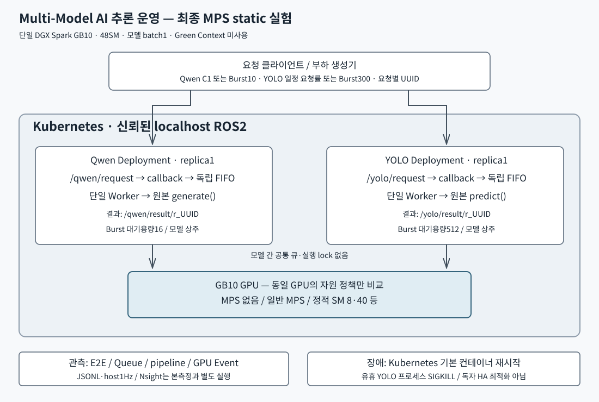

# CJ 4DPLEX Multi-Model Inference Platform

**단일 GPU 환경에서 LLM과 Computer Vision 모델의 동시 추론을 운영하고, 모델별 실행 특성에 기반한 GPU 자원 배분으로 지연시간을 최적화한 프로젝트입니다.**

2026년 하반기 CJ그룹 CJ 4DPLEX **AI Platform 개발 직무 사전과제**로 수행했습니다.

## 1. Project Overview

NVIDIA DGX Spark의 **단일 GB10 GPU(48 SM)**에서 서로 다른 특성을 가진 두 AI 모델을 독립적으로 실행합니다.

| 구분 | 구성 |
|---|---|
| LLM | Qwen3.5-9B · BF16 · 텍스트 생성 |
| Computer Vision | YOLO26l · FP16 · 객체 검출 |
| Hardware | NVIDIA DGX Spark GB10 · 물리 GPU 1개 · 48 SM |
| Runtime | ROS 2 Jazzy · Kubernetes · Docker · CUDA |
| Serving | 모델별 독립 Pod, FIFO Queue, Worker 1개 |
| GPU Optimization | CUDA MPS Static SM Partitioning |

이 프로젝트는 모델 학습이나 정확도 향상보다는 **한정된 GPU에서 여러 AI 서비스를 함께 운영할 때 발생하는 지연과 자원 경합을 분석하고 개선하는 것**에 초점을 맞춥니다. Qwen3.5-9B는 멀티모달 기능이 있는 모델이지만, 이번 실험에서는 **텍스트 입력만 사용**했습니다.

### Key Results

동일한 최신 환경에서 **Qwen 10건 + YOLO 300건**을 공통 시작 장벽에서 발행하는 Burst Workload를 비교했습니다.

| 평가 지표 | MPS 없음 | 일반 MPS | MPS 정적 8/40 SM |
|---|---:|---:|---:|
| 전체 310건 완료시간 | 113.361 s | 112.495 s | **111.887 s** |
| YOLO 300건 완료시간 | 16.322 s | 25.373 s | **11.592 s** |
| YOLO 요청 E2E p95 | 14.963 s | 23.404 s | **10.674 s** |
| Qwen 요청 E2E p95 | 113.299 s | 112.468 s | **111.876 s** |
| Qwen 내부 Generate TTFT p95 | 223.592 ms | 199.489 ms | 498.506 ms |

- **YOLO 300건 완료시간:** MPS 미사용 대비 **28.98% 감소**, 일반 MPS 대비 **54.31% 감소**
- **YOLO E2E p95:** MPS 미사용 대비 **28.66% 감소**
- **전체 310건 완료시간:** MPS 미사용 대비 **1.30% 감소**로 변화는 작음
- **Trade-off:** Qwen의 전체 응답 완료시간은 거의 유지했지만, **내부 TTFT는 증가**

완료시간은 조건당 5회 독립 Burst의 평균입니다. 요청 E2E p95는 조건별 요청을 모은 기술통계이며, Qwen 50건·YOLO 1,500건이 각각 독립 실험 50회·1,500회를 뜻하지는 않습니다.

> **해석 범위:** 위 결과는 고정 입력과 유한 Burst 부하에 대한 측정입니다. 지속적으로 요청이 도착하는 운영 환경의 SLO, 장기 가용성 또는 모든 입력에서의 성능을 입증하지 않습니다.

## 2. System Architecture



ROS 2 기반 요청·응답 경로를 사용하며, 두 모델은 Kubernetes에서 별도 Pod로 실행됩니다.

1. 클라이언트가 모델별 ROS 2 요청 Topic에 요청을 발행합니다.
2. 각 Pod의 Subscriber가 요청을 **독립적인 FIFO Queue**에 저장합니다.
3. 모델별 Worker 1개가 Queue에서 요청을 하나씩 꺼냅니다.
4. 미리 로딩된 Qwen 또는 YOLO가 동일한 물리 GPU에서 추론합니다.
5. 각 Pod가 요청 UUID별 결과 Topic에 응답을 발행하고, 클라이언트가 이를 수신합니다.

| 구성요소 | Qwen | YOLO |
|---|---|---|
| 요청 Topic | `/qwen/request` | `/yolo/request` |
| 결과 Topic | `/qwen/result/{request_id}` | `/yolo/result/{request_id}` |
| Worker | 1개 | 1개 |
| Burst 실험 시 FIFO 용량 | 16 | 512 |
| 정적 MPS 분할 후보 | 8 SM | 40 SM |

Queue 용량 16/512는 최신 Burst 측정 조건입니다. 기존 일반 서빙의 기본 Queue 용량 8과 구분합니다. 두 모델 사이에는 공통 Queue나 전역 실행 순서 조정 로직이 없습니다.

**Kubernetes는 Pod 실행 및 재시작을 관리하며, MPS는 GPU의 SM 자원을 배분합니다.** Kubernetes의 GPU 공유 슬롯 자체가 SM을 고정 예약하는 것은 아닙니다. 정적 분할 역시 GPU 메모리·대역폭·장애를 완전히 격리하지는 않습니다. 그림의 8/40은 성능 비교 후보이며, 실험 뒤 확인한 복원 상태인 일반 MPS+Green 16/32와 구분합니다. [배포 모드 안내](docs/DEPLOYMENT_MODES.ko.md).

## 3. Experiment Workflow

본 과제의 최적화 과정은 다음 순서로 진행했습니다. 실험별 목적·가설·방법·한계·원본 경로는 [실험 인덱스](docs/EXPERIMENT_INDEX.ko.md)에서 이 순서로 따라갈 수 있습니다.

| 단계 | 목적 | 주요 실험·증거 |
|---|---|---|
| 1. Baseline | 모델 단독·상주·동시 활성 시 지연 비교 | [초기 지연 측정](results/latency-baseline/README.ko.md) |
| 2. Bottleneck Analysis | GPU 실행 간섭과 FIFO 대기 분리 | [최신 MPS 비교](results/static-eval/README.ko.md) |
| 3. Model Characterization | Prefill·Decode·YOLO의 SM 민감도 분석 | [SM Sweep](results/sm-sweep/README.ko.md) |
| 4. Hypothesis Validation | 비대칭 SM 분할 가설 검증 | [정적 SM 분할 실험](results/static-eval/README.ko.md) |
| 5. Optimization | 5개 SM 분할 비율 비교 및 8/40 선정 | [실험 결과](results/static-eval/README.ko.md) |
| 6. Trade-off | YOLO 완료시간과 Qwen TTFT의 상충관계 분석 | [Technical Report](docs/TECHNICAL_REPORT.ko.md) |
| 7. Fault Recovery | IPC 장애 및 유휴 프로세스 강제 종료 복구 | [장애 실험](results/fault-idle/README.ko.md) |

### 3.1 Baseline

초기 단독·동시 실행 실험(2026-11-03)에서 두 모델이 동시에 활성화되면 지연이 증가하는 현상을 확인했습니다. 이 단계의 App Queue 대기는 작아, 당시 지연 증가를 FIFO 대기만으로 설명할 수 없었습니다.

이후 드라이버와 CUDA 실행 환경을 변경했으므로, 최종 개선율은 **2026-11-10의 동일 환경에서 다시 측정한 MPS 미사용 조건**을 Baseline으로 사용했습니다. 서로 다른 날짜·드라이버·입력 길이의 실험 수치를 직접 비교해 개선율을 산출하지 않았습니다.

### 3.2 Bottleneck & Hypothesis

모델별 SM 민감도 실험에서 **Qwen Prefill과 YOLO Forward는 할당 SM 수에 상대적으로 민감했지만, Qwen Decode의 지연 개선은 제한적**이었습니다. Qwen은 출력 토큰마다 Decode를 반복하므로, 고정한 128토큰 생성 작업에서는 반복 Decode가 전체 생성시간에서 큰 비중을 차지했습니다.

이를 바탕으로 다음 가설을 검증했습니다.

> Qwen에 상대적으로 적은 SM을 배정해 Prefill 지연 증가를 허용하더라도 전체 생성시간의 손실이 작다면, 남은 SM을 YOLO에 배정해 CV 처리시간과 후속 FIFO 대기를 더 크게 줄일 수 있다.

MPS 없음, 일반 MPS, 정적 **8/40 · 16/32 · 24/24 · 32/16 · 40/8 SM**을 비교했습니다. 비율의 표기 순서는 **Qwen/YOLO**입니다. 최신 정적 분할 실험에는 Green Context를 사용하지 않았습니다.

### 3.3 Optimization & Trade-off

측정한 다섯 정적 분할 후보 중 **Qwen 8SM / YOLO 40SM**이 해당 Burst의 YOLO 완료시간, YOLO 요청 E2E p95, 전체 완료시간에서 가장 유리했습니다.

다만 모든 지표가 개선된 것은 아닙니다.

- Qwen Prefill과 내부 TTFT는 8SM 배정에서 악화됐습니다.
- 단일 YOLO `predict()`의 p95는 8/40보다 **16/32**가 더 낮았습니다.
- YOLO가 먼저 완료되므로 전체 Burst 내내 두 모델이 계속 경합한 것은 아닙니다.

따라서 8/40은 **해당 Workload와 평가 지표에서 선택한 정책**이지, 모든 서비스 시나리오에 적용되는 최적 비율은 아닙니다.

## 4. Fault Recovery

두 종류의 운영 문제를 구분해 분석했습니다.

**① Fast DDS IPC 장애:** Kubernetes Pod가 Ready인데도 ROS 2 요청이 전달되지 않는 현상을 관측했습니다. Fast DDS shared-memory 파일과 로그인 세션의 IPC 수명 정책을 조사한 뒤 linger 설정 및 Pod 재생성으로 정상 요청 처리를 확인했습니다. 이 사례의 정확한 자동 탐지시간·MTTR은 측정하지 못했습니다.

**② 제어된 YOLO 프로세스 종료:** YOLO의 GPU 작업이 유휴 상태이고 FIFO가 빈 조건에서 ROS 2 Node 프로세스에 SIGKILL을 가하는 실험을 3회 수행했습니다. Kubernetes의 기본 컨테이너 재시작 후 정상 응답으로 복구되는 것을 확인했습니다.

| 지표 | 측정 결과 |
|---|---:|
| 실험 횟수 | 3회 |
| 종료 직전부터 첫 정상 응답까지 | **평균 4.390 s** |
| 관측 범위 | 4.163–4.504 s |

이 복구는 **Kubernetes 기본 재시작 기능**으로 수행된 것이며, 자체 Failover 알고리즘이나 Warm Standby를 구현했다는 뜻은 아닙니다. GPU 실행 중 장애, Queue 내 미처리 요청 보존, 무중단 서비스는 이 실험으로 입증하지 않았습니다.

## 5. Repository Structure

| 경로 | 설명 |
|---|---|
| `ros2/` | Qwen·YOLO ROS 2 Node 및 메시지 처리 |
| `clients/` | UUID 기반 Qwen·YOLO 요청 및 결과 수신 |
| `containers/` | 모델별 Dockerfile 및 실행 환경 |
| `k8s/` | Kubernetes 배포·GPU 공유 설정 |
| `diagnostics/mps_static/` | MPS 정적 SM 분할·검증·성능 비교 |
| `benchmark/` | 요청 생성, 지연 측정, 자원 샘플링, 통계 집계 |
| `experiments/` | 실험 조건·설정·실행 절차 |
| `results/` | 원시 데이터, 요약 결과, 검증 로그 |
| `docs/figures/` | 기술 보고서의 성능 그래프·수치 출처 |
| `docs/` | 기술 보고서·설계·재현 문서 |
| `tests/` | 기능 및 회귀 테스트 |

최적화 전 동결 원본은 `baseline-frozen-20261103` 태그와 commit `6a99fdaf26307e2f0b41f708478fdec3fcfad7ac`으로 보존합니다. `baseline` 브랜치에는 최신 개발 이력도 있으므로 브랜치 이름을 측정 기준선과 혼동하지 않습니다. 최종 제출 브랜치에서는 Baseline과 최적화 환경의 **실제 변경 사항과 재현 방법**을 구분합니다.

## 6. How to Run

본 프로젝트는 **ARM64 기반 DGX Spark와 사전 준비된 모델 가중치·CUDA/Kubernetes/ROS 2 환경**이 필요합니다. 이미지 빌드, Kubernetes 적용 순서, MPS 설정, 실험 환경 복원 방법은 [재현 가이드](docs/REPRODUCIBILITY.ko.md)를 참조하세요.

### ROS 2 요청 예시

Spark 호스트의 ROS 2 환경이 준비되고 모델 Pod가 실행 중인 경우 다음과 같이 요청할 수 있습니다.

```bash
source ~/.config/cj-ros2/spark-jazzy.bash
cd clients

# LLM: 텍스트 생성
python3 request_qwen.py --text "GPU 자원 경합을 설명해 줘." --max-new-tokens 128

# CV: 객체 검출 (입력 이미지는 사용자가 준비)
python3 request_yolo.py --image /path/to/bus.jpg --output /tmp/cj-yolo-result.png
```

위 경로와 명령은 Spark 호스트 구성에 의존하며, 클라이언트가 ROS 2 Topic을 통해 이미 실행 중인 Node에 요청하는 예시입니다. `/tmp/cj-yolo-result.png`가 이미 존재하면 다른 출력 경로를 사용하세요. 전체 성능 실험은 별도 부하 생성·집계 스크립트로 수행합니다.

### 실험 환경

| 항목 | 2026-11-10 성능 측정 환경 |
|---|---|
| NVIDIA Driver | 595.99.02 |
| CUDA Toolkit | 13.1.2 |
| 실제 CUDART | 13.1 (13010) |
| PyTorch | 기존 2.9.0a0 계열 이미지, CUDA 13.0 빌드 유지 |
| 입력 / 출력 | Qwen 512 input / 128 output tokens, YOLO 640×640 batch 1 |
| 반복 | 7조건 × 5회, 조건 순서 무작위화 |
| 본 측정 | 10,850건 응답 검증, 워밍업 별도 1,155건 |

CUDA Toolkit 업그레이드가 컨테이너의 PyTorch 빌드 버전을 자동으로 바꾸는 것은 아닙니다. 재현 시 드라이버, 실제 로드된 CUDA Runtime, 컨테이너 이미지와 실험 입력을 함께 확인해야 합니다.

## 7. Limitations

- 본 제출 보고서의 성능 평가는 **Qwen 10건 + YOLO 300건의 유한 Burst**로 한정하며, 다른 요청 도착 패턴·장기 운영으로 결론을 일반화하지 않습니다.
- Qwen은 고정 입력·출력 토큰, YOLO는 단일 테스트 이미지로 평가했습니다. 자연 종료 출력·다양한 영상 데이터·모델 정확도 일반화는 별도 검증이 필요합니다.
- 요청 E2E에는 FIFO 대기가 포함됩니다. 최신 Burst의 YOLO p95가 수 초인 것은 한 장의 GPU 모델 연산이 수 초 걸렸다는 의미가 아닙니다.
- Qwen TTFT는 서버 내부 첫 토큰 관측시간이며 클라이언트 스트리밍 TTFT가 아닙니다.
- 상대 성능 평가 기준을 탐색 결과 이후 설정했으며, 독립적인 운영 SLO 달성이나 장기 가용성을 주장하지 않습니다.
- 정적 SM 분할은 메모리 대역폭·용량 및 GPU 장애의 완전 격리가 아닙니다.
- 유휴 프로세스 종료 복구를 측정했지만, GPU 실행 중 장애 및 요청 유실 방지까지 검증하지는 않았습니다.

## 8. Documentation

- [System Architecture](docs/ARCHITECTURE.ko.md)
- [Technical Report](docs/TECHNICAL_REPORT.ko.md) · [PDF](docs/TECHNICAL_REPORT.ko.pdf)
- [Executive Summary](docs/EXECUTIVE_SUMMARY.ko.md) · [2페이지 PDF](docs/EXECUTIVE_SUMMARY.ko.pdf)
- [Experiment Index](docs/EXPERIMENT_INDEX.ko.md)
- [Reproducibility Guide](docs/REPRODUCIBILITY.ko.md)
- [Source Code Map](docs/CODE_MAP.ko.md)
- [사용 내역 및 구현 범위](docs/implementation.md)
- [구현 상세·코드 근거](docs/IMPLEMENTATION.ko.md)
- [Deployment Modes](docs/DEPLOYMENT_MODES.ko.md)
- [Model and Open-Source Licenses](docs/USAGE_AND_LICENSES.ko.md)

## 9. Notes

원본 모델 가중치와 테스트 이미지의 저작권·라이선스는 해당 제공처의 조건을 따릅니다. 이 저장소에는 필요한 실행 코드와 실험 근거를 제공하되, 모델 재배포 권한이 확인되지 않은 가중치·개인 인증정보는 포함하지 않습니다.

실험 결과는 실제 실행 로그와 집계 파일에 근거하며, AI 도구로 생성한 가상 측정값을 사용하지 않았습니다.
