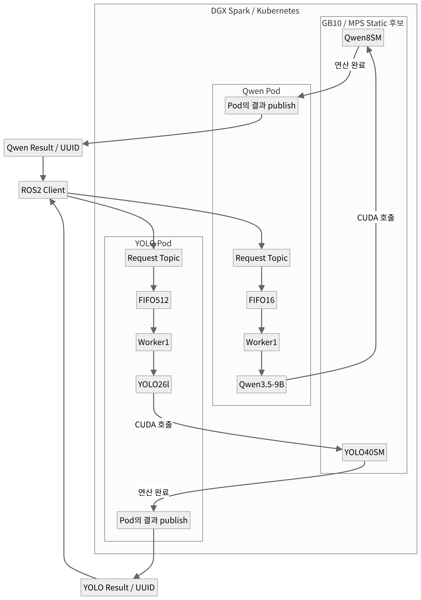

# System Architecture
### ROS 2 기반 비동기 Multi-Model AI 추론 플랫폼

## 1. 시스템 개요

본 시스템은 단일 DGX Spark GPU에서 Qwen3.5-9B와 YOLO26l을 독립적으로 운영하기 위한 Multi-Model AI 추론 플랫폼이다.

Kubernetes를 이용하여 두 모델을 각각 독립적인 Pod에 배포하고, ROS 2의 Publish/Subscribe(Pub/Sub) 통신 구조를 활용하여 사용자의 추론 요청을 수신하고 결과를 반환하도록 설계하였다.

각 모델은 독립적인 FIFO Queue와 Worker를 통해 요청을 순차적으로 처리하며, 두 모델은 하나의 물리 GPU를 공유한다.

특히 다수의 요청이 동시에 발생하는 상황에서 결과가 혼동되지 않도록 **UUID 기반 요청·응답 매칭 구조**를 적용하였다.

이를 통해 모델별 요청 처리의 독립성을 유지하면서, 단일 GPU 환경에서 발생하는 자원 경합을 측정하고 최적화할 수 있도록 구성하였다.

### System Architecture Diagram

**Figure 1.** Architecture of the ROS 2-based Multi-Model AI Inference Platform.

그림은 Qwen 8SM / YOLO 40SM의 정적 자원 분할 구성을 예시로 나타낸다. MPS 미적용 환경에서는 고정된 SM 파티션 없이 두 모델이 동일한 GPU를 공유한다.

## 2. 주요 구성요소

| 구성요소 | 역할 |
|---|---|
| ROS 2 Client | 추론 요청 발행 및 결과 수신 |
| ROS 2 Subscriber | 모델별 요청 Topic 구독 |
| UUID | 개별 요청과 결과 식별 |
| FIFO Queue | 수신한 요청을 도착 순서대로 저장 |
| Worker | Queue에서 요청을 가져와 추론 수행 |
| Qwen Pod | Qwen3.5-9B 텍스트 생성 서비스 |
| YOLO Pod | YOLO26l 객체 검출 서비스 |
| CUDA MPS | GPU 공유 및 정적 SM 자원 분할 |
| Monitoring / Logging | 요청 처리시간, Queue 대기, 모델 실행 및 시스템 상태 기록 |

### 2.1 Kubernetes 기반 독립 Pod 구성

Qwen과 YOLO를 각각 독립적인 Kubernetes Pod에서 실행하도록 구성하였다.

각 Pod는 모델을 시작 시 로딩한 후 메모리에 유지하며, ROS 2 Subscriber와 FIFO Queue, Worker를 통해 추론 요청을 처리한다.

모델별 프로세스와 Queue가 분리되어 있으므로 한 모델에 다수의 요청이 도착하더라도 다른 모델의 FIFO Queue에 직접 영향을 주지 않는다.

다만 두 모델은 동일한 물리 GPU를 사용하므로 GPU 자원 경합에 따른 성능 간섭은 발생할 수 있다.

## 3. ROS 2 기반 요청·응답 구조

### 3.1 Publish/Subscribe 통신

사용자는 ROS 2 Client를 통해 원하는 AI 모델의 Request Topic에 추론 요청을 발행한다.

각 모델의 Pod는 자신에게 할당된 Request Topic을 구독하여 요청을 수신한다.

| 구분 | ROS 2 Topic | 역할 |
|---|---|---|
| Qwen 요청 | `/qwen/request` | 텍스트 생성 요청 |
| YOLO 요청 | `/yolo/request` | 객체 검출 요청 |
| Qwen 결과 | `/qwen/result/r_<UUID>` | 요청별 텍스트 생성 결과 |
| YOLO 결과 | `/yolo/result/r_<UUID>` | 요청별 객체 검출 결과 |

요청 Topic은 모델별로 고정되어 있으며, 결과 Topic은 개별 요청의 UUID를 이용해 구분한다.

### 3.2 UUID 기반 요청·응답 매칭

일반적인 Pub/Sub 구조에서 여러 사용자가 동일한 모델에 동시에 요청을 발행하면, 각 결과가 어떤 요청에 대응하는지 구분해야 한다.

이를 위해 본 시스템에서는 요청마다 고유한 UUID를 부여하고, 결과를 해당 UUID와 연결하는 구조를 적용하였다.

처리 과정은 다음과 같다.

1. ROS 2 Client가 요청별 UUID를 생성한다.
2. Client는 UUID와 입력 데이터를 포함하여 모델의 Request Topic에 요청을 발행한다.
3. 모델 Pod가 요청을 수신하고 FIFO Queue에 저장한다.
4. Worker가 해당 요청의 추론을 수행한다.
5. 추론 완료 후 UUID에 대응하는 Result Topic으로 결과를 발행한다.
6. Client는 해당 UUID의 결과를 수신하여 요청과 매칭한다.

이를 통해 하나의 모델에 여러 요청이 전달되더라도 각 Client가 자신의 요청에 대응하는 결과를 구분할 수 있다.

**UUID는 요청과 응답을 식별하기 위한 수단이며, 사용자 인증이나 접근 제어를 제공하지는 않는다.**

또한 Qwen은 생성이 완료된 텍스트를 한 번에 반환하므로, 현재 구조는 토큰 단위 스트리밍 응답을 제공하지 않는다.

## 4. FIFO Queue 및 Worker 구조

### 4.1 모델별 독립 Queue

각 모델은 독립적인 FIFO Queue를 사용한다.

ROS 2 Subscriber가 요청을 수신하면 해당 요청을 Queue에 저장하고, Worker가 Queue에서 요청을 하나씩 가져와 처리한다.

이를 통해 요청 수신과 모델 추론 실행을 분리하였다.

최신 Burst 실험에서 사용한 Queue 용량은 다음과 같다.

| 모델 | FIFO Queue 용량 | Worker |
|---|---:|---:|
| Qwen3.5-9B | 16 | 1 |
| YOLO26l | 512 | 1 |

위 용량은 대량 요청 성능 평가에 사용한 설정이며, 일반 서빙 환경의 기본 Queue 용량과 구분된다.

### 4.2 단일 Worker 기반 순차 처리

각 모델에는 Worker를 하나씩 배치하여 해당 모델의 요청을 순차적으로 처리하도록 구성하였다.

따라서 하나의 모델 Pod 내부에서는 동시에 여러 요청을 모델에 전달하지 않으며, 각 요청은 앞선 요청의 처리가 완료된 후 실행된다.

반면 Qwen과 YOLO의 Worker는 서로 독립적으로 동작하므로 두 모델의 추론은 GPU 자원 공유 정책에 따라 병행 진행될 수 있다.

현재 시스템에는 두 모델의 실행 순서를 통합적으로 제어하는 별도의 전역 스케줄러가 없다.

이 구조는 모델별 요청 처리를 단순하고 독립적으로 관리할 수 있다는 장점이 있지만, 대량 요청이 한꺼번에 유입되면 Queue 대기시간이 증가할 수 있다.

## 5. GPU 자원 공유 구조

두 모델은 독립적인 Kubernetes Pod에서 실행되지만, 하나의 DGX Spark GB10 GPU를 공유한다.

GPU 자원 경합에 따른 성능 저하를 분석하기 위해 다음 실행 구성을 비교하였다.

- MPS 미적용
- 정적 자원 분할 없는 일반 MPS
- CUDA MPS 기반 정적 SM 분할

정적 SM 분할은 MPS를 이용해 각 모델 프로세스가 사용하는 SM 영역을 고정하는 방식이다.

본 프로젝트에서는 Qwen과 YOLO의 연산 특성 차이를 고려하여 비대칭 자원 배분을 적용하였으며, 최종 성능 비교에서 Qwen 8SM / YOLO 40SM 구성을 선정하였다.

이러한 자원 분할은 GPU의 SM 실행 자원을 분리하는 것이며, 메모리 용량·메모리 대역폭·GPU 장애까지 완전히 격리하는 것은 아니다.

## 6. Monitoring 및 Logging 구조

성능 분석과 시스템 상태 확인을 위해 요청 단위의 계측 및 로그 수집 구조를 구성하였다.

### 6.1 요청 처리 계측

각 요청에 대해 UUID와 타임스탬프를 이용하여 처리 과정을 추적하였다.

주요 계측 항목은 다음과 같다.

| 계측 항목 | 설명 |
|---|---|
| Request E2E | 요청 발행부터 결과 수신까지의 경과시간 |
| Queue Waiting | FIFO Queue에서 대기한 시간 |
| Model Processing | Qwen generate 또는 YOLO predict 호출시간 |
| GPU Forward | CUDA Event 기반 forward 경과 구간 |
| TTFT / TPOT | Qwen 내부 토큰 생성 지연 |
| Completion Time | 모델별 요청 묶음의 전체 완료시간 |
| Request ID | UUID를 통한 요청·결과 대응 관계 |

수집한 로그는 성능 분석 스크립트를 통해 집계하고, Baseline과 최적화 설정의 차이를 비교하는 데 활용하였다.

### 6.2 GPU 및 시스템 상태 분석

GPU 실행 특성을 파악하기 위해 별도의 NVIDIA Nsight 및 CUPTI 기반 진단을 수행하였다.

이를 통해 GPU Kernel 실행 구간과 모델 간 실행 겹침을 분석하였다.

또한 호스트 CPU·메모리·GPU 온도 등 자원 상태를 기록하고, Kubernetes의 Pod 상태와 컨테이너 재시작 정보를 확인하였다.

GPU 프로파일링은 성능 측정과 분리하여 수행하였으며, 프로파일링으로 인한 오버헤드가 본 성능 비교에 직접 반영되지 않도록 구성하였다.

현재 Monitoring은 로그·계측·프로파일링 및 상태 확인을 중심으로 구성되어 있다. 별도의 통합 모니터링 대시보드나 자동 경보 시스템을 구현한 것으로 설명하지 않는다.

## 7. 설계 특징 및 한계

본 시스템의 주요 설계 특징은 다음과 같다.

**첫째, 모델별 독립적인 서비스 구조이다.**  
Qwen과 YOLO를 별도 Pod, Queue, Worker로 구성하여 모델별 요청 처리와 배포를 독립적으로 관리한다.

**둘째, UUID 기반 비동기 요청·응답 매칭을 지원한다.**  
ROS 2 Pub/Sub 통신을 이용하면서 다수 요청의 결과가 혼동되지 않도록 개별 요청과 결과를 연결한다.

**셋째, GPU 자원 배분 정책을 비교할 수 있다.**  
모델 서빙 구조를 유지한 상태에서 MPS 설정을 변경하여 GPU 자원 경합과 최적화 효과를 측정할 수 있다.

**넷째, 요청 처리 단계별 성능 분석이 가능하다.**  
전체 응답 지연을 Queue 대기, 모델 처리 및 기타 구간으로 구분하여 병목을 분석한다.

다만 현재 모델별 Worker는 하나씩 동작하므로 지속적인 요청 증가에 따라 Queue 대기시간이 커질 수 있다. 또한 UUID별 결과 Topic을 사용하는 구조는 다수의 동적 Topic 생성에 따른 DDS 관리 비용을 추가로 고려해야 한다.

향후에는 Queue 포화 대응, 요청 제한 및 취소 정책, 실제 요청 처리 상태를 반영하는 Health Check, 동적 GPU 자원 배분 등을 검토할 수 있다.

## 8. 결론

본 프로젝트는 **Kubernetes 기반 독립 AI 서비스와 ROS 2 Pub/Sub 통신을 결합하여, 단일 GPU에서 여러 AI 모델의 추론 요청을 처리할 수 있는 시스템**을 구축하였다.

특히 UUID 기반 요청·응답 매칭과 모델별 FIFO Queue 및 Worker 구조를 통해 다수 요청을 독립적으로 관리하도록 설계하였다.

또한 요청 단위 계측과 GPU 실행 분석 기능을 활용하여 자원 경합에 따른 병목을 확인하고, CUDA MPS 기반 자원 분할 최적화의 효과를 평가할 수 있도록 구성하였다.
