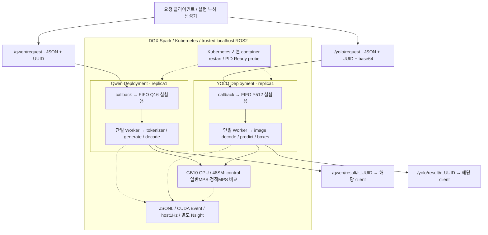

# 시스템 아키텍처

최종 성능 비교는 **Green Context 없는 native MPS static** 구조다. 아래 그림은 그 실험 경로이며, 실험 종료 후 복원된 상시 서빙(normal MPS+Green16/32)과 구분한다. [SVG 구성도](architecture.svg).

## 역할과 경계

| 구성요소 | 역할 | 하지 않는 일 |
|---|---|---|
| 클라이언트 | UUID 생성, 자기 결과 채널 선구독, publish, 답변 출력/검출 이미지 저장 | 다른 요청 결과 수집, 인증·권한 부여 |
| callback | raw 요청을 자기 모델의 FIFO로 전달 | 모델 추론, 공통 GPU 스케줄링 |
| FIFO/Worker | 모델별 순차 처리, 원본 generate/predict 호출, 결과 송신 | 모델 간 전역 lock, batching, 재시작을 넘는 queue 보존 |
| Kubernetes | 독립 Deployment, 이미지·볼륨·자원표현, 기본 프로세스 재시작 | SM을8/40으로 직접 분할, ROS traffic의 Ready gate |
| NVIDIA device-plugin | 같은 GPU에 대한 shared 접근 슬롯2개 | 각Pod에GPU50% 성능·메모리 보장 |
| MPS static | 서로 다른 고정 SM 파티션을 각 CUDA client 프로세스에 할당 | 메모리/대역폭/장애의 완전 격리 |
| 관측 도구 | 단계별 timestamp·로그·자원·별도 GPU 진단 | event-span을순수SM실행시간이라고보장 |

일반서빙 기본FIFO는모델별대기8이며, 그림의Q16/Y512는Burst실험 설정이다. Worker가결과publisher발견/ACK를기다리는동안다음요청은큐에서대기할수있다.

## 요청과 결과
1. 클라이언트가`r_`+UUID로request_id를만들고`/<model>/result/<id>`를구독한다.
2. `/<model>/request`로JSON을전송한다. 입력토픽을UUID별로늘리거나wildcard구독하는구조가아니다.
3. 서버callbackenqueue→Workerdequeue→전처리→상주모델호출→결과준비→UUID별결과publisher.
4. 클라이언트가일치ID를검사해출력/저장한다.서버는DDS ACK확인후일회성publisher를정리한다.

## 프로세스·GPU 관계

두모델은서로의존재를모르고각자진행한다. MPS없음에서도OS/driver는CUDA context를요청내부에서교대할수있으므로'Qwen요청이끝날때까지YOLO실행불가'가아니다. 호스트요청구간의겹침과물리GPU동시kernel실행은구별한다.

최종정적실험은MPSdaemon을static모드로시작하고8/40등두파티션을만든뒤각Pod에partitionID를전달했다. 실제SMproperty·MPSmembership·runtime13010을검사했다. Green API가실행경로에없음을확인했다. baseline은MPS없음,일반MPS는정적partition없음이다.

## 성능 평가 범위

이 구성도의 주 성능 경로는 고정 작업량 **Burst** 비교다. 지속 부하 생성기와 open-loop SLO 평가는 별도 탐색 자료이며 이 아키텍처의 주 성능 근거나 상시 운영 설계에 포함하지 않는다. 모델별 독립 FIFO/Worker 설명은 부하 생성 방식과 무관하게 유지된다.

구현·관측·미구현의 구분은 [구현 범위](IMPLEMENTATION.ko.md), 실제 entrypoint·환경·볼륨과 모드 차이는 [배포 모드](DEPLOYMENT_MODES.ko.md)를 참고한다.

## 장애·보안·운영 범위

Kubernetesstartup/readiness는모델로딩후PIDmarker를검사한다. 현재구성은functionalhang를탐지하는프로덕션liveness검사가아니다. 실험observer/실제응답probe를운영탐지알고리즘과혼동하지않는다.

hostNetwork/hostIPC·localhost discovery·동일UID MPS는신뢰된단일호스트의선택이다. 요청토픽/UUID는보안경계아니며외부공개전인증·인가·암호화·메모리격리검토가필요하다. fault실험은GPU유휴SIGKILL에한정한다. 자세한한계는[기술보고서](TECHNICAL_REPORT.ko.md), 실제파일은[코드지도](CODE_MAP.ko.md).
