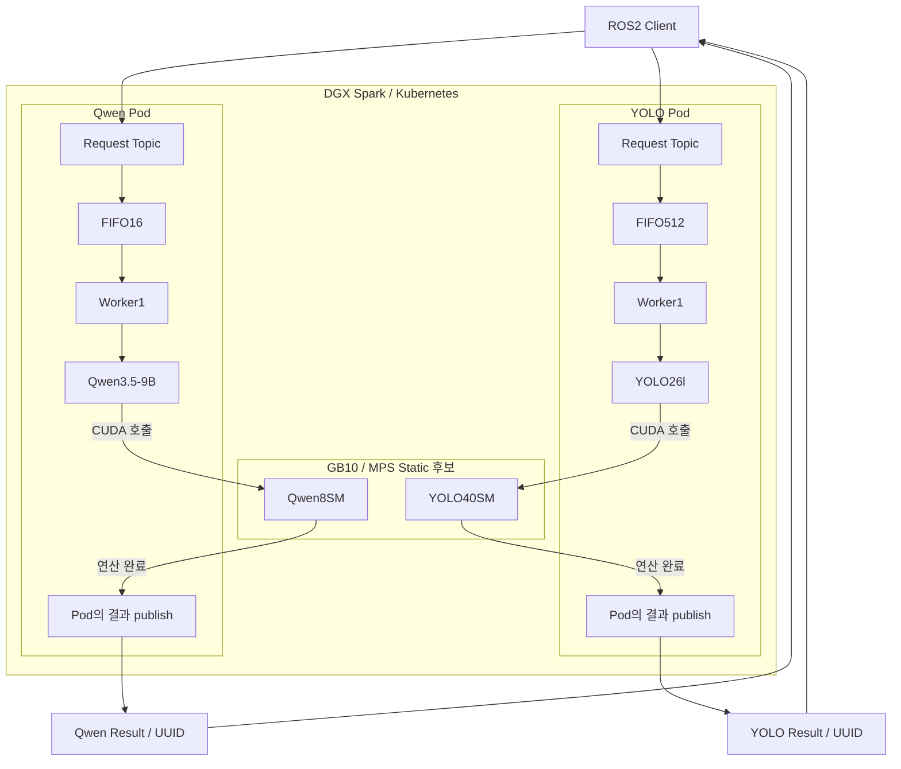
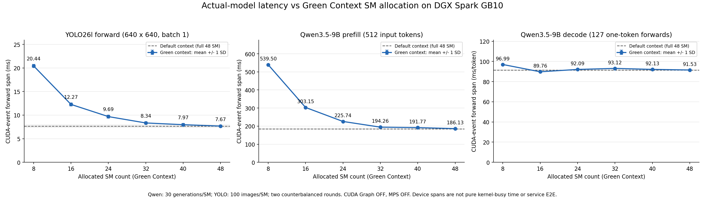
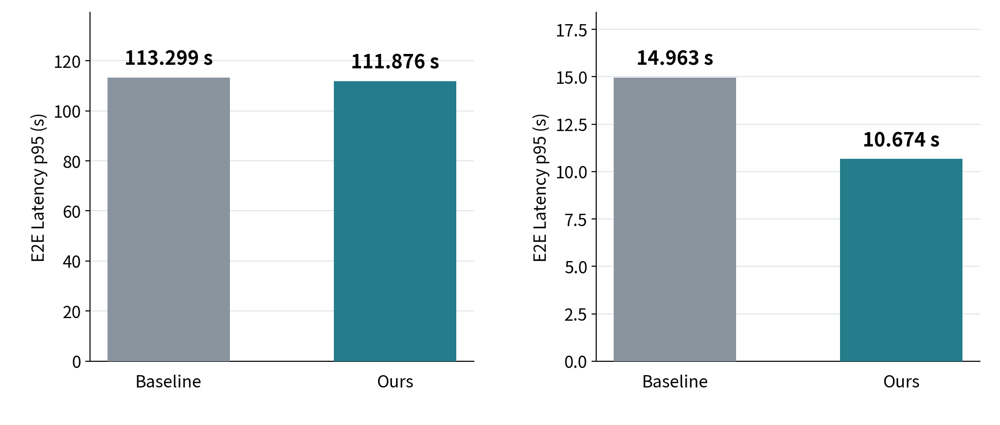

# CJ 4DPLEX AI Platform 개발 사전과제 — Technical Report

**보고서 주제:** Multi-Model AI 추론 운영 인프라 구축 및 최적화  
**분석 대상:** Qwen3.5-9B와 YOLO26l의 단일 GPU 동시 추론  
**작성 기준:** 2026-11-12 · 안하민

**실험 근거:** 동결 baseline의 초기 측정 자료, 2026-11-09 모델별 SM 민감도 분석, 2026-11-10 native MPS 정적 분할의 원시 요청·로그·집계·GPU 진단, 제어된 프로세스 장애 주입 결과를 사용했다. 원시 자료는 로컬 저장소에 보관되어 있으며, 제출 GitHub의 최종 업로드·평가자 접근 확인과는 구분한다.

성능 평가는 **Qwen 10건·YOLO 300건의 유한 Burst**로 한정한다. SLO는 탐색 후 합의한 상대 평가 기준으로 설명하고, 장애 대응은 실제 관측·주입 실험에서 검증한 범위만 기술한다.

## 1. 문제 정의

### 1.1 배경 및 목표

콘텐츠 제작 환경에서는 텍스트를 생성하는 LLM과 영상·이미지의 객체를 검출하는 CV 모델이 같은 GPU를 공유할 수 있다. 실행 시간과 자원 요구가 다른 작업이 겹치면 GPU 실행 간섭, 추론 지연 증가와 후속 Queue 대기가 발생할 수 있다. 따라서 모델별 최고 속도뿐 아니라 한정된 GPU 자원에서 작업 완료 시간과 서비스 지연을 함께 관리해야 한다.

본 과제는 단일 DGX Spark GB10의 GPU 1개·48SM에서 두 모델을 독립 운영하고, 실제 요청과 단계별 지표로 병목을 확인한 뒤 자원 배분 정책을 검증하는 것이다. 특히 **Qwen의 전체 응답을 유지하면서 YOLO의 Burst 지연을 줄이는 것**을 목표로 한다. GPU 경합의 정확한 원인은 측정 전에 확정하지 않는다.

모델의 정확도 향상·재학습은 범위가 아니다. Qwen3.5는 멀티모달 가능 모델이지만 본 실험은 텍스트만 입력했다. 모델 특성 분석의 결론을 모든 VLM에 일반화하지 않는다.

### 1.2 시스템 구성과 요청 처리

| 항목 | 구성 |
|---|---|
| 하드웨어 | NVIDIA DGX Spark GB10, 단일 물리 GPU, 48SM, unified memory |
| LLM | Qwen3.5-9B, BF16, SDPA, FLA·causal-conv GPU 경로 |
| CV | YOLO26l, 원본 PyTorch FP16, 640×640, batch 1 |
| 배포 | Kubernetes 기반 독립 Qwen/YOLO Pod, 모델별 replica 1 |
| 요청 처리 | 독립 FIFO Queue와 Worker 1개, 모델 시작 시 로딩 후 상주 |
| 최신 Burst 큐 | Qwen 대기 16, YOLO 대기 512; 일반 서빙 기본 대기 8과 구분 |
| 입출력 | ROS2 DDS, 모델별 고정 요청 Topic, UUID별 결과 Topic |
| GPU 공유 | MPS 없음·일반 MPS·정적 MPS를 비교; 최종 정적 실험에 Green 미사용 |

요청은 `ROS 수신→FIFO enqueue→Worker dequeue→generate/predict→CUDA 연산→Pod의 결과 publish→UUID별 클라이언트 수신` 순서로 진행된다. 두 모델 사이에 공동 Queue·실행 순서 조정·전역 작업 lock은 없다. 10/300은 요청 묶음 크기이며 모델 텐서 batching이 아니다.

그림은 후보 8/40을 나타낸다. Baseline에서는 파티션 없이 같은 GPU를 공유한다. 결과 발행은 GPU가 아닌 각 Pod의 Worker가 수행한다. UUID는 요청 혼선 방지이지 인증·암호화 수단이 아니다.

Kubernetes는 배포·기본 재시작을 담당하고, device-plugin의 `nvidia.com/gpu.shared`는 접근 슬롯을 표현한다. 이 슬롯이 SM·메모리를 절반씩 예약하지는 않는다. 정적 SM 분할은 MPS가 담당한다. 관측에는 JSONL·UUID·호스트 자원 샘플·별도 Nsight를 사용했으며 전용 통합 모니터링 플랫폼을 구현했다고 가정하지 않는다. [상세 아키텍처](ARCHITECTURE.ko.md).

### 1.3 주요 평가 지표

- **요청 E2E:** 요청 JSON 생성/publish 직전부터 대응 응답 수신·파싱까지. FIFO·모델 호출·기타 서버 처리·전송/클라이언트 잔여를 포함한다.
- **모델 호출:** Qwen `generate()`와 YOLO `predict()`의 wall time.
- **CUDA Event:** 모델 호출 내부 forward 경과 구간이며 순수 SM-active 시간이 아니다.
- **내부 TTFT:** generate 진입 후 서버에서 첫 생성 토큰을 관측할 때까지. 현재 ROS는 최종 문장만 반환하므로 실제 streaming 첫 토큰 지연과 다르다.
- **묶음 완료:** 공통 발행 장벽에서 해당 모델의 마지막 결과 수신까지.

초기 DDS 탐색·결과 구독 준비·입력 파일 준비는 장벽 전에 수행해 E2E에서 제외한다. 외부 인터넷·CLI 기동까지 포함한 지연이 아니다. 구성요소 p95를 합산하거나 모델 호출과 그 안의 GPU Event를 중복 합산하지 않는다.

## 2. Baseline 측정

### 2.1 초기 동시 실행 Baseline — 2026-11-03

최적화 전에 모델 자체 지연, 상주 여부와 동시 활성의 영향을 확인했다. 이 실험은 driver 580/CUDA 13.0 계열, 모델당 C1 closed-loop, Qwen 입력 23~27/출력 128토큰, YOLO 두 이미지 순환 조건이다.

| 조건 | Qwen E2E 평균 | YOLO E2E 평균 | 비고 |
|---|---:|---:|---|
|각 모델 단독 Pod|11.561s|20.604ms|해당 모델만 상주|
|두 모델 상주·한 모델만 활성|11.575s|23.149ms|다른 모델도 로딩|
|두 모델 동시 활성|15.930s|39.640ms|모델별 독립 요청|

두 모델 resident/한 모델 활성 조건 대비 동시 활성에서 Qwen E2E 평균은 37.62%, YOLO는 71.24% 증가했다. YOLO 내부 inference도 7.776→16.930ms로 증가했다. App Queue 평균은 각각 1ms 미만이어서 이 성능 저하를 긴 FIFO 대기로만 설명할 수는 없었다.

초기 YOLO 요청 p95는 DDS/클라이언트 잔여의 영향도 받아 추론 시간과 구분한다. CPU·GPU·메모리 중 원인을 이 단계에서 확정하지 않았다. [초기 Baseline 원본](../results/latency-baseline/README.ko.md), [초기 프로토콜](experiments/2026-11-03-latency-baseline.md).

### 2.2 최적화 전후 비교용 새 Baseline — 2026-11-10

호스트 환경 변경 후 이전 결과를 개선율의 분모로 재사용하지 않고, 같은 새 환경에서 7조건을 새로 비교했다.

| 항목 | 동일하게 통제한 조건 |
|---|---|
|GPU/Driver|GB10·48SM, Driver 595.99.02|
|CUDA|Toolkit 13.1.2, 실제 CUDART 13010, Driver API 13020|
|컨테이너|PyTorch 2.9.0a0 build CUDA 13.0의 동결 이미지; host 13.1 runtime read-only overlay|
|Qwen|입력 512·출력 128 강제, greedy, thinking off|
|YOLO|동일 bus 이미지, 640×640, batch 1, native FP16|
|부하|공통 장벽에서 Q10/Y300 동시 연속 발행, 이전 응답을 기다리지 않음|
|워밍업|매 조건 Q3/Y30 처리 후 본 측정에서 제외|
|반복|7조건×5 randomized complete blocks, 총 35Burst|

호스트 Driver/Toolkit 업그레이드·재부팅을 검증했다. 컨테이너의 Torch까지 CUDA 13.1용으로 새로 빌드했다는 뜻은 아니다. 실제 runtime 13010을 조건마다 확인했다.

본 측정 10,850응답과 워밍업 1,155응답의 UUID·입력 SHA·토큰 수·형상·타임스탬프·발행 ACK를 검증했다. 관측 누락·실패·Queue overflow는 0이었다. Nsight는 성능 본 측정과 별도로 실행했다.

발신 스레드 2개가 공통 장벽에서 출발한 것이며 모든 요청이 같은 순간 GPU에 도착한 것은 아니다. publish/enqueue에는 유한한 시간이 걸리고, 전체 발행 요청을 완료까지 관찰했다.

### 2.3 SLO와 판정 범위

실험의 상대 목표는 MPS 없음 baseline 대비 **Qwen 요청 E2E p95 증가 0% 이하**, **YOLO 요청 E2E p95 감소 20% 이상**을 함께 만족하는 것이다. Baseline Qwen 113.299초·YOLO 14.963초에 대해 목표는 각각 113.299초 이하·약 11.970초 이하다.

목표는 Burst 탐색 결과를 본 뒤 합의했다. 8/40의 관측값을 이 기준으로 평가하되 사전 등록 목표나 새 독립 holdout 검증이라고 포장하지 않는다. 0% 관측 통과는 통계적 동등성·비열등성 보장이나 production SLA가 아니다.

## 3. Bottleneck 분석

### 3.1 동시 실행에 따른 모델 처리 지연

같은 최신 Burst에서 YOLO predict 평균은 MPS 없음 26.807ms, 일반 MPS 56.221ms, 정적 8/40에서 12.336ms였다. 일반 MPS를 켠 것만으로 CV 지연이 개선되지는 않았다. forward Event도 11.837→49.728→9.316ms로 달라져 GPU 공유 방식에 따른 간섭을 조사할 근거였다.

별도 GPU 진단에서는 host 호출·kernel span 겹침을 실제 계산 동시성과 혼동하지 않도록 context 교대도 확인했다. 정적 8/40의 20.027초 공통 창에서 kernel span 겹침은 약 2.398초였으며, clock 오차와 전환 경계를 보수적으로 제외한 겹침 175.751ms가 사전 50ms gate를 넘었다. 다만 이런 겹침 시간만으로 속도 우열이나 순간 SM 사용률을 판정하지 않는다. [별도 진단 근거](../results/static-eval/README.ko.md).

### 3.2 FIFO Queue가 지배하는 Burst E2E

`E2E = FIFO 대기 + 모델 호출 + 기타 서버처리 + 전송·발행·클라이언트 잔여`

| 정적 8/40의 요청 평균 | E2E | FIFO 대기 | 모델 호출 |
|---|---:|---:|---:|
|Qwen|62.041s|50.856s|11.166s|
|YOLO|5.610s|5.571s|12.336ms|

따라서 YOLO E2E p95 10.674초는 이미지 한 장의 추론에 10초가 걸린다는 뜻이 아니다. 대부분 앞선 요청의 처리·결과 발행을 기다린 시간이다. Worker 서비스 시간이 줄면 FIFO를 빨리 소진해 후속 요청의 E2E도 줄어들 수 있다.

Qwen의 MPS 없음 Baseline도 Queue 평균 52.286초, generate 11.301초였다. Queue가 크다는 사실만으로 Queue 버그라고 할 수 없으며, 한 번에 들어온 10/300 요청을 각 Worker 1개가 순차 처리한다는 구조와 함께 해석한다.

평균E2E의전체7조건구성은 [Queue·처리시간 상세 그림](../results/static-eval/20261110-v1/plots/request-components.png)에 보존한다. 이 그림은 요청 평균의 분해 자료이며5.3절의p95비교와분리해읽는다.

### 3.3 Qwen과 YOLO의 SM 민감도 차이

자원 배분 방향을 정하기 위해 별도 단독 활성 Green Context SM sweep(2026-11-09, driver 580/CUDA 13.0)을 사용했다.

| 배정 SM | Qwen Prefill(ms) | Qwen Decode(ms/token) | YOLO forward(ms) |
|---:|---:|---:|---:|
|8|539.50|96.99|20.44|
|16|303.15|89.76|12.27|
|32|194.26|93.12|8.34|
|48|186.13|91.53|7.67|

Qwen Prefill과 YOLO forward는 SM 추가에 상대적으로 민감했지만, Qwen Decode는 SM 증가에 비례해 빨라지지 않았다. 본 입력 512/출력 128에서는 Prefill 1회 뒤 one-token Decode 127회가 반복된다.

> 전체 생성 시간 ≈ Prefill 시간 + 반복 Decode 시간의 합 + 기타 처리

따라서 Prefill을 가장 빠르게 하는 배분이 전체 생성이나 두 모델의 서비스 지연을 가장 유리하게 만든다고 볼 수 없다. SM을 줄여 Prefill이 느려지더라도, 전체 시간을 지배하는 Decode의 손실이 작다면 남은 SM을 YOLO에 주는 방향을 검토할 수 있다.

그렇다고 **Decode가 SM을 활용하지 못한다**고 단정하지 않는다. 관측은 지연 민감도에 관한 것이며 사용률·메모리 대역폭·cache·kernel 선택 중 원인을 직접 입증한 것은 아니다. 단독 Green 8SM의 전체 생성 12.906초는 48SM 11.847초보다 길었으므로 SM 감소가 무손실이라고 가정하지도 않았다.

이 단독 곡선은 가설·후보 선정 근거이고, 새 MPS 환경의 동시 E2E 유지 여부는 별도로 검증한다. 과거 Green 시간과 최신 MPS 시간을 직접 나눠 개선율로 쓰지 않는다. [SM 분석 원본](../results/sm-sweep/README.ko.md).

## 4. 가설 수립 및 검증

### 4.1 모델 특성에 기반한 가설

> **Qwen의 Prefill이 일부 느려지더라도 적은 SM으로 전체 응답 지연을 유지할 수 있다면, 남은 SM을 YOLO에 배분해 검출 서비스 시간과 후속 Queue 대기를 줄이는 편이 유리할 것이다.**

허용하려는 비용은 Prefill·내부 TTFT의 증가이지, Qwen 전체 응답의 임의 악화가 아니다. 모델 특성→비대칭 분배 방향→분할 비교→동시 E2E 검증→8/40 선택 순서로 판단했다. 처음부터 8/40을 정답으로 두지는 않았다.

- **H1:** 반복 Decode가 생성 시간을 지배하므로, Prefill 비용 증가가 있어도 Qwen 전체 generate 손실은 상대적으로 작을 수 있다.
- **H2:** YOLO에 더 많은 SM을 고정 배분하면 간섭과 forward 대기가 완화되어 predict가 짧아질 수 있다.
- **H3:** 독립 FIFO/Worker 1개 구조에서 YOLO 처리 시간이 줄면 300건 Queue 소진이 빨라져 E2E와 YOLO 묶음 완료가 개선될 수 있다.

### 4.2 검증 설계

MPS 없음·일반 MPS·정적 8/40·16/32·24/24·32/16·40/8을 비교했다. SM 표기 순서는 **Qwen/YOLO**다.

MPS 없음과 일반 MPS의 비교는 GPU 스케줄링 환경까지 바뀌는 비교이며, 정적 5조건 사이의 비교가 분배 비율에 대한 비교다. 모델·입력·출력 길이·정밀도·Queue·Worker·계측을 같게 두고, 라운드마다 조건 순서를 무작위화했다.

실제 단위 2SM/chunk, 파티션 생성 후 client 시작, 초과 할당 거부, device property의 SM 수·partition ID·MPS membership을 확인했다. 최종 정적 실험에는 Green Context를 쓰지 않았다. MPS는 가설을 구현하는 수단이지 도입 자체가 최적화 성과는 아니다. [Driver595 MPS 공식 문서](https://docs.nvidia.com/deploy/mps/595/when-to-use-mps.html).

### 4.3 관측에 따른 판단

| 가설 | 관찰 | 판단 |
|---|---|---|
|H1|8/40에서 Prefill/내부 TTFT 악화, generate 평균 11.301→11.166초, 요청 p95 113.299→111.876초|해당 Burst의 전체 응답 유지 관측에 부합|
|H2|YOLO predict 평균 26.807→12.336ms, forward Event 11.837→9.316ms|처리 구간 개선 관측에 부합; 원인을 SM 하나로 확정하지 않음|
|H3|일반 MPS 대비 predict 약 43.9ms/건 감소, YOLO 묶음 약 13.8초 단축|300건 환산 약 13.2초와 규모가 비슷해 서비스 시간·Queue 연결을 뒷받침|

이는 구간 회계와 통제 비교에 근거한 해석이지 독립적인 원인별 완전 분해는 아니다. 전체 310건 완료의 큰 개선을 가설로 과장하지 않는다.

## 5. 최적화 결과

### 5.1 전체 완료 시간과 모델별 응답

아래 완료 시간은 5회 평균이고, 요청 p95는 각 조건의 전체 요청을 합친 pooled 기술통계다. 서로 다른 집계 방식을 구분한다.

<!-- RESULT_TABLES_START -->
### Burst 전체 비교

완료시간은 실행5회의 평균이다. 요청 E2E p95는 조건별 전체 요청을 합친 기술통계(pooled)다. 조건당Qwen50개·YOLO1500개이며 독립 실행 반복은5회다.

| 설정(Qwen/YOLO SM) | Qwen10개 완료(s) | YOLO300개 완료(s) | Qwen 요청 E2E p95(s) | YOLO 요청 E2E p95(s) |
|---|---:|---:|---:|---:|
|control|113.361|16.322|113.299|14.963|
|mps-only|112.495|25.373|112.468|23.404|
|static-q8-y40|111.887|11.592|111.876|10.674|
|static-q16-y32|119.285|12.713|119.047|11.538|
|static-q24-y24|114.618|14.126|114.792|12.780|
|static-q32-y16|119.755|18.125|119.620|16.524|
|static-q40-y8|117.722|26.764|117.747|24.807|

### 핵심 지표 요약 — MPS 없음 대비 정적 8/40

| 성능 지표 | MPS 없음 | 정적 8/40 | 변화율 |
|---|---:|---:|---:|
| YOLO 300건 완료 평균(s) | 16.322 | 11.592 | -28.98% |
| YOLO 요청 E2E 평균(s) | 7.759 | 5.610 | -27.70% |
| YOLO 요청 E2E p95(s) | 14.963 | 10.674 | -28.66% |
| Qwen 요청 E2E p95(s) | 113.299 | 111.876 | -1.26% |
| Qwen 내부 TTFT 평균(ms) | 188.317 | 471.930 | +150.60% |
| 전체 310건 완료 평균(s) | 113.361 | 111.887 | -1.30% |

출처: `results/static-eval/20261110-v1/analysis/summary.json`. 생성: `python3 scripts/render_submission_tables.py`.
<!-- RESULT_TABLES_END -->

전체7조건의 완료시간·5회 반복값은 [상세 비교 그림](../results/static-eval/20261110-v1/plots/batch-completion.png)에 보존했다. 이 상세 그림의 지표는 묶음 완료시간으로,5.3절의 요청별p95와 다르다. 기존3%전체완료tie-band선택에서도8/40이선택됐지만,그휴리스틱은SLO나통계검정과구분한다.

### 5.2 비교 기준별 개선율

| 지표 | MPS 없음 대비 8/40 | 일반 MPS 대비 8/40 |
|---|---:|---:|
|전체 310건 완료|1.30% 감소|0.54% 감소|
|YOLO 300건 완료|28.98% 감소|54.31% 감소|
|YOLO 요청 E2E p95|28.66% 감소|54.39% 감소|

두 개선율은 분모가 다르므로 합쳐 표현하지 않는다. 8/40은 측정한 정적 5조합 중 전체 완료·YOLO 완료·Queue 포함 YOLO p95가 가장 낮았다. 단, 모든 반복에서 일반 MPS 대비 전체 완료가 빨랐던 것은 아니다.

실험의 상대 SLO는 8/40에서 관측상 충족했다. Qwen p95는 113.299→111.876초로 약 1.26% 감소했고, YOLO p95는 14.963→10.674초로 28.66% 감소했다. 사후 합의 기준의 회고적 판정이며 새 독립 검증·운영 보장과 구분한다.

### 5.3 운영상 이점과 8/40 선택의 의미

**이 그림이 보여주는 것은 “Qwen의 전체 응답 지연을 유지하면서 YOLO의 늦은 응답을 줄였다”는 결과다.** 비교 조건은 최적화 전 MPS 없음과 최적화 후 정적 8/40 두 개만 사용한다.

- **왼쪽 Qwen:** 요청 E2E p95가 113.299→111.876초로 약 1.26% 낮아졌다. 큰 가속보다는 전체 응답 지연이 악화되지 않았다는 점에 의미가 있다.
- **오른쪽 YOLO:** 요청 E2E p95가 14.963→10.674초로 약 28.66% 낮아졌다. 같은 300건의 Burst에서 늦은 요청의 응답까지 앞당겨졌다.
- **공통 조건:** 요청을 버리거나 입력·출력 길이·모델 batch 크기를 바꿔 작업량을 줄인 결과가 아니다. 모델별 FIFO와 Worker 1개도 유지했다.

두 패널 모두 **요청별 E2E p95**를 초 단위로 표시한다. 전체 310건 완료시간이나 요청 평균, 순수 추론시간을 그린 것이 아니다. 각 조건의 5회 Burst에서 Qwen 50건·YOLO 1,500건을 합친 분포로 계산했으며, E2E에는 Queue 대기가 포함된다. 두 패널의 y축 범위는 달라 각 모델 안에서 전후를 비교한다.

따라서 8/40은 본 Burst에서 Qwen 전체응답 유지와 YOLO 지연 개선을 함께 달성한 조합으로 해석한다. **내부 TTFT까지 유지됐다는 뜻은 아니며**, 그 비용과 모델 단계별 시간은 다음 Trade-off 절에서 따로 다룬다. 0% 상대목표의 관측 통과를 통계적 동등성이나 모든 부하의 보장으로 확대하지 않는다.

도표 수치는 원본 집계에서 생성했으며 [수치·출처 JSON](figures/burst-request-p95-before-after.json)과 [확대용 SVG](figures/burst-request-p95-before-after.svg)를 함께 제공한다.

## 6. Trade-off 분석

정적 8/40은 모든 지표에서 우월하지 않다. 아래 표의 평균·p95는 행별 표기를 따른다. 모델 호출 지표와 Queue 포함 E2E를 구분한다.

| 지표 | MPS 없음 | 일반 MPS | 정적 8/40 | 정적 16/32 |
|---|---:|---:|---:|---:|
|Qwen generate 평균(s)|11.301|11.219|11.166|11.891|
|Qwen 요청 E2E p95(s)|113.299|112.468|111.876|119.047|
|Qwen 내부 TTFT p95(ms)|223.592|199.489|498.506|287.306|
|YOLO predict 평균(ms)|26.807|56.221|12.336|14.873|
|YOLO predict p95(ms)|30.213|62.452|26.336|17.045|

Qwen Prefill 평균은 MPS 없음 187.024ms에서 8/40의 470.632ms로, 내부 TTFT p95는 223.592→498.506ms로 증가했다. 전체 응답 완료가 유지됐다는 결과를 **Qwen의 모든 지연 지표가 악화되지 않았다**고 설명할 수는 없다. 내부 TTFT는 실제 사용자 streaming 응답과도 구분한다.

Qwen에서는 한 번의 Prefill forward가 약 284ms 늘었지만, Decode forward는 토큰당 약 3.32ms 낮아 127회로 환산하면 약 421ms 차이에 해당했다. 이 이벤트 평균의 순 차이인 약 138ms 감소는 generate wall의 약 135ms 감소와 규모가 비슷하다. 반복 Decode와 한 번의 Prefill 비용을 함께 봐야 한다는 설명에 부합하지만, 순수 GPU 시간이나 독립 인과 증명으로 해석하지 않는다.

또한 8/40의 YOLO predict 평균은 16/32보다 짧지만, predict p95는 26.336ms 대 17.045ms로 더 길었다. Burst 완료와 Queue 포함 E2E를 중시하면 8/40이 유리하나, Qwen 초기 반응이나 단일 YOLO 호출의 tail을 강하게 보호하려면 16/32 등 다른 배분도 검토해야 한다.

8/40의 YOLO는 약 11.6초, Qwen은 약 111.9초에 끝나 두 모델의 작업이 겹칠 수 있는 구간은 초반 일부다. Qwen 전체 시간 유지를 Decode 특성 하나로 확정하지 않는다. 정적 partition의 유휴 SM을 다른 partition이 자동으로 빌려 쓰는 구조가 아니며, 유휴 자원 회수도 구현하지 않았다. [NVIDIA 공식 설명](https://docs.nvidia.com/deploy/mps/latest/appendix-common-tasks.html).

정적 SM 분할은 메모리·대역폭·GPU 장애의 완전 격리가 아니다. clock/DVFS·cache·framework 선택의 영향도 남는다. 실험 후 원래의 일반 MPS+Green 16/32 서빙으로 복원했고, 추천 8/40을 임의로 상시 배포하지 않았다.

## 7. 장애 대응 및 운영 안정성

### 7.1 실제 운영 중 발견한 IPC 장애

Pod가 Ready여도 ROS2 요청이 전달되지 않는 장애를 관측했다. 새로운 processing_started 기록이 없고, FastDDS shared-memory 관련 파일은 deleted 상태였다. 마지막 SSH 로그아웃 시 UID의 IPC를 정리하는 logind 수명 정책과 일치하는 증거가 있었다.

대상 계정의 linger를 활성화하고 Pod를 재생성해 실제 요청 성공을 확인했다. SSH 세션이 없는 15초·45초 구간에서도 IPC 유지와 재접속 후 요청 성공을 확인했다. 전역 RemoveIPC나 GPU 보안 정책을 무효화하지는 않았다.

이 사례는 Ready만으로 실제 ROS 통신·추론 처리 가능성을 보장하지 못함을 보여준다. 정확한 발생 시각이 없으므로 **이 IPC 사례 자체의 자동 탐지 시간·MTTR은 산출하지 않는다.** [IPC 장애 기록](../results/green-context/README.ko.md).

### 7.2 제어된 프로세스 장애와 복구 측정

IPC 사례와 별도로 **YOLO 자신의 CUDA 작업이 유휴 상태이고 Queue가 비었음을 확인한 뒤 Node 프로세스에 SIGKILL을 3회** 수행했다. Worker는 스레드이므로 Worker 스레드만 종료했다고 쓰지 않는다.

실제 추론 Worker에서 `torch.cuda.synchronize()`와 nonce ACK를 확인하고 새 GPU 작업을 막았다. host PID·UID·명령·시작 시각·container ID·MPS membership을 검사해 대상을 제한했다.

Kubernetes가 같은 Pod UID 안에서 container를 재시작했다. exit 137이며 OOM은 아님을 확인했고, restartCount 0→1, 새 container ID와 실제 UUID 응답을 확인했다. 복구는 **Kubernetes 기본 기능**이며 자체 Failover 최적화가 아니다.

| 반복 | 탐지 관측(s) | Container 시작 관측(s) | 첫 정상응답(s) | Ready 관측(s) |
|---|---:|---:|---:|---:|
|1|0.746|1.253|4.504|8.258|
|2|0.999|1.254|4.504|6.506|
|3|0.493|0.997|4.163|6.498|

**SIGKILL 직전→일치 UUID 응답 파싱 완료**까지 평균 4.390초, 범위 4.163~4.504초였다. 모델 재로딩·요청 처리·전송을 포함한다. 250ms polling의 탐지/Ready 값은 API 질의 지연을 포함한 관측 상한이며 정확한 kubelet 내부 시각이 아니다.

hostNetwork의 ROS는 Kubernetes Service를 경유하지 않으므로 Ready 관측 전에 응답할 수 있었다. 다른 Service/Ingress 경로의 RTO로 일반화하지 않는다.

### 7.3 검증한 범위와 미검증 범위

- Qwen/MPS 서버 PID와 정상 응답은 유지됐다. 다만 장애와 겹친 Qwen cohort 평균은 11.032→11.296초(+2.40%, 각 3건)로 관측돼 다른 모델에 영향이 없었다고 주장하지 않는다.
- 3회의 기능 복구를 확인했으므로 제어된 프로세스 재시작 시간을 미측정이라고 쓰지 않는다. 반면 GPU 실행 중 강제 종료·GPU OOM·MPS 서버 장애·functional hang는 별도 미검증이다.
- 장애 시점의 in-flight/대기 요청을 비웠으므로 Queue 보존·무손실·무중단을 증명하지 않는다. 프로세스 내 FIFO는 영속 Queue가 아니다.
- 복구 probe는 1회 publish 후 90초 기다렸다. transient-local DDS writer의 retained 전달이 가능하며, 앱 재시도나 서버 영속 Queue를 검증한 것이 아니다.
- 각 trial은 새 Pod로 진행해 동일 Pod의 반복 CrashLoop/backoff는 미검증이다. 장기 가용성이나 복구 SLO도 정의·입증하지 않았다.

### 7.4 재발 방지·피해 완화

IPC 수명 문제에는 linger 조치와 로그아웃 후 재검증을 수행했다. 추가 제안은 GPU drain을 포함한 정상 종료, 작업 진행/E2E health, deadline·retry/idempotency·Queue 보존 요구 정의, MPS 공통 장애 runbook이다. 제안을 모두 구현했다고 하지는 않는다. 이번 범위에서 warm standby/HA 최적화는 추가하지 않았다. [정량 장애 원본](../results/fault-idle/README.ko.md).

## 8. 한계 및 개선 방향

1. **유한 Burst:** Q10/Y300 일괄 유입이 평가 범위다. 측정 전 구간에 GPU 경합이 있었다고 보지 않으며, 다른 요청 도착 패턴·장기 운영은 본문 결론에 포함하지 않는다.
2. **반복 단위:** 독립 Burst는 조건당 5회다. 요청 50/1500건을 독립 실험 50/1500회로 대체하지 않고 반복 간 변동을 함께 공개한다.
3. **입력 대표성:** 입력 512/출력 128·이미지 1종에 한정한다. 긴 입력·가변 출력·영상 분포·streaming·정확도·COCO mAP로 일반화하지 않는다.
4. **원인 분리:** CPU 평균 10.5~11.3%만으로 단일 스레드 병목을 부정하지 않는다. CUDA Event도 순수 GPU busy가 아니며, SM·DRAM·cache·DVFS·backend 선택의 기여를 완전히 분리하지 않았다.
5. **메모리:** GB10 NVML device-memory는 N/A로 남기고 host RAM을 모델별 VRAM으로 취급하지 않았다. SM 분할을 메모리 대역폭 예약과 동일시하지 않는다.
6. **동적 운영:** 고정 배분이므로 유휴 SM을 자동 재배분하지 않는다. 단일 GPU 조건이며 다중 GPU 확장성·외부 공개 서비스 보안도 검증 범위 밖이다.
7. **SLO:** 상대 목표를 합의했고 8/40은 관측상 충족했으나 탐색 후 설정한 기준이다. 독립 holdout과 실제 업무 입력으로 확인하는 일은 추후 과제다.
8. **복구:** 유휴 YOLO의 기본 재시작은 정량화했다. busy GPU 장애·요청 보존·동일 Pod 연속 장애는 미검증이며, 무중단·자체 HA로 설명하지 않는다.

개선 방향은 서비스별 SLO에 따른 TTFT/최종 완료/CV tail 우선순위, 요청량·실행 단계별 재배분의 필요성 평가, Queue 상한·admission·deadline·retry·cancellation·보존 정책의 요구 정의다. batching·양자화·다른 engine 등 평가하지 않은 기술을 이번 최적화 성과에 포함하지 않는다.

## 9. 결론

본 과제는 모델별 독립 Pod/FIFO/Worker를 유지하면서 초기 동시 실행 간섭과 Burst의 Queue 대기를 구분해 관측했다. Qwen Prefill·반복 Decode·YOLO forward의 SM 민감도 차이에서 비대칭 배분을 제안하고, 같은 새 환경의 5개 분할 후보를 비교해 8/40을 선택했다.

8/40은 YOLO 300건 완료를 MPS 없음 대비 28.98%, 일반 MPS 대비 54.31% 단축했다. 전체 310건 완료 개선은 각각 1.30%와 0.54%로 작았다. 반면 Qwen 내부 TTFT는 크게 늘었고, 단일 YOLO predict의 p95는 16/32가 더 낮았다. 최적 배분은 어떤 서비스 지표를 보호하는지에 따라 달라진다.

따라서 주장하는 성과는 **모델 특성에 기반한 가설을 실제 운영 지표로 검증하고, Qwen 전체 응답을 유지하면서 YOLO Burst 지연을 줄인 것**이다. 별도로 Kubernetes 기본 재시작의 유휴 장애 복구를 실측했고, 검증한 범위와 한계도 구분했다. 과거 개인 연구 성과를 이번 측정값으로 사용하지 않는다.

## 근거 자료 및 재현 참고

- [초기 Baseline](../results/latency-baseline/README.ko.md), [초기 프로토콜](experiments/2026-11-03-latency-baseline.md)
- [native MPS 정적 결과](../results/static-eval/README.ko.md), [원시 집계 JSON](../results/static-eval/20261110-v1/analysis/summary.json), [실행별 CSV](../results/static-eval/20261110-v1/analysis/trials.csv)
- [SM 민감도](../results/sm-sweep/README.ko.md), [진단 타임라인](../results/serving-timelines/README.ko.md)
- [IPC 장애](../results/green-context/README.ko.md), [제어된 장애 결과](../results/fault-idle/README.ko.md)
- [구성도](ARCHITECTURE.ko.md), [설치·실행·재집계](REPRODUCIBILITY.ko.md), [코드 지도](CODE_MAP.ko.md), [모델·OSS·AI 활용 고지](USAGE_AND_LICENSES.ko.md)

제출 전에는 위 로컬 자료가 최종 GitHub에서 실제로 열리는지, 평가자가 저장소와 필요한 이미지에 접근할 수 있는지 별도로 확인한다. 로컬 증거 확보와 외부 제출 완료를 혼동하지 않는다.
