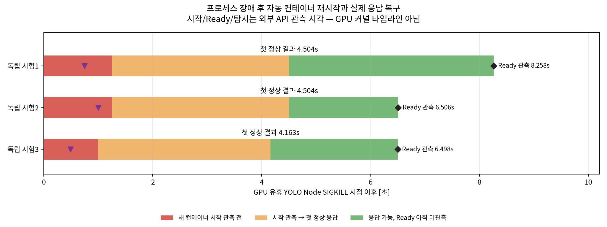
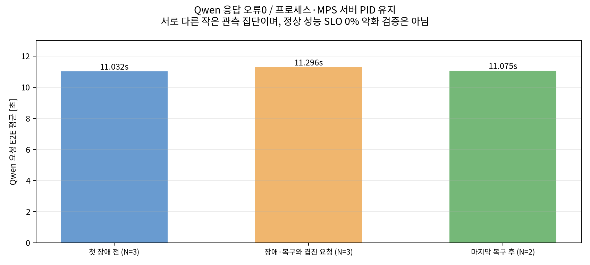

# YOLO Node 장애 주입·자동 복구 실험

## 결론
**GPU 작업이 완료된 YOLO ROS Node 프로세스를 SIGKILL로 종료한3회 모두, 같은 Pod 안에서 Kubernetes가 컨테이너를 재시작했고 실제추론응답이 재개됐다.**

- 첫 정상결과수신: **평균4.390초**, 범위 **4.163–4.504초**.
- 장애상태관측: 평균0.746초. 새컨테이너실행관측: 평균1.168초.
- Ready표시관측: 평균7.087초. 이환경에서는실제ROS응답이Ready관측보다먼저돌아왔다.
- 실험중 MPS서버PID와Qwen프로세스PID는유지됐고Qwen요청오류는0이었다.
- 다만Qwen의장애전3요청평균11.032초,장애·복구구간과겹친3요청평균11.296초로**약2.40% 증가**했다. 이를‘지연영향없음’이라고하지않는다.
- 모든실험종료후원래Deployment·MPS서비스와실제ROS응답을복원확인했다.

**범위:** GPU유휴시점의‘프로세스장애’다. GPU작업진행중강제종료,Worker스레드정지,GPUfatalfault,Queue유실방지,장기가용성또는정상성능SLO0%충족을검증한것이아니다.

## 1. 환경 및 구성
- DGX Spark GB10,48SM,driver595.99.02,kernel7.0.0-1025-nvidia,actualCUDART13.1.
- native MPS static **Qwen8SM/YOLO40SM**, GreenContext미사용. 기존frozenQwen3.5-9B BF16/YOLO26l nativeFP16이미지및stock추론호출유지.
- 실험용domain81,모델별독립FIFO/Worker1개.현재Worker는Python스레드이므로강제종료대상은**YOLO Node 전체프로세스**다.
- Qwen은512input/128output,C1closed-loop.첫3회워밍업제외,이후3회정상기준관측,장애구간및후속정상요청관측.
- YOLO는동일bus.jpg,640/batch1.초기워밍업3회,각trial전워밍업1회,장애후patientprobe1회,복구후정상확인2회.
- 임시배포와gate/계측은원본이미지·라이브러리·모델코드패치가아니다.실험종료시원래서빙template으로되돌린다.

## 2. MPS 안전 경계
NVIDIA는GPU미완료작업을동기화하지않고MPS클라이언트를종료하면다른클라이언트와MPS서버가불안정해질수있다고설명한다. 따라서이번기본실험에서는:

1. YOLO의앞선요청결과와발행을완료시킨다.
2. **실제YOLO inference Worker스레드**가Queue empty를확인한다.
3. 같은프로세스에서 `torch.cuda.synchronize()`로GPU작업완료를기다린다.
4. nonce·시각·PID가포함된idleack를기록하고,gate해제전에는추가GPU작업을제출하지않는다.
5. hostPID/UID1000/cmdline/프로세스startticks/PodcontainerID/MPS실제client목록을재확인한다.
6. 정확한YOLO hostPID에SIGKILL을보내고gate를즉시지워새컨테이너는막히지않게한다.

helper exec프로세스에서CUDA동기화한것이아니며실제Worker의동기화다. `terminate_client`로관리종료한뒤그것을갑작스러운busy-GPU장애라고부른것도아니다. **안전하게제한한idle-process crash**라는범위를유지한다.

## 3. 반복 설계
- **새 Pod UID마다1회**,총3회독립과정.
- 각trial시작시restartCount0. SIGKILL후같은PodUID/새containerID/restartCount1/종료코드137확인.
- 반복사이에는YOLOtemplateannotation을바꿔새Pod로초기화한다.이운영자reset시간은복구시간에포함하지않는다.
- 같은Pod를연속으로죽여CrashLoopBackOff가누적된상황과혼합하지않는다.반복crash시4.4초가유지된다는보장도아니다.
- Qwen Pod/프로세스는이3회동안유지한다.실험후원상복구를위한Qwen/MPS의정상교체는별도조작이다.

## 4. 측정 방법

| 지표 | 정의 |
|---|---|
| 장애시점t0 | host가검증된YOLO PID에SIGKILL을보내기직전CLOCK_MONOTONIC.직후시각도함께보관 |
| 장애관측 | container종료/대기,Ready false,restartCount증가또는새container등을외부관측기가처음확인한시각 |
| 새컨테이너시작관측 | 같은Pod에서다른containerID의running상태와restartCount증가를처음확인 |
| Ready관측 | 새containerID가ready상태인것을처음확인 |
| **기능복구** | 장애후한번발행한UUID요청에대해정상YOLO결과를클라이언트가수신·파싱한시각 |

API는250ms목표간격으로조회했고각조회시작/종료를원시기록했다.실제쿼리최대소요는trial별약53–59ms였다. **탐지/시작/Ready는관측상한으로,실제kubelet내부인식시각과같지않다.** Kubernetes의startedAt/finishedAt초단위필드를host ns와섞어정밀시간을만들지않았다.

### 복구 요청의 의미
결과reader와requestwriter를미리만들되장애전에는발행하지않는다. SIGKILL직후요청을**한번만**보내고90초deadline까지같은writer/reader를유지했다.

- application재전송0,trial당publish1회.
- request QoS는기존서버와맞는reliable/transient-local,depth1이다.서버가없는동안**클라이언트writer가메시지를보관하고새subscriber에전달할수있다.** 외부영속Queue를구현한것이아니다.
- 실제응답의server_enqueue가장애후임을검증했다.세요청은각각장애후약1.7–5.5ms에발행됐다.
- 첫정상응답이후reader를1초더유지해발행ACK를받을수있게했다.늦게돌아올요청을짧은timeout으로버려Worker발행대기5초를인위적으로쌓지않았다.
- 90초는실험의안전한종료deadline이지합의된RTO목표가아니다.이환자형probe성공으로장애중요청성공률/가용성100%를주장하지않는다.

## 5. 실제 결과
단위:초,모두SIGKILL시점기준.3표본의관측값이며population p95나항상보장되는RTO가아니다.

| 독립시험 | 장애상태관측 | 새컨테이너실행관측 | 첫정상결과수신 | Ready관측 |
|---|---:|---:|---:|---:|
| 1 | 0.746 | 1.253 | 4.504 | 8.258 |
| 2 | 0.999 | 1.254 | 4.504 | 6.506 |
| 3 | 0.493 | 0.997 | 4.163 | 6.498 |
| 평균 |0.746|1.168|4.390|7.087|
| 중앙값 |0.746|1.253|4.504|6.506|



### Ready보다먼저응답이온이유
이번통신은**hostNetwork의ROS2/DDS직접요청**이며Kubernetes Service의readiness기반라우팅을거치지않는다.새Node가모델을로딩하고subscriber를연뒤응답할수있지만,기존startup/readiness주기및API관측으로Ready표시는더늦을수있다.

이는‘Kubernetes가틀렸다’는뜻이아니다. **기능복구시각과probe상태관측시각의정의가다르다.** 향후HTTP+KubernetesService를사용하면실제서비스입구에서다시RTO를측정해야하며4.4초를그대로인용하면안된다.또한Ready검사가PID/파일존재중심이므로스레드hang/통신불능을모두탐지한다는뜻도아니다.

## 6. Qwen 및 공유 GPU 영향
- 실험중MPS서버PID **1286646**,Qwen프로세스hostPID **1286470** 유지.
- Qwen총13개응답(워밍업3+관측10) 모두정상.오류0.장애·복구와겹치는Qwen요청이각trial에1개씩있음을rawtimestamp로확인.
- YOLO는워밍업·patientprobe·후속확인총15개정상.따라서실험용클라이언트결과총28개를보존했다.종료후원래서빙health는별도자료다.

| Qwen 요청 집단 | N | E2E 평균 | 관측범위 |
|---|---:|---:|---:|
| 첫장애전 정상관측 |3|11.032초|10.994–11.094초|
| 장애·복구구간과겹친요청 |3|11.296초|11.275–11.317초|
| 마지막기능복구후 |2|11.075초|11.070–11.080초|

장애와겹친집단평균은약**2.40% 증가**했다.서로다른작은관측집단이므로유의성/원인을확정하지않지만‘지연영향없음’으로숨기지않는다.본부하는정상SLO의baseline비교와다르며**Qwen E2Ep95악화0% SLO를검증·달성한결과가아니다.**



## 7. 손실·장애 범위의 한계
1. fault시YOLO GPU작업0·FIFO대기0을의도적으로확인했다.**서버메모리에있던대기요청이나실행중작업의보존·재처리를검증한것이아니다.**
2. patientprobe는DDSwriter를살려한번발행했다.짧은실제업무timeout/외부client실패율/월가용성은모른다.
3. wholeNode프로세스장애이며Python Worker스레드정지·GPUhang·MPSservercrash는미검증이다.현재PID생존probe로이런장애를모두탐지할수없다.
4. SM고정은GPU의전체장애격리가아니다.MPSbusyclient를강제종료하면다른client영향가능성이있으므로이번idle결과를GPUfatalfault에일반화하지않는다.
5. freshPod에서첫crash를3회비교했다.동일Pod반복crash로backoff가누적되거나coldimagepull/노드재부팅/다른모델의긴로딩은별도시나리오다.
6. 탐지는측정용관측기의API확인이다.운영용E2Eheartbeat/알람전달지연/장애자동분류를이미구현한것은아니다.
7. RTO SLO수치는아직합의하지않았다.‘5초이내보장’으로사후목표를만들지않는다.관측4.163–4.504초를향후목표검토근거로사용할수있다.

## 8. 원인 분석·복구·재발 방지 관점
- **장애원인:** 테스트가검증된Node hostPID에주입한SIGKILL.각exit137및같은Pod의container교체로확인했으며OOM으로오인하지않음.
- **탐지/복구:** Kubernetes의기존컨테이너재시작정책이프로세스종료를처리했다.실험자가장애후수동rollout/restart를호출해RTO를단축한것이아니다.반복사이Podreset은별도조작으로기록했다.
- **복구후검증:** 모델로드/Ready뿐아니라실제UUID응답,검출5개,CUDA40SM/Greenfalse,후속요청2개,MPS서버/Qwen PID보존을확인했다.
- **이미적용한실험안전:** 전용domain·privateMPS경로,실제Worker의CUDA동기화,Queueempty·PID/UID/startticks/멤버십검증,noncegate,원복finally/timeout/로그보존.
- **운영개선후보(아직상시배포하지않음):** 실제E2E heartbeat와Worker진행감시,지속부하중실패/timeout집계,명시적요청deadline·재시도/idempotency,영속Queue필요성검토,계획된종료시CUDA작업완료확인,MPS공유영향runbook.
- 외부SIGKILL/임의GPUfault자체를이번실험으로예방했다고하지않는다.더빠른RTO가업무상필요하다면warmstandby등의자원비용을별도로평가한다.이전연구의1초결과를여기에옮겨쓰지않는다.

## 9. 보존 및 재현
- [3회실험 CSV](20261110-v1/analysis/trials.csv), [종합JSON](20261110-v1/analysis/summary.json), [독립감사](20261110-v1/verification/independent-audit.json).
- raw자료: `results/trial*/{fault,idle-barrier,pod-before,pod-after,probe-result}.json`, `pod-observations.jsonl`,`yolo-previous.log`,`yolo-restarted.log`,Qwen전체결과/로그,메타데이터및리소스샘플.
- source: `diagnostics/fault_idle/` 및로컬실행코드복사본 `20261110-v1/src/`.추론호출은원본stock 인터페이스유지.노드별파일각각별도.
- 실행소스7개SHA before/after일치.원본baseline677파일불변.전체unit152/Ruff/compile검증.
- 초기독립분석에서trial이름문자열을숫자시간과비교한분석기TypeError가있었다.분석코드만수정했으며측정자료/실행소스/실험회수는바꾸지않았다.실패분석로그도보존한다.
- root재사용으로기존결과를덮어쓰지않게open('x')/새root를사용한다.재실행시새root와현장template snapshot이필요하다.

```bash
# 보관된 데이터의 독립 재분석 (GPU/ROS 실행 불필요)
.venv/bin/python diagnostics/fault_idle/analyze.py --root results/fault-idle/20261110-v1
# 기존 시스템 Matplotlib 사용
python3 diagnostics/fault_idle/plot.py --root results/fault-idle/20261110-v1
```

## 10. 종료 상태
원래Deployment template/replicas1·1과사용자MPS서비스를복원했다.두PodReady1/1,실제domain42 ROS요청/결과PASS.원복에따른새Qwen/MPS PID는시험중PID보존과별도로구분한다.실험용idleGate/Node/트래픽/관측프로세스는종료했다.호스트driver/kernel/security설정변경·새라이브러리설치·Gitpush·상시새SM정책적용은없다.

지속부하의정상성능SLO(Qwen0%/YOLO-20%)독립검증은이번장애실험과별개이며아직진행하지않았다.

공식근거: [NVIDIA MPS Client Early Termination](https://docs.nvidia.com/deploy/mps/latest/when-to-use-mps.html#client-early-termination), [Kubernetes Pod lifecycle/restart](https://kubernetes.io/docs/concepts/workloads/pods/pod-lifecycle/#restart-policy).
