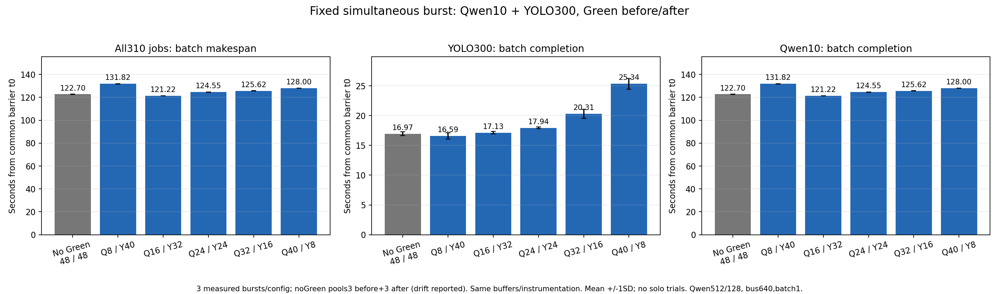
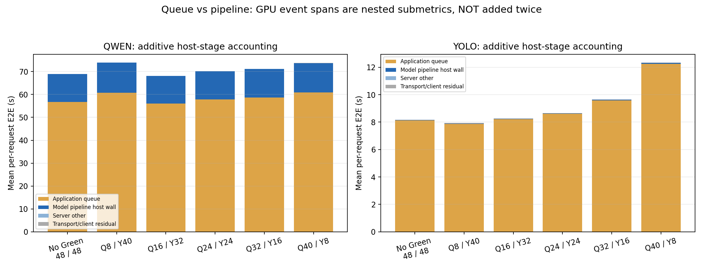

# 고정 동시 묶음 실험: Green 적용 전후와 최적 분배

2026-11-09, DGX Spark GB10(48 SM), Qwen3.5-9B BF16/YOLO26l Torch FP16.

**단독 요청은 측정하지 않았다. 모든 main trial에서 Qwen10개와 YOLO300개를 결과 수신 대기 없이 제출하고,310개 결과를 전부 받을 때까지 측정했다.** 이전 C1/solo 실험과 다른 새 protocol이다.

## 1. 결과: 총 작업 완료시간 최소는 Qwen16 / YOLO32 SM

시간의 공통 기준은 두 발신 thread barrier 해제(t0)다. 전체 완료시간은 마지막 결과 parse 완료−t0이고, 모든 trial에서 Qwen이 마지막에 끝났다. 아래는 반복 측정의 평균±1 SD이며 population CI가 아니다.

| Qwen / YOLO SM | 반복 | 전체310개 완료(s) | YOLO300개 완료(s) | 전체시간 변화(미적용 대비) |
|---|---:|---:|---:|---:|
| 미적용(각48) | 6 | 122.705 ± 0.103 | 16.968 ± 0.329 | +0.00% |
| 8 / 40 | 3 | 131.818 ± 0.177 | 16.591 ± 0.550 | +7.43% |
| 16 / 32 | 3 | 121.223 ± 0.021 | 17.132 ± 0.212 | -1.21% |
| 24 / 24 | 3 | 124.554 ± 0.068 | 17.944 ± 0.130 | +1.51% |
| 32 / 16 | 3 | 125.621 ± 0.118 | 20.305 ± 0.742 | +2.38% |
| 40 / 8 | 3 | 128.003 ± 0.088 | 25.343 ± 0.884 | +4.32% |

- 각 Green 후보3회. 미적용은 실험 앞3회+뒤3회를 별도 기록 후 합산6회. 평균 request E2E가 아니라 **전체 작업 묶음 makespan**이다.
- **엄격한 최단 전체시간:** Qwen16/YOLO32, **121.223s**. 미적용 **122.705s**보다 약 **1.482s(1.21%)** 짧았다.
- 효과는 작다.16/32에서 YOLO 완료는17.132s로 미적용16.968s보다0.164s 느렸다. 큰 종합 향상이나 완벽한 GPU 격리라고 주장하지 않는다.
- **YOLO 완료만 최소:** Qwen8/YOLO40,16.591s. 그러나 전체는131.818s로 느려진다. CV만 빨라진 것을 전체 최적이라고 부르지 않는다.
- 사전 정의한 "최단 makespan의3% 이내를 실용적 동률로 보고, 그 안에서 CV 완료가 빠른 쪽" 규칙은 **미적용**을 선택했다. 이는 통계적 동등성/SLO가 아닌 선택 heuristic이다. 목표가 총 완료시간에 엄격히 한정되면16/32가 측정상 최단이고, 작은 차이와 운영 복잡도까지 고려하면 미적용 유지도 타당하다.

[기준별 ranking/반복 통계 JSON](20261109-v1/analysis/summary.json), [trial별 component CSV](20261109-v1/analysis/trials.csv).

## 2. Queue 대기와 GPU 추론 구간은 분리했다

아래는 **한 요청당 평균**(초)이며 위의 전체 묶음 완료시간과 다른 값이다.

| 모델 / 분배 | 요청 E2E | App Queue | 모델 pipeline wall | GPU forward span(내부 지표) | 나머지 서버·통신/client |
|---|---:|---:|---:|---:|---:|
| qwen / 미적용 | 68.962 | 56.695 | 12.242 | 12.194 | 0.024 |
| qwen / 16 / 32 | 68.129 | 56.010 | 12.104 | 12.056 | 0.014 |
| yolo / 미적용 | 8.177 | 8.120 | 0.030 | 0.015 | 0.027 |
| yolo / 16 / 32 | 8.269 | 8.213 | 0.030 | 0.016 | 0.026 |

정의:
- **App Queue:** 서버 callback에서 Queue에 들어간 시점→Worker가 꺼낸 시점. DDS/client 전송 중 대기는 이 Queue로 잘못 포함하지 않았다.
- **모델 pipeline wall:** 원본 generate()/predict() 시작→선택 stream 계산 완료. CPU dispatch와 GPU 대기·전후처리 일부가 포함되는 실제 호출 구간이다.
- **GPU forward span:** 선택 CUDA Stream의 Event로 native Module.forward 앞뒤를 재서 얻었다. Qwen은 Prefill512토큰 한 번+Decode1토큰127번, YOLO는1×3×640×640 forward 한 번을 확인했다. 이벤트는 timing 밖에서 미리 초기화했으며 추가 per-token synchronize는 없다.
- GPU 이벤트 구간에는 GPU scheduling/CPU dispatch 공백 등이 들어갈 수 있어 **순수 SM/kernel busy time이 아니다.** App Queue와는 구분되지만 host pipeline 안에 중첩되는 submetric이다.
- **중복 합산 금지:** 요청 E2E=AppQueue+pipeline wall+server nonpipeline+transport/client residual. GPU span을 다시 더하지 않았다. 다른 잔여시간을 전부 네트워크나 CPU 계산 시간이라고 단정하지 않는다.
- Main에서 음수 잔여시간은0건이었다. 원시 음수 값을0으로 덮는 처리는 하지 않았다. 모델별 GPU span은 [별도 그래프](20261109-v1/plots/burst-gpu-forward.png)에 표시했다.

Qwen16/YOLO32 예시: Qwen 요청 평균68.129s 중 Queue가56.010s, pipeline이12.104s였다. YOLO는 요청 평균8.269s 중 Queue가8.213s이고 native GPU forward span은약15.69ms였다. **대량 요청에서 요청별 E2E를 GPU 추론시간으로 오해하면 안 된다.**

## 3. 전체 완료시간만으로 간섭 제거를 판단하면 안 되는 이유

모든 설정/반복에서 YOLO300개가 먼저 끝났고, **Qwen10개 중8개는 마지막 YOLO 모델 추론이 끝난 뒤에 모델 호출을 시작했다.** 이 구간은 shared host monotonic clock을 확인한 뒤 비교한 host pipeline 구간이며 GPU kernel overlap 증명이 아니다.

즉, 이 workload의 전체 약120~132초 대부분은 Qwen tail의 영향이다. Green의 단독 성능·대량 처리량을 확인하는 데 유효하지만, 전체 시간이 비슷하다고 지속적인 두 모델 간섭이 없어졌다고 결론낼 수 없다. 이전 continuous-C1 시험과 단순 수치 비교하거나, 그 결과를 이번 최적화 개선율로 합산하지 않는다.

## 4. 미적용 앞/뒤 대조군과 변동

| 대조군 | 전체 완료 평균(s) | YOLO 완료 평균(s) |
|---|---:|---:|
| 앞3회 | 122.614 | 17.285 |
| 뒤3회 | 122.796 | 16.650 |

전체 완료는 앞/뒤 약0.15% 차이였다. CV 완료는 약3.7% 차이가 있었고, 미적용과16/32의 CV 평균차이0.164s는 개별 반복 SD보다도 작다. 따라서 CV의 작은 순위 차이를 보편적인 우열로 단정하지 않는다. 반복은 후보당3회로, 더 많은 반복·다른 입력/배치/도착률까지 검증한 것은 아니다.

## 5. 고정한 실험 조건

- **동시 부하만:** 각 설정 Qwen10+YOLO300 main burst3회. 워밍업도 Qwen3+YOLO30을 동시 제출한 묶음이고 main에서 제외했다. solo phase는 없다.
- 미적용 before/after를 포함한21개 main burst, 요청 **Qwen210+YOLO6300=6510개**. 워밍업7묶음231개를 합해 **6741개**. unique ID/성공 결과를 모두 확인했다.
- 두 publisher thread를 common barrier로 해제하고, 응답을 기다리지 않고 모든 요청을 보냈다. 요청별 실제 JSON encode/publish 시작/return을 기록했다. 전달이 수학적으로 같은 순간은 아니다. Main 제출 window는약 **0.521~0.860s**였다.
- 이미지 파일 읽기/base64 준비, UUID·310개 result subscriber 생성과 초기 discovery/settle은 t0 이전. 요청별 E2E는 실제 JSON encode/publish 시작부터 해당 결과 parse까지다. batch E2E는 공통 t0부터 마지막 결과다.
- 서버 AppQueue Qwen16/YOLO512, 요청 DDS writer/reader depth512(reliable/transient-local). **미적용과 모든 Green 후보에 동일하게** 적용했다. 기존8개 Queue로300개를 보내고 유실 때문에 빨라 보이는 실험을 하지 않았다.
- Queue·DDS 용량은 신규 burst workload 지원용이다. Green 최적화만을 위한 차별 설정이 아니며, frozen baseline 파일/이미지는 수정하지 않았다.
- 동일512 input token IDs(input SHA는 prior SM sweep과 일치), stock min_new_tokens=max_new_tokens=128, greedy/cache=True. YOLO fixed bus.jpg,640×640/batch1/rectFalse. Qwen9B BF16/SDPA/native FLA/causal-conv, YOLO nativeTorchFP16. MPS/TRT/DDS latency tuning/명시적 CUDA Graph 최적화 없음.
- 실제 model.forward event 길이/개수와 native CUDA precision을 확인했다. GPU 추론 framework 자체를 patch하지 않았다.
- 기존 독립 FIFO/Worker/UUID별 결과 topic을 유지했고, 임시 domain74로 다른 요청과 격리했다. both 모델은 메모리에 상주하며 별도 Pod/replica1씩이다. 기존 GreenPair splitter에서 선택한 part(Q1/Y0) stream만 모델 추론에 사용하고 unused complement는 idle이다. 전역 물리 SM 독점 예약·메모리/스케줄링 격리를 보장한다고 주장하지 않는다.
- host/container perf_counter 구현·time namespace·offset이 같은 것을 각 설정에서 확인했다. 서로 다른 호스트의 wall clock을 빼서 Queue를 계산하지 않았다.

## 6. 실패·검증·원상복구

- 초기 local source 준비 호출에 repo import 경로가 없어 파일 생성이 실패했고, 첫 experimental Pod가 존재하지 않는 node 경로로 시작을 시도했다. import 경로를 수정해 실제 파일을 생성·검사한 뒤 다시 시작했고, **그 전에 측정 burst는 실행되지 않았다**. 기록은 [초기 launch evidence](20261109-v1/verification/initial-launch-evidence.txt)에 보존했다. 이 실패를 Green 성능/SDK 미지원으로 해석하거나 숨기지 않는다.
- startup 중 재시작한 이전 experimental YOLO Pod는 종료 grace를 기다리는 지연이 있었지만, 원래 코드/이미지·모델 수치를 바꾸어 우회하지 않았다. Ready/워밍업/입출력 검증이 끝난 뒤 main을 시작했다.
- [독립 audit](20261109-v1/verification/protocol-audit.json): 모든28개 묶음(21 main+7 warm),6741개 결과의 UUID/개수/상태/input SHA/출력128/SM/forward shape·GPU event·component 회계 통과. AppQueue overflow 없음, live publication 로그 누락 없음, 음수 잔여시간0건.
- 종료 후 원래 domain42 두 Deployment template/replicas1을 정확히 복구하고 원본 모델 실제 요청도 확인했다. [복구](20261109-v1/verification/restored.json), [health](20261109-v1/verification/health.log), [controller](20261109-v1/verification/controller-status.json).
- **124개 단위 테스트·변경 코드 Ruff/compile 검사 PASS, 동결 baseline677개 checksum PASS.** [검증 로그](verification/).
- source·환경·image/native binary/input hash, 실제 patch/Pod 스냅샷, 원시 요청·GPU timing·가용 로그·그림/CSV를 `20261109-v1/`에 보관했다. `ARTIFACTS_SHA256SUMS`로 원격→로컬 보관 무결성을 확인한다. global driver/보안/clock/GPU-sharing 정책·모델 weights/framework는 변경하지 않았다.
- [실험 코드/시간 정의/재현 설명](../../diagnostics/green_burst/README.md), [사전 평가 계약](../../docs/plans/2026-11-09-green-burst-optimization.md). AI Coding Assistant가 코드/실행/분석/문서화에 사용됐고 수치는 실제 Spark 기록에서 계산했다. 새 dependency 설치·모델 학습·외부 추론 API 사용은 없다.

## 최종 판단

**이 고정 Q10/Y300 묶음의 전체 완료시간만 최소화한다면 Qwen16/YOLO32 SM이 측정상 최단이다. 다만 이득은약1.2%이며, CV 완료까지 고려한 실용적 동률 선택은 미적용이었다.** 큰 성능 향상이나 일반적인 최적 분배를 입증한 결과는 아니다. 목표와 workload가 달라지면 최적점도 다시 검증해야 한다.
