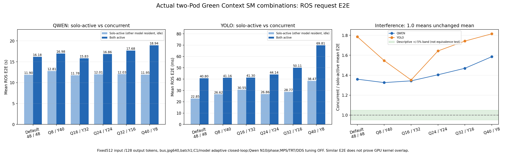
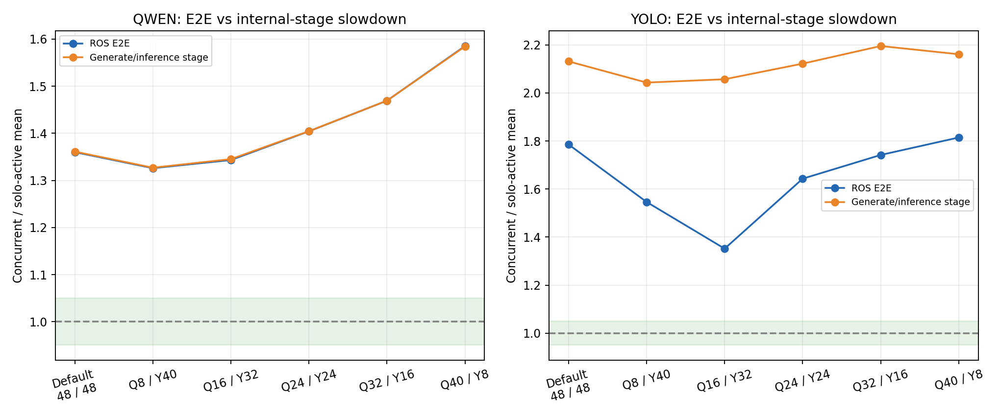

# Green Context 조합별 실제 ROS E2E: 단독 수준을 유지하는가?

2026-11-09, 단일 DGX Spark GB10, Qwen3.5-9B+YOLO26l, 별도 Kubernetes Pod/독립 FIFO/Worker.

## 결론

**이번 두 프로세스/두 Pod 구현과 부하에서는 다섯 SM 조합 모두 단독 요청 수준의 평균 E2E를 유지하지 못했다.** 사전 정의한 실용적 ±5% 범위에 두 모델 모두 들어오는 조합은 없었다. 범위는 설명용이며 통계적 동등성 검정이나 사업 SLO가 아니다.

이는 Green Context 미지원/미적용을 뜻하지 않는다. 실제 자원 수·선택 stream·요청의 GPU kernel binding을 검증했다. 단독 SM 곡선은 후보를 찾는 자료지만, 그대로 동시 서비스 성능으로 이어지는 것은 아니라는 실제 결과다.

## 1. 조합별 평균 E2E

표의 SM 순서는 **Qwen / YOLO**, 지연은 **Solo-active → Both-active**다. Solo에서도 두 모델을 메모리에 상주시켰고 한 모델에만 요청했다. 각 조합의 같은 Pod/같은 설정을 유지해 동시 요청의 영향만 비교했다.

| Qwen / YOLO SM | Qwen E2E(s), 단독→동시 | 증가율 | YOLO E2E(ms), 단독→동시 | 증가율 |
|---|---:|---:|---:|---:|
| 분할 없음(각48) | 11.895 → 16.178 | +36.0% | 22.85 → 40.80 | +78.6% |
| 8 / 40 | 12.809 → 16.983 | +32.6% | 26.62 → 41.16 | +54.6% |
| 16 / 32 | 11.783 → 15.829 | +34.3% | 30.55 → 41.30 | +35.2% |
| 24 / 24 | 12.007 → 16.861 | +40.4% | 26.86 → 44.14 | +64.3% |
| 32 / 16 | 12.032 → 17.678 | +46.9% | 28.77 → 50.11 | +74.2% |
| 40 / 8 | 11.946 → 18.939 | +58.5% | 38.47 → 69.81 | +81.5% |

- 분할 없음은 물리48 SM GPU를 두 모델이 모두 사용할 수 있는 기본 context 상태다.96 SM GPU를 뜻하지 않는다.
- 단독 그래프에서 첫 후보로 보았던 **Qwen16 / YOLO32**도 Qwen **11.783→15.829s(+34.3%)**, YOLO **30.55→41.30ms(+35.2%)**였다. "단독과 똑같다"고 볼 수 없다.
- 이 조합은 분할 없는 동시 실행 대비 Qwen 약 **-2.16%**, YOLO 약 **+1.23%** 차이였다. 즉, 현재 데이터로 큰 종합 개선이나 무간섭을 주장하기 어렵다.
- **비율만 보지 않는다.** 예를 들어 YOLO의 동시/단독 증가율은16/32에서 기본보다 작아졌지만, 그 조합의 Solo E2E 자체가30.55ms로 기본22.85ms보다 높다. 작은 상대 증가율을 그대로 절대 성능 개선으로 해석하면 안 된다.

[전체 수치 CSV](20261109-v1/analysis/comparison.csv), [계산 결과 JSON](20261109-v1/analysis/comparison.json).

## 2. 통신만의 문제인가?

추론/generate 단계도 함께 증가했다.

| Qwen / YOLO SM | Qwen generate wall(s), 단독→동시 | YOLO inference(ms), 단독→동시 | 동시 CV 실제 요청/s |
|---|---:|---:|---:|
| 분할 없음(각48) | 11.874 → 16.163 | 7.95 → 16.94 | 23.36 |
| 8 / 40 | 12.794 → 16.977 | 8.20 → 16.75 | 23.30 |
| 16 / 32 | 11.761 → 15.822 | 8.58 → 17.64 | 23.09 |
| 24 / 24 | 11.994 → 16.846 | 9.88 → 20.97 | 21.68 |
| 32 / 16 | 12.026 → 17.670 | 11.99 → 26.32 | 19.20 |
| 40 / 8 | 11.942 → 18.922 | 20.81 → 44.97 | 13.91 |

16/32 조합에서:
- Qwen generate **11.761→15.822s(+34.5%)**, TPOT **90.29→121.52ms/token**.
- YOLO inference **8.58→17.64ms(+105.7%)**, processing **13.34→33.58ms**.
- 평균 Queue 대기는 Qwen **0.68→0.88ms**, YOLO **0.17→0.22ms**로, 수 초/수십 ms 증가를 설명할 정도가 아니다.

따라서 해당 증가를 전부 ROS 통신이나 애플리케이션 Queue 탓으로 돌릴 수 없다. 다만 generate/inference의 synchronized host span은 순수 GPU kernel busy time이 아니므로, 이 자료만으로 CUDA context 직렬화·메모리 대역폭·cache·dispatch 중 어느 원인인지 확정하지 않는다.

## 3. p95가 오히려 줄어드는 경우의 주의점

16/32의 YOLO p95 E2E는 단독98.03ms→동시50.22ms로 줄었다. 그러나 평균 E2E와 inference는 둘 다 악화됐다. 기존 reliable per-request DDS endpoint의 초기 handshake/ACK tail과 부하별 분포 변화가 섞이므로, **p95 하나가 개선됐다고 GPU 간섭이 없다고 판단하지 않는다.**

DDS 설정은 이번에 바꾸지 않았다. 원시 E2E·서버 timing·후행 ACK 로그를 별도로 보관했다. 이 현상의 정확한 기여도 분해를 끝냈다는 뜻은 아니다.

## 4. 측정 조건

- 동일512 입력 token IDs와128 출력 토큰. 자연어 text를 기존 chat template/tokenizer에 넣어 이전 standalone SM 실험과 **input SHA까지 일치**함을 확인했다. 출력은 experimental copy에서 원본 generate()의 min_new_tokens=max_new_tokens=128, greedy/cache=True로 고정했다.
- 고정 bus.jpg,640×640/batch1/rect=False, 원본 YOLO Torch FP16. Qwen 원본9B BF16/SDPA/native FLA/causal-conv. 모델 학습·framework patch·MPS·TensorRT·DDS tuning·graph 최적화 없음.
- 각 설정 Qwen-only10회, YOLO-only300회, Both에서 Qwen10회+Qwen 종료까지 YOLO C1 반복. 각 단계 warmup3/model 제외·보존. **adaptive closed-loop C1/model**로, 고정 offered rate 실험은 아니다. 조합에 따라 실제 CV 요청률이 다르므로 across-case LLM 차이를 모두 순수 SM 분할 효과로 해석하지 않는다.
- E2E: client JSON 인코딩/publish 직전→해당 UUID의 결과 parse 완료. 초기 discovery, 이미지 파일 읽기/base64 준비, 그림 그리기/저장은 제외. 이전 standalone 곡선의 CUDA-event model.forward 시간과 같은 지표가 아니다.
- 임시 ROS domain73에서 실험해 기존 domain42 요청과 섞이지 않게 했다. localhost discovery/reliable ACK/기존 topic·UUID·Queue8·독립 Worker 및 replicas1 유지. 종료 후 domain42 원본 배포로 복구했다.
- Qwen N10의 p95는 탐색용 기술 통계이며, population tail/정밀 동등성 검정이나 높은 사용자 동시성 검증이 아니다. 이미 정의되지 않은 사업 SLO를 사후에 만들어 충족했다고 주장하지 않는다.

## 5. 실제 Green Context가 적용됐는가?

- 두 별도 worker는 같은 CUDA13 `GreenPair(YOLO_SM)` split을 생성하고, YOLO는 part0, Qwen은 part1을 사용했다. actual SM 수·stream owner·현재 PyTorch stream을 검증했다.
- 각 프로세스에 두 Green 객체가 생성되지만 모델 GPU 추론에는 선택한 한 stream만 쓴다. 나머지 complement는 idle이다. **이 구현 조건의 결과이며, 모든 가능한 Green 구현의 성능 한계라고 주장하지 않는다.**
- startup에서 native SM-ID 집합을 샘플링했다. 서로 겹치지 않는 관측과 correct resource count는 확인하지만, 서로 다른 프로세스의 전역 물리 SM 소유권/독점 예약을 보장한다고 주장하지 않는다. 메모리·cache·스케줄링 등 GPU 전체 자원은 따로 격리하지 않았다.
- Q16/Y32의 별도 profiling pilot에서 실제 ROS 요청의 Qwen **251,766개 kernel**, YOLO **845개 kernel**이 모두 nonzero CUPTI greenContextId로 기록됐다. [검증 JSON](20261109-v1/verification/serving-green-kernel-coverage.json). 이 profiled request latency는 main 표에 섞지 않았다.
- 위 pilot은 request path binding 검증이다. 세 번째 warmup request를 캡처한 범위이지, 실제 동시 단계의 두 프로세스 GPU timeline overlap을 입증하는 실험이 아니다. **비슷한 E2E만으로 GPU 병렬 실행도 단정할 수 없다.**

## 6. 무엇을 알았고, 무엇이 남았나

확인한 것:
1. 실제 모델에 SM 제한을 적용하고 API E2E를 측정할 수 있다.
2. 모든 시험 분배에서 동시 요청의 평균 지연 증가가 남았다.
3. 같은 모델의 standalone 자원 민감도와 두 서비스의 간섭/종단 지연은 다른 문제다.
4. GPU 단계·평균·p95·처리량·Queue를 함께 봐야 한다.

미확정:
- 지연 증가의 GPU 스케줄링/메모리/cache 기여도, 실제 concurrent main 단계의 kernel overlap.
- 다른 Green 생성/수명/프로세스 구조의 결과, 다른 입력 길이/출력/이미지, 다른 제공 부하/사용자 수.
- 따라서 현재만으로 "Green은 안 된다", "MPS가 필수다", "고정 SM 독점 격리가 됐다" 중 어느 것도 단정하지 않는다.

## 7. 기록·재현·원상복구

- 총19개 benchmark run(18개 main 단계+1개 profile pilot), 워밍업 포함 **23,446개 요청**의 UUID·상태·SM/입력/출력 고정 계약·이미지 detection fidelity 감사 PASS. [audit](20261109-v1/verification/protocol-audit.json). Main 표는 pilot을 제외한다.
- 모든 측정 요청의 live publication 로그 coverage를 대조해 누락을 검사했다. 후행 ACK/로그 회전 문제를 피하도록 **부하 전부터 live 수집**했다. [audit 요약](20261109-v1/verification/protocol-audit.log).
- 원본 template/replicas1을 정확히 복구하고 domain42의 실제 Qwen·YOLO 요청도 성공: [복구](20261109-v1/verification/restored.json), [health](20261109-v1/verification/health.log), [최종 controller 상태](20261109-v1/verification/controller-status.json).
- **120개 단위 테스트·변경 코드 Ruff/compile 검사 PASS, 동결 baseline677개 checksum PASS.** [검증 로그](verification/).
- Source/image/native-binary/input/weights와 가용 trace/원시 request/timing/log는 `20261109-v1/`에 보관. `ARTIFACTS_SHA256SUMS`로 원격→로컬 전송 무결성을 확인한다. baseline source/image/weights/plugin 정책은 바꾸지 않았다.
- [코드·구현 한계·재현 방법](../../diagnostics/green_e2e/README.md), [사전 계획](../../docs/plans/2026-11-09-green-e2e-combinations.md). AI Coding Assistant가 구현·실행·분석·문서화를 지원했고 수치는 실제 Spark 파일에서 계산했다. 외부 inference API나 새 package 설치는 없다.
