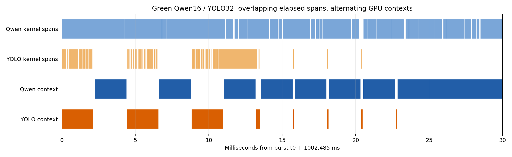

# Green Context 병렬 실행 확인 — 2026-11-10

## 결론
현재 **별도 두 Pod/프로세스, MPS 미사용, Green Qwen16/YOLO32** 구성에서 수집한 GPU 컨텍스트 전환 기록은 **두 프로세스가 번갈아 GPU에 상주하는 실행**을 보여준다. SM 사용 범위 제한과 실제 두 모델의 동시 SM 실행은 같은 사실이 아니다. 이미 각각 Green 전용 non-blocking CUDA stream을 사용하므로 단순히 stream 하나를 추가하는 것이 해결책이라고 볼 수 없다.

Qwen이 YOLO 전체 종료 뒤 처음 실행되는 구조도 아니다. CPU 모델 호출은 겹친다. 다만 GPU에서 두 컨텍스트가 교대한다. 후속 Qwen 요청의 늦은 시작에는 Qwen 자체 FIFO 대기가 포함된다.

## 실제 측정
같은 Spark에서 두 모델 모두 상주시킨 상태로 Qwen10/YOLO300 요청을 함께 발행했다. Qwen 입력512/출력128토큰, YOLO bus 이미지640/batch1. 단독 부하는 실행하지 않았다. 워밍업 후 약20초를 Nsight Systems로 기록했으며 각 burst의310개 결과를 모두 수신했다.

| 관측 | 추가 Green 캡처 결과 |
|---|---:|
| 양쪽 공통 분석 구간 | 20,029.659 ms |
| Qwen 컨텍스트 상주 합계 | 16,893.752 ms |
| YOLO 컨텍스트 상주 합계 | 2,794.888 ms |
| Qwen / YOLO 상주 구간 수 | 3,019 / 3,015 |
| 두 프로세스 컨텍스트 상주 겹침 | **0 ms** |
| 반면 커널 start–end 구간 겹침 | 2,985.771 ms |
| Qwen 커널 구간 중 YOLO 상주와 겹친 시간 | 2,482.610 ms |

`RESTORE_START → SAVE_END`를 컨텍스트 상주 구간으로 취급했다. 이는 복원/저장 경계도 포함하므로 순수 연산 시간은 아니다. 전체12,083개 전환 이벤트의 내부 sequence 누락은0이며, 마지막 미종결 상주 구간은 공통 분석 범위 밖이다. PID는 모델 보고서의 컨테이너 PID와 혼동하지 않고 호스트의 해당 Python 명령으로 검증했다(Qwen875217/YOLO875036). 원시 전환 이벤트와 PID는 SQLite에 보존했다.



위쪽 옅은 막대는 커널의 시작부터 종료까지 경과 구간이다. 아래쪽 진한 막대는 GPU 컨텍스트 상주 구간이다. **위쪽 겹침을 실제 동시 연산이라고 읽으면 안 된다.** Qwen의 커널 구간이 이어지는 동안에도 아래쪽 GPU 컨텍스트는 YOLO로 바뀌었다가 복귀한다.

장치 전체 SM Active 지표는 공통 구간 최대67%였다. 이는32/48SM에 대응하는 수준이지만, 장치 전체 샘플 지표이므로 단독으로 프로세스별 동시 실행 여부나 메모리 병목을 증명하지 않는다.

## 오판 방지 및 대조 실험
- 별도 최초 캡처에서도 Green 커널 구간은2,881.950ms 겹쳤으며, 최적화 없는 default도2,215.968ms 겹쳤다. **두 수치 모두 물리적 동시 실행의 증거로 사용하지 않는다.**
- 동일 프로세스 두 Green의 합성 제어 실험: 직렬 구간 겹침0ms, 병렬 구간 겹침191.106ms. 분석기가 겹침을 검출할 수 있는지 확인하는 도구 대조군일 뿐이며, 실제 Qwen/YOLO 성능이나 이전의191ms 모델 추론 결과가 아니다.
- 모델 커널은 해당 Green ID와 stream에 연결되어 있었다. Green 바인딩 실패와 프로세스 간 GPU 스케줄링 문제를 구분한다.
- 독립 보고서의0초를 단순 정렬하지 않았다. CPU NVTX mark와 CLOCK_MONOTONIC bracket을 맞춰 공통 시간축으로 변환했다. 추가 scheduler 캡처76개 anchor의 경험적 fit/bracket 오차58.232us. 이 값은 하드웨어 시계 정확도 보장이 아니다. 같은 scheduler 보고서 내 상주 구간의 교대 관계는 모델 보고서 간 정렬에 의존하지 않는다.

## 해석과 다음 단계
이번 증거는 **현재 두 프로세스 구성에서 의도한 동시 공간 분할 실행을 확인하지 못했고 교대 실행을 관측했다**는 결론이다. 모든 Green Context/GB10 환경이 항상 직렬이라는 일반화는 하지 않는다. 각 프로세스 내부에서 분할한 자원이 전역적으로 조정된 단일 partition 계약이라는 주장도 하지 않는다.

다음 검증 후보는 (1) 한 프로세스 안에서 두 모델/별도 Green stream 실행, (2) 별도 프로세스를 유지하는 MPS 실행이다. 각각 동일한 GPU context trace로 실제 동시 실행을 검증한 뒤에만 성능을 비교해야 한다. 이번 작업에서는 해당 구조 변경을 적용하지 않았다.

NVIDIA도 분리된 SM 자원만으로 동시 진행을 보장하지 않는다고 설명한다: [CUDA Green Context API](https://docs.nvidia.com/cuda/archive/13.0.0/cuda-driver-api/group__CUDA__GREEN__CONTEXTS.html). GPU 타임라인/컨텍스트/메트릭 의미는 [Nsight Systems User Guide](https://docs.nvidia.com/nsight-systems/UserGuide/index.html)를 참고했다.

## 보존 및 복원
- 원시 보고서/SQLite/시계 anchor/요청 결과/실패 기록: `20261110-v1/` (약845MB).
- 집계: `20261110-v1/analysis/scheduler-summary.json`, `summary.json`.
- 임시 root 수집 컨테이너는 SYS_ADMIN만 추가해 GPU context/metrics를 수집했다. 모델 Pod UID1000 유지, 드라이버 보안 설정 변경 없음. 첫 추가 수집은 출력 디렉터리 권한 문제로 실패했고 보존 후 별도 이름으로 재시도했다.
- 프로파일링은 성능에 영향을 주므로 이번 지연시간은 기존 비프로파일링 최적화 순위와 합치지 않는다.
- 원래 Deployment template 일치, replicas1/1 복원, 정상 ROS domain42 실제 요청 결과 PASS. 임시 수집 컨테이너 제거 확인.
- frozen baseline 브랜치/이미지/모델 소스 수정 없음. Git push 없음.

## 재분석
분석은 프로젝트Python3.12 venv, 그래프는 기존 matplotlib가 설치된 시스템Python을 사용한다. 신규 의존성 설치 없음.

```bash
.venv/bin/python diagnostics/kernel_overlap/scheduler_analysis.py --root results/kernel-overlap/20261110-v1
python3 diagnostics/kernel_overlap/scheduler_analysis.py --root results/kernel-overlap/20261110-v1 --plot-only
.venv/bin/python -m unittest discover -s tests -q
```
