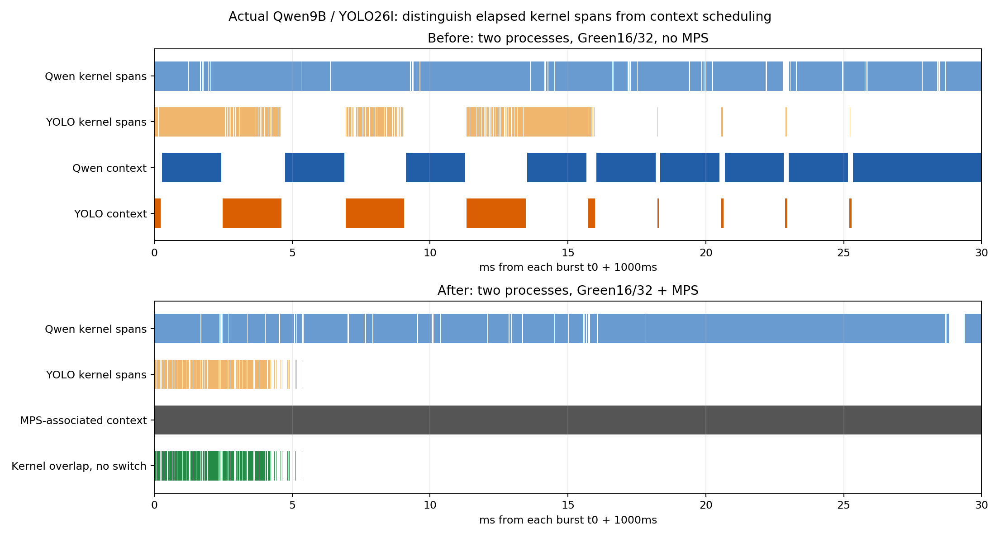

# 별도 Qwen/YOLO 파드의 GPU 병렬 실행 검증

## 변경
기존 두 Pod에 **같은 UID의 MPS 서버 연결**을 추가했다. Green Context Qwen16/YOLO32 및 독립 CUDA stream은 유지했다. 별도 모델/queue/ROS 요청·결과 프로토콜과 원본 추론 라이브러리는 유지한다.

이전 두 프로세스 구성은 GPU 컨텍스트 교대를 관측했다. 이번에는 MPS에 실제 모델 프로세스2개가 연결된 것을 확인한 뒤, 동일한 Qwen10/YOLO300 동시 burst를 프로파일링했다. 입력512/출력128토큰, bus640/batch1 조건은 동일하다. 워밍업33개와 본 요청310개 모두 정상 결과를 받았다. 별도 단독 부하는 실행하지 않았다.

## 증거
| 항목 | Green16/32, MPS 없음 | Green16/32 + MPS |
|---|---:|---:|
| 공통 분석 구간 | 20.030s | 20.020s |
| 전체 수집 GPU context-switch 이벤트 | 12,083 | 25 |
| 장치 전체 SM Active 최대 | 67% | 100% |
| MPS 관련 GPU 컨텍스트가 교대하지 않는 구간의 두 모델 커널 겹침 | 해당 없음 | **3,395.953ms** |
| 모델 시계 오차로 커널 구간을 축소한 보수적 겹침 | 해당 없음 | **343.621ms** |

이벤트 수는 각 전체 수집 세션 기준이므로 초당 전환율/성능 개선율로 비교하지 않는다. 커널 경과 구간 자체는 기존 no-MPS에서도 겹쳤지만 컨텍스트 교대 때문에 실제 동시 실행이라고 읽을 수 없었다. 이번에는 **전환 없는 MPS 관련 GPU 컨텍스트 상주 구간에서도 실제 두 모델의 커널 구간이 겹친다.** SM Active100% 관측도 함께 확인했다. 단, 장치 전체 GPU metric을 특정 프로세스의 사용률로 해석하지 않는다.



### 분석상의 주의
- MPS membership: server915489, 실제 모델 client930827/930900. 드라이버의 GPU context 이벤트는 server PID가 아닌 해당 **client PID**로 귀속됐다. server PID만 필터링하면0ms라는 잘못된 분석이 나오므로 실제 이벤트와 membership을 함께 사용한다.
- 공통 시계는 NVTX mark와 host CLOCK_MONOTONIC bracket으로 맞췄다. scheduler72개 anchor의 경험적 fit/bracket 오차60.914us, 모델측 분석 오차Q22.040us/Y35.058us. 각 하드웨어 컨텍스트 전환 경계에서200us를 제외하고, 모델 커널 구간도 각 시계 오차만큼 축소한 뒤 겹침을 다시 확인했다. 하드웨어 시계의 절대 정확도 보장이 아니다.
- 전체 전환 이벤트의 내부 sequence 누락0. 끝이 없는 마지막 구간은 분석 창 밖이다. 전환 경계 제외는 각 개별 컨텍스트 구간에 적용하여 여러 MPS client의 구간을 합치면서 전환을 숨기지 않는다.
- 실제 모델 커널의 Green ID/stream 연결도 확인했다. 각 프로세스가 출력한 SM ID 번호만으로 **전역적으로 배타적인16/32SM 예약**까지 증명했다고 주장하지 않는다.
- 이는 이번 GB10/driver580.173.02/CUDA13의 실제 캡처에서 동시 진행을 뒷받침하는 증거다. 모든 kernel 쌍이 항상 함께 실행되거나 모든 시점의 동시 instruction issue를 측정했다는 뜻은 아니다.

## 일반 서빙 배포
프로파일링 진단 종료 후 원본 파드 설정 복원 및 domain42 실제 ROS 결과 PASS를 확인했다. 이후 검증된 연결을 일반 서빙용 설정으로 적용했다. 일반 서빙은 profiler/실험용 출력 길이 강제/실험용 queue 크기를 사용하지 않는다.

최종 배포 상태와 실제 ROS health 근거는 `serving-runtime/verification/deployment-status.json`, `health.log`, `health/`에 보관한다. 실행 방법/선택 근거/복구 방법은 [운영 문서](../../k8s/mps-green/README.ko.md)를 참고한다.

## 제한
이번 요청의 목적은 병렬 실행 문제 해결이다. 프로파일링은 실행 시간을 바꾸므로 본 캡처에서 얻은 Qwen126.029s/YOLO13.592s 전체 완료 시간을 기존 비프로파일링 성능 표에 섞거나 개선율로 제시하지 않는다. **16/32가 새 구조에서도 최적이라는 결론은 내리지 않는다.** 최적 SM 조합/E2E 비교는 새 병렬 실행 구조에서 별도로 재측정해야 한다.

첫 실행은 새 실험 폴더의 workload.json 누락으로 warmup 발행 전에 실패했다. 모델 오류가 아니며 원본 복원 후 입력 파일을 보완하고 `r1`이라는 별도 이름으로 재실행했다. 실패 로그도 보존했다. 분석 중 server PID만 기대했던 필터의 잘못된 가정 역시 원시 client 귀속 기록을 근거로 수정했다.

## 재분석
```bash
.venv/bin/python diagnostics/mps_concurrency/analyze_case.py --root results/mps-concurrency/20261110-v1
python3 diagnostics/mps_concurrency/plot.py
.venv/bin/python -m unittest discover -s tests -q
```

원시 Nsight 보고서/SQLite/clock anchors/요청 결과/소스는 `20261110-v1/`에 있다. 이전 baseline 및 Green 실험 데이터는 수정하지 않았다. Git push/새 의존성 설치/드라이버 보안 설정 변경 없음.

공식 근거: [NVIDIA MPS 구조 및 역할](https://docs.nvidia.com/deploy/mps/latest/index.html), [Green Context의 동시 실행 제한](https://docs.nvidia.com/cuda/archive/13.0.0/cuda-driver-api/group__CUDA__GREEN__CONTEXTS.html), [Nsight Systems 타임라인/메트릭](https://docs.nvidia.com/nsight-systems/UserGuide/index.html).

일반 서빙 첫 배포에서는 health 클라이언트용 실행 명령이 `PYTHONPATH`를 덮어써 ROS `rclpy` import가 실패했다. 실제 두 모델의 MPS 연결은2개 확인됐지만 완료로 처리하지 않고 원복했다. ROS 환경을 보존하는 `launch_deploy.sh`와 배포 전 import preflight를 추가하고 회귀 테스트로 고정했다. 최초 오류/원복 로그와 재시도 로그는 `serving-runtime/verification/`에 별도로 남긴다.

MPS daemon을 정상 종료해도 Unix socket 파일은 남을 수 있었다. 재배포 시 socket 존재만으로 살아 있는 daemon이라고 판단하던 검사와 새 daemon 시작 직후의 readiness race를 수정했다. 현재는 private 디렉터리의 daemon PID/명령과 실제 제어 응답을 함께 확인한다. 이 과정의 실패 상태/정상 원복 로그도 보존했으며, 잘못된 검증 실행을 성공 결과에 포함하지 않았다.

**최종 확인(2026-11-10 01:23 KST): 일반 서빙 배포 PASS, 두 파드1/1 Ready, user MPS 서비스 active/enabled, server968638에 실제 모델 client968529/968707 연결, 기존 native ROS health PASS.** 현재 이 병렬 실행 설정을 유지한다. 로컬 전체137개 테스트, Ruff/compile/shell syntax 및 frozen baseline677개 파일 무결성 검사 통과. 원격 원시 trace6개를 로컬로 복사하고 SHA256 일치 확인.
