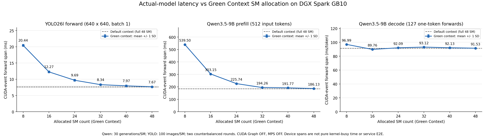
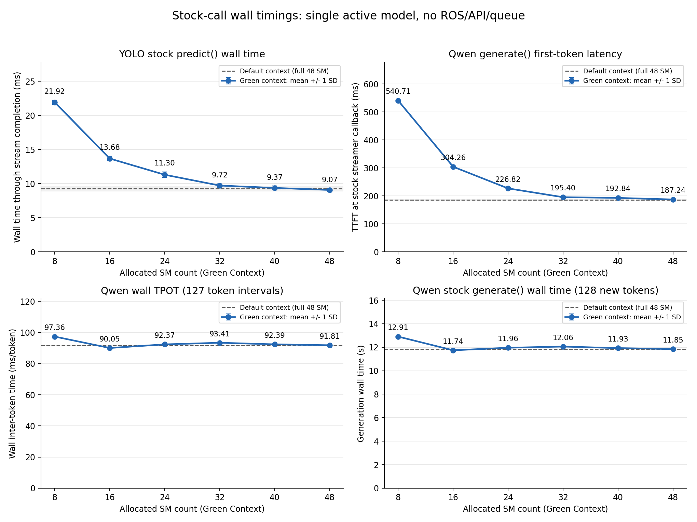

# 실제 Qwen·YOLO의 Green Context SM 민감도 측정

2026-11-09, 단일 DGX Spark GB10(48 SM, driver580.173.02, CUDA13). **실제 모델과 고정 입력으로 SM 배정량만 바꾸는 실험**이다. 합성 반복 연산 테스트가 아니며, 두 모델 동시 실행이나 ROS 서비스 E2E 개선을 측정한 것도 아니다.

## 1. 핵심 그래프

- 왼쪽: YOLO26l 원본 PyTorch FP16 모델 forward.
- 가운데: Qwen3.5-9B BF16,512토큰 Prefill의 첫 forward.
- 오른쪽: Qwen의127개 one-token Decode forward의 평균 시간(ms/token).
- 파란선은 Green Context의 실제 배정 SM 수, 오차 막대는 반복 측정의 **±1 SD**(신뢰구간 아님). 회색 점선은 Green이 아닌 일반 primary context의 full48 SM 기준이다.
- CUDA 이벤트는 native model.forward 앞뒤에 기록했다. 시간 범위에 GPU의 대기/CPU dispatch 공백이 포함될 수 있으므로 **순수 kernel busy time이 아니다.** 모든 input/output shape·token count를 검사했다.

## 2. 측정 결과

각 SM에서 Qwen30회, YOLO100회 측정. 아래 CUDA-event 단계 시간과 generate wall은 서로 다른 지표다.

| Green SM | YOLO forward(ms) | Qwen Prefill(ms) | Qwen Decode(ms/token) | Qwen 전체128토큰 생성 wall(s) |
|---:|---:|---:|---:|---:|
| 8 | 20.44 | 539.50 | 96.99 | 12.906 |
| 16 | 12.27 | 303.15 | 89.76 | 11.741 |
| 24 | 9.69 | 225.74 | 92.09 | 11.957 |
| 32 | 8.34 | 194.26 | 93.12 | 12.058 |
| 40 | 7.97 | 191.77 | 92.13 | 11.927 |
| 48 | 7.67 | 186.13 | 91.53 | 11.847 |

별도 일반 full-GPU reference 평균: YOLO forward **7.65ms**, Qwen Prefill **184.84ms**, Decode **91.56ms/token**, 생성 wall **11.847s**. Green48과 가까워서 full48 reference도 구분해서 공개한다.

[평균·SD·중앙값·p95·라운드별 평균 CSV](20261109-v2/plots/sm-latency-summary.csv), [분석 JSON](20261109-v2/plots/analysis.json).

## 3. 분석

### YOLO:32 SM 이후 추가 SM의 이득이 작아진다
- 8→32 SM: **20.44→8.34ms**, 약59.2% 단축.
- 32→48 SM: **8.34→7.67ms**, 약0.67ms 추가 단축.
- full48 대비32 SM의 forward 지연 증가는 **8.7%**다. 이 입력에서는 최대 성능의 근처까지 가는 데 반드시48 SM이 필요한 것은 아니다.
- 이것은 eligibility32/48의 결과이지 GPU 전력·메모리·전체 자원을33% 절감했다는 뜻은 아니다.

### Qwen Prefill:SM 감소에 민감하고 약32 SM 부근부터 완만해진다
- 8 SM **539.50ms**,16 SM **303.15ms**,32 SM **194.26ms**,48 SM **186.13ms**.
- full48 대비32 SM은 **4.4%** 느리지만,16 SM은 **62.9%** 느리다.
- 입력을 한 번에 처리하는 이 단계에는 Decode와 다른 자원 배분 기준이 필요하다.512토큰 입력 하나의 결과라 긴/짧은 입력에 그대로 일반화하지 않는다.

### Qwen Decode:이 조건에서는 SM 수에 둔감하다
- 8 SM **96.99ms/token**,48 SM **91.53ms/token**: 배정량은6배 차이지만 Decode 시간 차이는 약**6.0%**다.
- 16 SM은 **89.76ms/token**으로 이번 측정에서는 full48보다 약**1.9% 짧았다**. 두 라운드에서도 유사했지만, 모든 모델/배치/입력에서16 SM이 항상 최적이라는 결론은 아니다.
- 원인이 memory bandwidth/latency, cache, kernel geometry, CPU dispatch 중 무엇인지 이 곡선만으로 특정할 수 없다. SM 수를 늘린다고 항상 단조롭게 빨라지지는 않는다는 **관측 결과**로 남긴다.

### 전체 생성 시간만 보면 Prefill 차이를 놓칠 수 있다
- 16 SM의 전체 생성은 **11.741s**,48 SM은 **11.847s**로 비슷했다.
- 그러나 첫 토큰 시간(TTFT)은16 SM **304.26ms**,48 SM **187.24ms**였다. 총 시간 대부분을 Decode가 차지해 Prefill 차이가 가려지는 사례다.
- 따라서 "전체 생성이 비슷하다"와 "첫 응답도 비슷하다"는 같은 말이 아니다.

## 4. Wall timing 추가 그래프

- YOLO: CPU preprocessing/postprocessing을 포함하는 원본 predict() 호출 시간이며, 선택 stream의 완료까지 기다렸다. JPEG 파일 읽기·decode, ROS/Base64/Queue, 결과 그림 저장은 제외했다.
- Qwen: 원본 TokenClock의 generate TTFT / wall TPOT와 전체 generate() 시간을 따로 기록했다. 현재 ROS 서비스의 client streaming TTFT를 뜻하지 않는다.
- [SVG 원본:단계별](20261109-v2/plots/sm-latency-model-stages.svg), [SVG 원본:wall](20261109-v2/plots/sm-latency-wall.svg).

## 5. 무엇을 다음 동시 실험 후보로 볼 수 있나

예를 들어 **YOLO32 / Qwen16 SM**은 단독 곡선에서 검토할 가치가 있다. YOLO의 forward 손실은8.7%이고 Qwen의 전체 생성은 비슷하지만 Prefill/TTFT 손실이 있다. 반대로 TTFT가 더 중요하면 Qwen32 / YOLO16도 별도 후보이며, 이때 YOLO forward는12.27ms로 증가한다.

이는 **후보 선정 근거일 뿐 추천 배포 확정이 아니다.** 각 곡선은 단독 실행이며, 두 프로세스의 동시 진행, 서로 겹치지 않는 물리 SM의 전역 예약, memory bandwidth 간섭, Queue/API 포함 E2E를 입증하지 않았다. 남는 SM을 다른 모델이 실제로 함께 활용할 수 있는지는 다음 실제 동시 실행 실험으로 확인해야 한다. 이번에 MPS/TensorRT를 섞거나 예전 MPS 결과와 수치를 합산하지 않았다.

"full48보다10% 이내" 규칙을 단순 설명용으로 적용하면 표본 중 YOLO forward와 Qwen Prefill은32 SM, Decode는8 SM이 최소였다. **사후 성능 분석용 지표이지 사업 SLO가 아니다.**

## 6. 실제 실험 조건과 검증

- 원본 서비스 두 Pod를 잠시0으로 내려 다른 AI 추론이 GPU에 들어오지 않게 한 뒤 모델별로 순차 실행했다. 일반 desktop context는 끄지 않았다. GPU clock을 고정하거나 driver/전역 보안 설정을 변경하지 않았다.
- SM8/16/24/32/40/48. CUDA13 Driver API의 최소8/정렬8을 조회했고,48도 실제 Green Context로 생성했다. requested/actual SM 수, stream owner, native SM-ID sample을 모두 확인했다.
- Qwen 입력은 chat prefix/suffix를 보존한 정확한512 token IDs, batch1. min_new_tokens=max_new_tokens=128, greedy/use_cache=True. 조건별 출력 길이를 맞추기 위해 의도적으로 early EOS를 막았다. 모델/프레임워크 코드는 수정하지 않았다. 이번 main과 일반 reference의190회 측정에서는 출력 token-ID hash도 모두 일치했다. 그렇다고 모든 입력의 문자열·의미 품질 동일성을 보장하는 것은 아니다.
- Qwen 각 생성에서 실제 forward 입력512 한 번+1토큰127번, 생성128토큰을 검사했다. 입력 IDs와 SHA는 manifest에 보관했다. Decode의127개 시간 평균을 한 생성의 표본으로 취급했다(3810개 독립 표본으로 부풀리지 않음).
- YOLO 고정 bus.jpg, 원본 PyTorch CUDA FP16,640×640/batch1/rect=False.600개 측정의 detection count/class/fidelity gate 모두 통과. 워밍업까지 포함한 최소 matched IoU **1.000000**, 최대 confidence 차이 **0.000000**. 단일 이미지 검증이며 COCO mAP 결과가 아니다.
- 각 SM에서 Qwen15회/YOLO50회씩 두 라운드. 순서 `[24,40,48,32,8,16]`과 역순. 각 point/round의 warmup3/10은 제외하되 raw에 보존했다. 일반 full-GPU reference는 앞뒤 Qwen5회/YOLO50회씩 따로 측정했다.
- 일반 reference의 Qwen generate wall은 앞11.841s/뒤11.854s, YOLO forward는 앞7.628ms/뒤7.665ms였다. 주 단계/wall metric의 round 평균 차이 최댓값은 Qwen약0.32%, YOLO약3.95%였다. 이는 정밀한 population CI나 장기 안정성 보장이 아니다.
- point 시작/끝 snapshot에서 Qwen SM clock은2405MHz로 기록됐다. clock을 lock하지 않았고 연속 관측도 아니므로16 SM의 작은 개선 원인을 clock/cache 등으로 단정하지 않는다. 온도·power snapshot도 raw에 남겼지만 에너지 효율 결과로 사용하지 않는다.

### 실제 커널이 Green으로 갔는가?

성능 측정과 별도의 Nsight Systems 프로파일에서8/48 SM 양 끝을 검증했다.
- YOLO: 각 조건 **845개 커널 모두 nonzero greenContextId**.
- Qwen: 각 조건 **251,766개 커널 모두 nonzero greenContextId**.
- [YOLO CUPTI 검증](20261109-v2/verification/pilot-yolo-coverage.json), [Qwen CUPTI 검증](20261109-v2/verification/pilot-qwen-coverage.json).
- 중간 SM 조건에는 같은 어댑터의 native resource/stream 검사와 실제 forward의 현재 PyTorch stream 검사를 적용했다. 중간 네 조건까지 개별 Nsight trace를 했다는 뜻은 아니다. 프로파일링으로 늘어난 시간은 곡선에 사용하지 않았다.

참고한 원본 그림은 RTX5090/CUDA Graph ON/pi0의 다른 모델·입력이다. 우리는 GB10/stock eager, CUDA Graph 최적화 없음이므로 **절대 지연시간을 원본 그림과 직접 비교하지 않는다.**

## 7. 보존·실패 기록·원상복구

- main: Green 측정 Qwen180+YOLO600, default 측정10+100, 워밍업42+140. 총**1072회 실제 모델 호출**, 그중**890회 측정**. fixed work/shape/timing/stream/resource 감사 PASS: [audit](20261109-v2/verification/main-audit.json).
- 첫 v1 pilot은 diagnostic guard가 Transformers dispatcher wrapper의 module을 직접 검사해 native kernel 부재로 잘못 판단했다. 원래 서비스의 `inspect.getclosurevars(...).nonlocals['implementation']` 검사로 맞추고 회귀 테스트했다. 라이브러리 설치나 framework patch로 우회한 것이 아니다. 실패한 시도와 성공한 원상복구 기록은 `failed-20261109-v1/`에 보존하며 main 그래프에 섞지 않았다.
- 원본 두 Deployment의 template/replica1을 정확히 복구했고 실제 ROS 요청도 성공했다: [복구](20261109-v2/verification/restored.json), [health](20261109-v2/verification/health.log), [controller](20261109-v2/verification/controller-status.json).
- CUDA 어댑터·모델 runner·커널 검증·plot 코드: [실험 소스/재현 설명](../../diagnostics/sm_sweep/README.md). [사전 계획](../../docs/plans/2026-11-09-green-sm-sweep.md).
- 원시 stage/event 샘플·input IDs·fidelity·resource·센서·환경·소스 hash·Nsight 보고서/SQLite는 `20261109-v2/`에 있다. `ARTIFACTS_SHA256SUMS`로 원격→로컬 보관 무결성을 검증했다. 원본 baseline의 source/이미지/weights/클러스터 GPU-sharing 정책을 바꾸지 않았다.
- **114개 단위 테스트, 변경 코드 Ruff/compile 검사, 동결 baseline677개 checksum 검사 PASS.** [검증 로그](verification/).
- AI Coding Assistant가 실험 코드/설정/실행/분석/문서화를 지원했다. 모든 수치는 실제 Spark 파일에서 집계했다. 새 dependency 설치, 모델 학습, 외부 추론 API 사용은 없다.

## 결론

**실제 모델에서도 Green Context의 SM 배정량에 따른 지연 곡선을 확인했다. YOLO·Prefill에는 약32 SM 부근의 완만해지는 구간이 있었고, 이 Qwen Decode는8~48 SM 사이의 민감도가 작았다.** Green Context를 성능 불량으로 배제할 근거가 아니라, 다음 동시 실행 배분을 설계할 수 있는 근거다. 다만 단독 곡선만으로 동시 서비스 개선을 약속하지 않는다.
