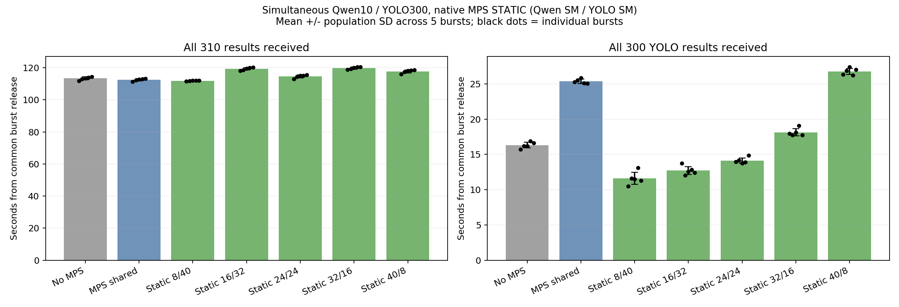
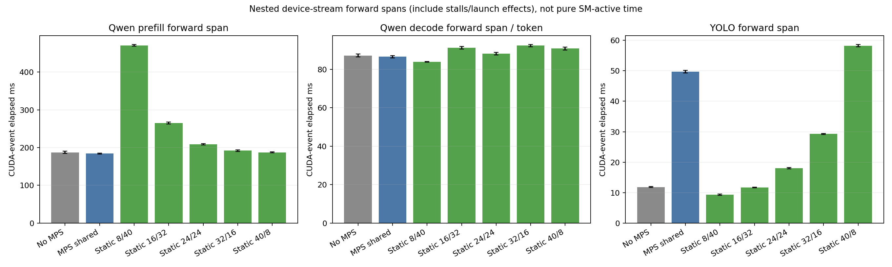
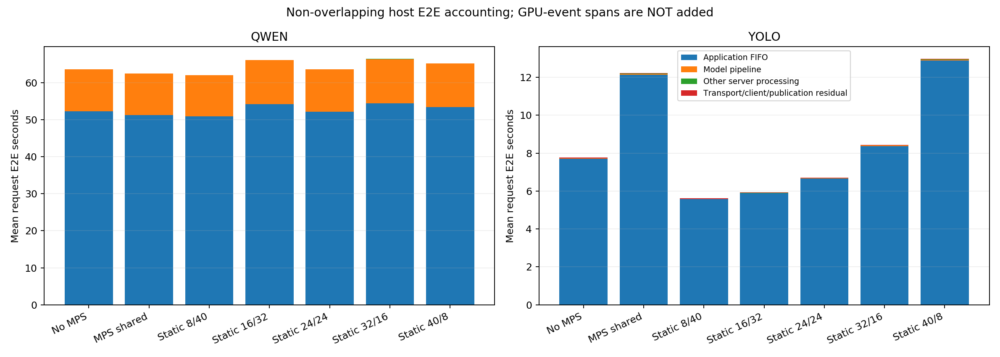
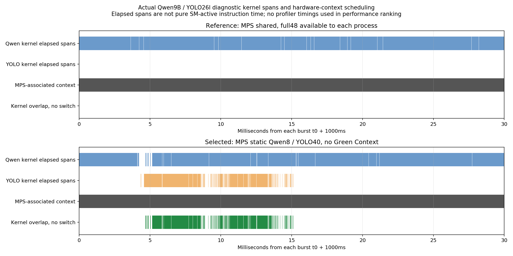

# Native MPS 정적 SM 분할: 병렬 실행 검증 및 성능 비교

## 결론
**Green Context 없이도 서로 다른 Qwen/YOLO 프로세스에 고정 SM을 할당하고 병렬 실행할 수 있다.** 새 드라이버에서 실제 CUDA 프로그램과 모델 추론으로 확인했다.

이번 동시 finite-burst 조건에서는 **Qwen8SM / YOLO40SM**이 측정한5개 고정 조합 중 가장 유리했다. 일반 MPS와 비교해:
- 전체310개 결과 완료 평균: **112.495 → 111.887초(-0.54%)**. 소폭 차이이므로 강한 전체 처리량 개선 주장은 하지 않는다.
- YOLO300개 완료 평균: **25.373 → 11.592초(-54.31%)**.
- YOLO 요청 E2E p95: **23.404 → 10.674초(-54.39%)**.
- YOLO CUDA-event forward 평균: **49.728 → 9.316ms(-81.27%)**.
- 반대 비용: Qwen 내부 첫 토큰 생성시간은 **185.173 → 471.930ms(+154.86%, 약287ms 증가)**. 모든 지표가 좋아진 것은 아니다.

**운영 추천:** 이번 배치 완료/CV 지연 우선 시나리오에서는8/40. LLM 첫 토큰 지연을 더 중요하게 본다면24/24 등과 SLO 기준으로 다시 선택해야 한다. 아직 운영용 SM 정책을 임의로 바꾸지는 않는다.

## 환경 / 구현 범위
| 항목 | 실제 사용 |
|---|---|
| 서버/GPU | 단일DGX Spark, GB10, 물리48SM, ARM64 |
| OS커널 / 드라이버 | Ubuntu24.04, **7.0.0-1025-nvidia / 595.99.02** |
| Toolkit / 실제 로드 CUDART | **13.1.2 / 13.1(13010)**; nvcc13.1.115 |
| 드라이버 API | 13.2(13020), native595 MPS; 구형compat590 미사용 |
| 모델 | Qwen3.5-9B BF16/SDPA/FLA; YOLO26l nativePyTorch FP16 |
| 모델 이미지 | 기존 frozen image 두 개 그대로; 실제 이미지 ID는verification/image-ids.txt |
| PyTorch | 기존2.9.0a0 계열, **컴파일 CUDA13.0** 유지 |
| CUDA 라이브러리 구성 | 모든조건 동일하게 호스트13.1 Toolkit을 read-only mount하고 실제runtime13010 확인. 컨테이너가 자동 업그레이드됐다는 의미 아님 |
| 서빙 | Kubernetes 두 Pod, ROS2독립FIFO/Worker, 요청별UUID 결과 채널 |
| 측정 코드 | 원본추론호출 유지, 별도 generated node에 timer/검증만 추가. Green API/GreenPair/green_bridge 호출 없음 |

불변 이미지+호스트runtime overlay로 비교했다. 완전히 자기완결적인 신규13.1 컨테이너 이미지를 만들었다고 주장하지 않는다. 호스트driver595/Toolkit131이 재현 전제다.

## 실험 설계
- 새로운595환경에서 **MPS 없음, 일반MPS, 정적5조합**을 새로 측정했다. 이전580/Green/프로파일링 수치는 섞지 않았다.
- **5개 randomized complete blocks**, seed20261110. 각 라운드마다7개조건의 순서를 섞음. 설정마다 총5회, 측정35bursts.
- 매조건 두 모델 재로딩 후 **Qwen3/YOLO30 동시 워밍업**, 이후 **Qwen10/YOLO300 동시 발행**. 결과를 기다렸다 다음 요청을 보내는 방식 아님. 단독 요청 실험 없음.
- Qwen: 실제입력512토큰, 출력128토큰 강제, greedy/생각모드off. 동일inputID SHA 및512+[1]*127 forward형상 검증.
- YOLO: 동일bus.jpg,640×640,batch1. 동일모델/정밀도/입력형상 유지.
- 모든조건 동일 FIFO Q16/Y512, 요청DDSdepth512, domain74, Torch threads4. 기본 OS/일반MPS는 각 프로세스가 GPU전체48SM에 접근하고, 정적설정만 서로 다른 고정 파티션 사용.
- GB10에서 측정한 단위는2SM/chunk. 예:8/40은4chunks/20chunks. **두 파티션을 먼저 생성한 후** 클라이언트를 시작하고 초과할당 거부까지 확인.
- 실제CUDA device property의SM수, 실제로드runtime, 모델호스트PID와 MPS client 일치, 파티션ID, 요청/토큰/shape/로그ACK를 검증.
- Nsight는 timed35runs에서 끔. 별도 진단 캡처만 시행.

## 1. 전체 결과
단위:초. `평균 ± 관측값의 모집단표준편차`, 조건별독립burst5개. 전체완료는 공통발행장벽부터 마지막310번째 결과 수신/파싱까지이며, 이실험에서는 항상Qwen10개완료와 같다.

| 설정(Qwen/YOLO) | 전체완료(=Qwen10개) 평균±SD | YOLO300개 완료 평균±SD | YOLO 요청 E2E p95 |
|---|---:|---:|---:|
| MPS 없음 / 고정 분할 없음 | 113.361 ± 0.907 | 16.322 ± 0.391 | 14.963 |
| 일반 MPS / 고정 분할 없음 | 112.495 ± 0.717 | 25.373 ± 0.300 | 23.404 |
| MPS 정적 **8/40SM** | 111.887 ± 0.199 | 11.592 ± 0.851 | 10.674 |
| MPS 정적 **16/32SM** | 119.285 ± 0.801 | 12.713 ± 0.575 | 11.538 |
| MPS 정적 **24/24SM** | 114.618 ± 0.893 | 14.126 ± 0.384 | 12.780 |
| MPS 정적 **32/16SM** | 119.755 ± 0.641 | 18.125 ± 0.504 | 16.524 |
| MPS 정적 **40/8SM** | 117.722 ± 0.903 | 26.764 ± 0.430 | 24.807 |



MPS만 켠다고 모든모델이 빨라지지 않는다. 일반MPS에서 YOLO완료는 MPS없는기준16.322초보다25.373초로 악화됐다. 고정8/40은 새baseline대비YOLO완료28.98%,p95E2E28.66% 감소했다. 전체완료1.30% 차이는 작으므로 효과를 과장하지 않는다.

사전규칙은 최소평균전체완료와 그3%이내 조건 중 최소YOLO완료 선택이었다.8/40은 strict-fastest,3%선택,평균2목적Pareto 모두에 해당했다.0/1/3/5% tie-band sensitivity도summary.json에 제공한다. 이는 통계적동등성 검정이나 SLO판정이 아니다.

일반MPS대비8/40의 라운드별 전체차이는 **+0.31,-0.47,-0.49,-0.92,-1.12%**였다. 모든반복에서 전체가 빨랐다고 주장하지 않는다. 반면YOLO완료는 모든라운드에서 약47.77–58.45% 감소했다.

## 2. 지연 구성요소 / 병목
단위:ms, 마지막열만초. forward는 CUDA-event stream elapsed span이며 순수SM-active시간이 아니다.

| 설정 | Qprefill forward | Qdecode forward/token | Q 내부generate TTFT | Yforward | Y평균FIFO대기(초) |
|---|---:|---:|---:|---:|---:|
| MPS 없음 / 고정 분할 없음 | 187.024 | 87.227 | 188.317 | 11.837 | 7.703 |
| 일반 MPS / 고정 분할 없음 | 183.925 | 86.639 | 185.173 | 49.728 | 12.128 |
| MPS 정적 **8/40SM** | 470.632 | 83.908 | 471.930 | 9.316 | 5.571 |



일반MPS→8/40에서 YOLO predict pipeline 평균은56.221→12.336ms로 줄었다.300장 환산 차이13.165초는 실제batch완료 차이13.781초와 규모가 일치한다. CUDA-event forward감소40.412ms/장은 그pipeline안에 포함되므로 별도로 더하지 않는다.

이는 **GPU forward구간 간섭 완화가 주요 개선으로 관측됐다**는 근거다. 정확한원인이 SM대기인지 메모리대역폭인지 단정하지 않는다. MPS static은 장치가 보고하는SM수도 바꾸므로 backend launch/kernel선택 영향도 있을 수 있다. 전용memoryBW counter/동일kernel고정실험 없이 메모리병목을 확정하지 않는다.

### E2E와Queue
- additive host accounting: `E2E = FIFO대기 + 모델pipeline + 기타server처리 + transport/client/publication잔차`.
- 8/40의 Q요청 평균E2E62.041초 중 FIFO50.856초,generate11.166초. Y요청 평균E2E5.610초 중FIFO5.571초,predict12.336ms.
- Queue가 크다는 것은 별도Queue버그의 증거가 아니다. 한번에10/300요청을 적재하고 각worker가FIFO직렬처리하므로 앞선요청의 추론·결과발행을 기다린다. GPU구간이 짧아지면 뒤요청Queue도 짧아진다.
- residual은 네트워크만이 아니다. 미분리DDS대기/직렬화/결과발행 등의차이를 포함한다.
- client초기DDS탐색/310개결과구독준비/입력파일로드는발행장벽전에하며 제외. E2E는 요청별JSON생성/publish직전부터 일치결과파싱까지. 외부인터넷/새CLI프로세스시작시간을 포함한E2E는 아니다.



## 3. Qwen trade-off
8/40의 Qdecode TPOT는86.879→84.205ms/token으로 낮아졌지만,prefill forward는183.925→470.632ms로 늘었다. 따라서 전체batch가 비슷해도 첫응답생성은 느려질 수 있다.

여기서generate TTFT는 stockTokenClock의 **서버내 첫생성토큰 시각**이다. 서버enqueue부터의TTFT는Queue까지 포함해일반MPS51.411초/8·40은51.330초평균이다. 현재ROS결과는 전체문장을 한번에반환하므로 client streaming TTFT를 측정했다고 하지 않는다.

LLM첫토큰을 중시한다면24/24는내부TTFT210.178ms/전체114.618초/YOLO14.126초라는다른절충점이다. 실제SLO를 먼저정한뒤선택해야 한다.

## 4. 고정 분할과 병렬성 확인
- native13.1 프로그램에서 서로 다른16/32SM 파티션을 선택한 두프로세스가 각각SM16/32를보고하고 실제CUDA커널값42를반환했다. 추가SM할당거부도확인했다.
- 동일이미지의PyTorch에서도 실제runtime13010,SM16/32,sum1024검증통과.
- 실제Qwen/YOLO16/32 진단은310개모두성공, CUPTI kernel greenContextId0, 파티션별SM property 및MPS클라이언트호스트PID일치.
- 약20초공통구간에서, 컨텍스트교대없는MPS관련상주구간에서도두모델kernel구간이**3.419초 겹침**. 모델clock오차로구간축소+전환경계200us제외후에도**161.966ms** 남음. 장치전체SMActive최대100%. 단순host호출구간겹침만으로판단하지않음.
- GPU context 이벤트가 serverPID아닌 clientPID로귀속될수있으므로 별도membership/hostPID기록과함께해석. clock오차는경험적anchor bracket/fit이며절대hardware보증아님.
- 프로파일링값은성능표에넣지않는다. 최종8/40및일반MPS추가캡처는별도artifact로보존한다.

최종후보 추가프로파일 및 복원 상태는 아래 완료기록을 참조한다.

## 5. 검증 / 재현
- 측정:35bursts×310 = **10,850결과**. 워밍업35×33 = **1,155결과**. 합계 **12,005개** UUID/runID/token/shape/timestamp/components/발행ACK로그검증PASS. 실패·누락·Queue overflow0.
- 실행소스15개before/after SHA일치, 원본baseline677개파일불변. 원본Qwen/YOLOimage ID불변. 사용자라이브러리/모델코드패치 없음.
- raw5개씩/라운드순서: `20261110-v1/schedule.json`, `results/*/final-requests.jsonl`, `warmup/`, `logs/`.
- 집계/모든metric분포/paired-round차이: [summary.json](20261110-v1/analysis/summary.json), [35회CSV](20261110-v1/analysis/trials.csv).
- 독립프로토콜대조: [protocol-audit.json](20261110-v1/verification/protocol-audit.json).
- source: `diagnostics/mps_static/{generate,plan,eval_runner,analyze_eval,summary_math,profile_runner,analyze_profile,plot_eval}.py`. 기존burst/clock/logger helper재사용. 모델별별도실행코드와FIFO보존.

```bash
# Spark에서동일snapshot/이미지/모델cache/SDK131준비후(root/privateMPSpath권한주의)
source ~/.config/cj-ros2/spark-jazzy.bash
export GREEN_BURST_ROOT=/home/avees/cj-static-eval/20261110-v1
export PYTHONPATH="$GREEN_BURST_ROOT/src:${PYTHONPATH:-}"
python3 "$GREEN_BURST_ROOT/src/analyze_eval.py" --root "$GREEN_BURST_ROOT"
# 로컬 기존matplotlib사용(새의존성설치없음)
python3 diagnostics/mps_static/plot_eval.py --root results/static-eval/20261110-v1
```

기존실험root는open('x')·기존결과검사로덮어쓰지않도록구성돼있다. 새실험은새root/새snapshot으로실행한다. 원본before-upgrade정상servingtemplate과MPS서비스는각컨트롤러finally에서복원/실제ROS응답검사한다. 신규8/40상시운영정책은사용자검토전임의적용하지않는다.

## 6. 한계
1. 5bursts는작은표본이다. request50Q/1500Y pooled분포를독립표본1500개통계검정처럼취급하지않는다.표준편차/원시5값/paired차이공개.
2. 고정512/128토큰·한이미지반복·finiteburst·on-hostROS 시나리오다. 긴prefill,연속영상,다른입력/사용자수,SLO로일반화하지않는다.
3. 검사한SM5조합중최선이며2SM단위전체공간의전역최적이라고하지않는다.8SM이경계이므로더세밀한탐색은향후과제다.
4. staticSM은VRAM/메모리대역폭/캐시/전력/장애의완전격리가아니다. Memory/CPU/GPU1Hz샘플은장치/호스트전체이며GB10NVMLN/A를0으로꾸미지않는다.
5. GPU-eventspan은stream대기/CPUlaunch영향포함,순수GPU실행누적시간아님. CPU/GPU중첩으로인해E2E에중복합산하지않는다.
6. 신호/에러시실험원복은있지만GPUfault/workerfailover/부하시장애SLO는이번변경범위아니다. 일반MPS만으로CV가악화한사실과TTFT악화도공개.
7. baseline은새595환경에서새로측정한instrumentedcontrol이다. 이전580기준과SDK/커널/라이브러리도달라직접개선율을만들지않는다.

공식근거: [CUDA13.1 MPS static 설명](https://docs.nvidia.com/cuda/archive/13.1.0/cuda-programming-guide/04-special-topics/green-contexts.html), [MPS 정적SM분할 관리/제약](https://docs.nvidia.com/deploy/mps/latest/when-to-use-mps.html#static-sm-partitioning), [Nsight타임라인/메트릭](https://docs.nvidia.com/nsight-systems/UserGuide/index.html).

### 자원 샘플링 추가 확인
측정구간만 추린1Hz샘플([resources.json](20261110-v1/analysis/resources.json))에서 호스트전체CPU평균은조건별약10.5–11.3%,시스템사용메모리는약26.5GiB였다. CPU전체평균이낮아도단일스레드병목없음을증명하지는않는다. GPU온도관측범위는전체57–79°C,8/40은63–73°C였다. 클록을고정하지않았으므로thermal/DVFS/후단heuristic효과와순수SM자원효과를완전히분리하지않는다. GB10 NVML GPUmemory는실제N/A였으며개별VRAM값을조작하거나0으로바꾸지않았다. 자원값은호스트/장치전체이며개별모델격리메모리값아니다.

## 완료 기록 — 2026-11-10 06:23 KST
- 성능 비교35/35회 및12,005개응답·발행ACK로그감사PASS. 실행소스15개 SHA before/after일치, baseline677파일검사PASS, unit146개/Ruff/compile/shellsyntax PASS.
- 최종 **8/40** 파티션을 실제모델로추가검증: 두프로세스가8/40SM을보고, 서로다른staticpartitionID사용, CUPTI의두모델kernel **greenContextId모두0**.310개결과모두수신.
- 8/40진단공통창20.027초에서 MPS관련GPU컨텍스트교대없는kernel구간겹침 **2.398초**. 시간축오차로kernel구간축소/전환경계200us제외후보수적겹침 **175.751ms**로사전50ms검증기준통과. 장치전체SMActive최대100%,context이벤트19개/내부sequence누락0. 이값은진단관측이지성능개선율이아니다.
- 일반MPS참조캡처도310개결과수신/복원PASS. 관측kernel구간겹침1.751초이나clockbracket/fit오차를반영한보수적겹침29.015ms는사전50ms기준미달. `--reference`로미달을명시해보존했으며검증기준을낮춰통과시킨것이아니다. 이것으로일반MPS가전혀병렬이아니라고주장하지않는다. 두캡처의20초내처리YOLO수도달라겹침초수를성능점수로직접비교하지않는다.
- 모든진단은unprofiled성능35회에포함하지않았다. Native16/32초기캡처와일반MPS/최종8·40캡처는각각 `results/static-profile/` 별도root에보존.



최종서빙상태: **기존정상template/replicas1·1복원, 두PodReady1/1, 원래사용자MPS서비스enabled/active, 실제ROS요청/결과PASS**. 새595driver/131Toolkit은유지했다. **추천8/40을운영정책으로영구배포한것은아니다.** 현재일반서빙은실험전의MPS+Green설정으로복원했으며사용자검토후별도전환한다. 새정적MPS테스트프로세스/프로파일러/부하발생기는종료했다. Gitcommit/push및DockerHub업로드없음.

소스/실행/원복증거: `verification/controller-status.json`, `restored.json`, `restored-serving-mps-membership.json`, `final-deployments.json`, `final-mps-service.txt`, 각profile의 `profile-status.json`/`health.log`. 원격raw요청/로그및18개Nsight원시파일의SHA256을로컬과대조해보존한다. 부팅·네트워크비밀설정백업은리포지터리밖private경로에유지했다.
