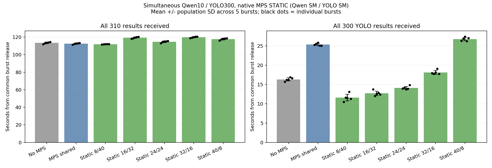
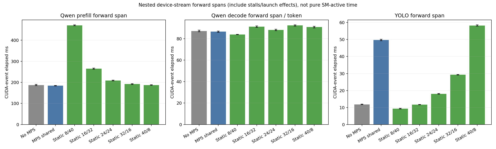
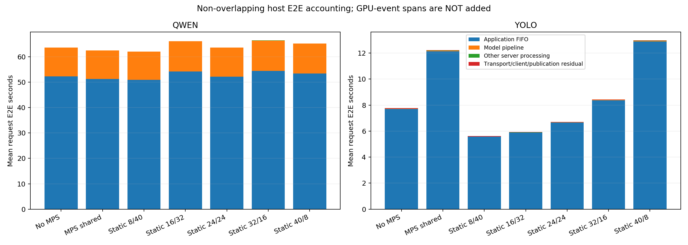

# CJ 4DPLEX AI Platform 사전과제 — 측정 결과 종합 정리
## SLO 검토를 위한 기초 자료

> **후속 측정 업데이트:** 2026-11-10에 GPU 유휴 YOLO Node 프로세스 강제 종료·복구를 3회 수행했다. 첫 정상 응답 평균4.390초(4.163–4.504초), 장애 상태 관측 평균0.746초, Ready 관측 평균7.087초였다. Qwen 오류0이나 장애 구간과 겹친3요청 평균은 약2.40% 증가했다. 이는 정상 성능 SLO 검증이나 진행 중 GPU/Queue 요청 손실 검증이 아니다. [장애 실험 보고서](results/fault-idle/README.ko.md) 참조. 아래 최초 측정 이력과 새 장애 시험의 범위를 구분한다.


- 정리 기준: 2026년 11월 10일까지 보관한 실험 자료
- 모델: **Qwen3.5-9B + YOLO26l**
- 장비: **단일 DGX Spark GB10, 물리 GPU 1개·48SM**
- 목적: 지금까지 확인한 성능·자원 경합·운영 문제를 정리하고, 이후 운영 시나리오와 SLO를 정할 때 참고한다.
- **이 문서는 SLO를 확정하거나 이미 달성했다고 선언하는 문서가 아니다. 새로운 실험도 수행하지 않았다.**


### 읽는 순서

- **최신 성능으로 SLO를 검토하려면:** 3절의 완료시간·요청 E2E·TTFT 표를 먼저 본다.
- **과거 결과와 왜 숫자가 다른지 확인하려면:** 2절의 지표 정의와 5절의 실험 이력을 본다.
- **목표를 적어 오려면:** 7절의 검토 항목과 빈칸 양식을 사용한다.

---

## 1. 먼저 읽을 핵심 요약

1. 두 모델을 같은 GPU에서 함께 운영할 때 지연 증가를 실제로 관측했다.
2. MPS를 켜서 병렬 실행이 가능해져도, 모든 모델의 지연이 좋아지는 것은 아니었다. 최신 실험에서 일반 MPS는 YOLO 지연을 오히려 악화시켰다.
3. 드라이버 업그레이드 후 **Green Context 없이 MPS 정적 SM 분할**을 적용할 수 있음을 확인했다.
4. 최신 고정 부하에서는 **Qwen 8SM / YOLO 40SM**이 측정한 5개 조합 중 가장 유리했다.
5. 일반 MPS 대비 YOLO 완료시간은 **54.31% 감소**, 최적화 없는 새 baseline 대비로는 **28.98% 감소**했다. 두 개선율의 기준이 다르다.
6. Qwen 전체 완료시간의 변화는 작았다. 반면 내부 첫 토큰 생성시간은 **일반 MPS 약185ms → 정적8/40 약472ms**로 악화됐다.
7. 최신 대량 요청에서는 E2E 대부분이 FIFO 대기였다. GPU 추론 구간 단축이 후속 요청의 Queue 대기 감소로 이어졌다.
8. **실시간·지속 도착 부하의 SLO, 장기 가용성, 진행 중 GPU 작업의 장애 복구는 아직 검증하지 않았다. GPU 유휴 Node 프로세스의 기초 복구시간은 위 후속 업데이트를 참조한다.**

### SLO를 생각할 때 가장 중요한 구분

- **최신 실험은 Qwen 10개와 YOLO 300개를 한꺼번에 보내는 유한 burst다.**
- 최신 표의 YOLO p95 약10.7초는 Queue를 포함한 요청 E2E다. 이미지 한 장의 모델 연산이 10초 걸렸다는 뜻이 아니다.
- 과거 C1 실험에서 측정한 YOLO E2E 수십 ms와 최신 burst의 수 초를 직접 비교하면 안 된다.
- Qwen 내부 TTFT는 서버에서 첫 생성 토큰을 관측한 시간이다. 현재 ROS 서비스는 완성된 텍스트를 한 번 반환하므로 **클라이언트 스트리밍 TTFT를 측정한 것이 아니다.**

---

## 2. 측정 지표의 뜻

| 지표 | 정의 | SLO를 정할 때 주의할 점 |
|---|---|---|
| 요청 E2E | 요청별 JSON 생성·publish 직전부터 일치하는 결과를 클라이언트가 수신·파싱할 때까지 | Queue·전송·서버 처리가 포함된다. ROS 초기 구동·초기 발견·결과 구독 준비·입력 파일 로드는 제외했다. |
| App Queue 대기 | 서버 callback이 FIFO에 넣은 시점부터 Worker가 처리를 시작할 때까지 | DDS 내부 대기나 GPU stream 대기와는 다르다. |
| Qwen generate pipeline | `model.generate()` 호출 구간의 wall time | CPU 생성 제어·GPU 대기·forward 등이 포함된다. 순수 GPU 실행시간이 아니다. |
| YOLO predict pipeline | `model.predict()` 호출 구간의 wall time | 내부 전처리·forward·후처리를 포함한다. |
| GPU forward span | Module.forward 앞뒤 CUDA Event로 측정한 stream elapsed time | 스케줄링·대기·CPU launch 공백의 영향이 들어갈 수 있다. 순수 SM-active 시간이라고 부르지 않는다. |
| Qwen Prefill forward | 입력512토큰을 처리하는 첫 forward의 CUDA-event span | 첫 토큰까지의 모든 CPU 제어·전송을 포함하는 TTFT와 같지 않다. |
| Qwen Decode forward/token | 이후127개 one-token forward의 평균 CUDA-event span | 토큰 생성 반복 구간의 내부 지표다. |
| Generate TTFT | generate 진입부터 서버 TokenClock이 첫 생성 토큰을 관측할 때까지 | App Queue를 제외한 내부 첫 토큰 생성시간이다. |
| Server TTFT | 서버 enqueue부터 첫 생성 토큰 관측까지 | Queue를 포함한다. 클라이언트에 그 시점에 토큰을 보냈다는 뜻이 아니다. |
| TPOT | 첫 토큰부터 마지막 토큰까지의 경과시간 / 이후 토큰 수 | CUDA-event Decode/token과 별도의 지표다. |
| 모델별 전체 완료 | 공통 발행 장벽 t0부터 해당 모델의 모든 결과 수신까지 | Qwen10개·YOLO300개 등 작업량을 같이 명시해야 한다. |
| 전체 작업 완료 | t0부터 Qwen·YOLO 결과 전체를 받을 때까지 | 최신 실험에서는 항상 Qwen이 마지막에 끝나 Qwen10개 완료시간과 같았다. |

### 중복 합산 금지

```text
요청 E2E = App Queue + 모델 pipeline + 기타 서버 처리 + 전송/클라이언트/발행 관련 잔차

GPU forward span은 모델 pipeline 안의 하위 지표다.
E2E에 GPU forward span을 다시 더하면 안 된다.
```

각 구성요소의 p95를 더해도 전체 E2E p95가 되지는 않는다. 서로 다른 요청이 각 항목의 p95에 해당할 수 있다.

---

## 3. 최신 실험: MPS 정적 SM 분할 비교

**SLO의 현재 성능 참고값은 우선 이 절의 자료를 사용하면 된다.** 다만 이 자료가 대표하는 부하 조건을 유지해야 한다.

### 3.1 환경

| 항목 | 측정 조건 |
|---|---|
| GPU | GB10, 물리48SM |
| 커널 / NVIDIA 드라이버 | 7.0.0-1025-nvidia / 595.99.02 |
| Toolkit / 실제 로드 runtime | CUDA Toolkit13.1.2 / CUDART13.1(13010) |
| 드라이버 API | 13.2(13020) |
| PyTorch | 기존2.9.0a0 계열, CUDA13.0으로 컴파일된 이미지 유지 |
| 실제 CUDA 구성 | 모든 조건에 동일하게 호스트13.1 Toolkit을 read-only mount하고 실제 runtime13010 확인 |
| Qwen | Qwen3.5-9B, BF16, SDPA, 기존 FLA·causal-conv GPU 경로 |
| YOLO | YOLO26l, 원본 PyTorch FP16, 640×640, batch1 |
| 실행 구조 | Kubernetes 별도 Pod·독립 FIFO·Worker1개/모델 |
| Queue / DDS | Qwen16 / YOLO512, 요청 DDS depth512 |
| 요청 방식 | Qwen10개 + YOLO300개를 공통 장벽에서 동시 발행, 응답을 기다렸다 다음 요청을 보내지 않음 |
| 입력 | Qwen 실제512 input token IDs 고정, YOLO 동일bus.jpg |
| 출력 | Qwen128토큰 강제, greedy·thinking off. 요청별 실제 token/forward shape 검증 |
| 반복 | 7조건 ×5회, 라운드마다 조건 순서 무작위화, seed20261110 |
| 워밍업 | 매 조건 Qwen3개 + YOLO30개 동시 처리 후 본 측정 |
| 계측 | 본 측정에서 Nsight 끔. GPU 프로파일링은 별도 실행 |

CUDA13.1을 설치했다고 기존 컨테이너의 PyTorch 빌드가 자동으로13.1이 된 것은 아니다. 원본 이미지는 유지하면서 실제 runtime을 동일하게 구성했다.

일반 MPS의 ‘각48SM 접근’은 물리96SM을 할당했다는 뜻이 아니다. 두 프로세스가 같은 물리48SM을 공유한다. 정적 분할만 서로 다른 고정 파티션을 선택했다. 정적 기능의 실제 GB10 단위는2SM/chunk이며, 두 파티션을 모두 만든 뒤 클라이언트를 시작하고 초과 할당 거부도 확인했다.

### 3.2 전체 작업 완료시간

단위: **초**, 조건별5회 평균 ± 관측 표준편차. 신뢰구간이 아니다.

| 설정 — Qwen/YOLO | 전체310개 완료 = Qwen10개 완료 | YOLO300개 완료 |
|---|---:|---:|
| MPS 없음 | 113.361 ± 0.907 | 16.322 ± 0.391 |
| 일반 MPS | 112.495 ± 0.717 | 25.373 ± 0.300 |
| 정적 8/40SM | 111.887 ± 0.199 | 11.592 ± 0.851 |
| 정적 16/32SM | 119.285 ± 0.801 | 12.713 ± 0.575 |
| 정적 24/24SM | 114.618 ± 0.893 | 14.126 ± 0.384 |
| 정적 32/16SM | 119.755 ± 0.641 | 18.125 ± 0.504 |
| 정적 40/8SM | 117.722 ± 0.903 | 26.764 ± 0.430 |



### 3.3 Qwen 요청별 지연

단위: **초**. 조건별50개 요청(10개×5회)을 합친 기술통계다. 독립 burst 표본은5개다.

| 설정 | E2E 평균 | E2E p95 | Queue 평균 | generate 평균 | generate p95 |
|---|---:|---:|---:|---:|---:|
| MPS 없음 | 63.618 | 113.299 | 52.286 | 11.301 | 13.460 |
| 일반 MPS | 62.469 | 112.468 | 51.224 | 11.219 | 11.863 |
| 정적 8/40SM | 62.041 | 111.876 | 50.856 | 11.166 | 12.181 |
| 정적 16/32SM | 66.125 | 119.047 | 54.200 | 11.891 | 12.890 |
| 정적 24/24SM | 63.617 | 114.792 | 52.159 | 11.442 | 12.490 |
| 정적 32/16SM | 66.404 | 119.620 | 54.433 | 11.953 | 12.715 |
| 정적 40/8SM | 65.208 | 117.747 | 53.440 | 11.754 | 12.231 |

`generate`는 한 요청의 모델 처리 구간이다. 최신 실험에서는 빈 Queue에서의 단일 요청 E2E를 별도로 반복 측정한 것이 아니다. 또한 YOLO가 먼저 끝나므로 Qwen 후반 요청은 YOLO가 끝난 이후 처리된다. 위 평균을 ‘YOLO 지속 부하가 항상 있는 상태의 단일 요청 성능’이라고 일반화하지 않는다.

### 3.4 Qwen 내부 단계

단위: **ms**, Decode/TPOT는ms/token. TTFT는 서버 내부 generate 기준이다.

| 설정 | Prefill forward 평균 | Decode forward/token 평균 | Generate TTFT 평균 | Generate TTFT p95 | TPOT 평균 |
|---|---:|---:|---:|---:|---:|
| MPS 없음 | 187.024 | 87.227 | 188.317 | 223.592 | 87.502 |
| 일반 MPS | 183.925 | 86.639 | 185.173 | 199.489 | 86.879 |
| 정적 8/40SM | 470.632 | 83.908 | 471.930 | 498.506 | 84.205 |
| 정적 16/32SM | 265.095 | 91.284 | 266.362 | 287.306 | 91.534 |
| 정적 24/24SM | 208.942 | 88.203 | 210.178 | 227.730 | 88.436 |
| 정적 32/16SM | 191.845 | 92.373 | 193.077 | 218.174 | 92.600 |
| 정적 40/8SM | 187.315 | 90.835 | 188.519 | 208.138 | 91.066 |

**확인한 사실:** Prefill은 SM 증가에 따라 대체로 빨라졌지만, Decode는 같은 양상으로 빨라지지 않았다. Decode의 정확한 병목이 메모리 대역폭이라고 확정하지 않았다. Qwen SM과 YOLO SM을 함께 바꿨으므로 Qwen 자체 SM 수의 효과만 분리한 실험도 아니다.

### 3.5 YOLO 요청별 지연

E2E·Queue는 **초**, predict는 **ms**. 조건별1,500개 요청(300개×5회)을 합친 기술통계이며 독립 burst는5개다.

| 설정 | E2E 평균(s) | E2E p95(s) | Queue 평균(s) | predict 평균(ms) | predict p95(ms) |
|---|---:|---:|---:|---:|---:|
| MPS 없음 | 7.759 | 14.963 | 7.703 | 26.807 | 30.213 |
| 일반 MPS | 12.213 | 23.404 | 12.128 | 56.221 | 62.452 |
| 정적 8/40SM | 5.610 | 10.674 | 5.571 | 12.336 | 26.336 |
| 정적 16/32SM | 5.932 | 11.538 | 5.882 | 14.873 | 17.045 |
| 정적 24/24SM | 6.704 | 12.780 | 6.655 | 21.308 | 23.586 |
| 정적 32/16SM | 8.439 | 16.524 | 8.376 | 32.750 | 35.148 |
| 정적 40/8SM | 12.965 | 24.807 | 12.876 | 62.116 | 65.534 |

### 3.6 YOLO 내부 단계

단위: **ms**. 전처리·후처리는 프레임워크 내부 단계 시간이며 forward와 완전히 같은 계측 범위가 아니다.

| 설정 | GPU forward 평균 | GPU forward p95 | 전처리 평균 | 후처리 평균 |
|---|---:|---:|---:|---:|
| MPS 없음 | 11.837 | 14.412 | 2.023 | 9.044 |
| 일반 MPS | 49.728 | 56.192 | 1.637 | 3.087 |
| 정적 8/40SM | 9.316 | 22.253 | 0.666 | 0.920 |
| 정적 16/32SM | 11.678 | 13.662 | 0.727 | 0.918 |
| 정적 24/24SM | 17.988 | 20.195 | 0.771 | 0.966 |
| 정적 32/16SM | 29.253 | 31.432 | 0.901 | 0.970 |
| 정적 40/8SM | 58.252 | 61.573 | 1.138 | 1.036 |



### 3.7 8/40의 개선과 비용

| 지표 | MPS 없음 | 일반 MPS | 정적8/40 |
|---|---:|---:|---:|
| 전체 작업 완료 평균 |113.361s|112.495s|111.887s|
| YOLO300개 완료 평균 |16.322s|25.373s|11.592s|
| YOLO 요청 E2E p95 |14.963s|23.404s|10.674s|
| Qwen Generate TTFT 평균 |188.317ms|185.173ms|471.930ms|
| Qwen Generate TTFT p95 |223.592ms|199.489ms|498.506ms|

- 일반 MPS 대비8/40: YOLO 완료54.31% 감소, YOLO E2E p95 54.39% 감소. 전체 완료 변화는0.54% 감소로 작다.
- MPS 없는 새 baseline 대비8/40: YOLO 완료28.98% 감소, E2E p95 28.66% 감소. 전체 완료는1.30% 감소다.
- 일반 MPS 대비 Qwen 내부 TTFT는 약287ms 증가했다. **모든 지표가 좋아진 것은 아니다.**
- 일반 MPS의 YOLO predict 평균56.221ms →8/40의12.336ms. 장당 약43.9ms 감소이며300장 환산 약13.2초로, YOLO 완료시간 감소량 약13.8초와 규모가 일치한다.
- 추론 처리구간이 짧아지면서 뒤 요청의 FIFO 대기도 줄었다. Queue를 줄여 요청을 버리거나 작업량을 줄여 얻은 개선이 아니다.
- GPU-event forward 감소를 순수 연산 자체의 가속으로만 해석하지 않는다. SM 경합·stream 대기·launch·공유 메모리 계층·backend heuristic 등의 기여를 완전히 분리하지 않았다.

#### 목표 지표를 바꾸면 선택도 달라질 수 있음

**8/40은 모든 지표에서 1등이 아니다.** 아래는 최신 측정값 중 관측상 가장 낮았던 설정이다. 이것을 운영 목표로 자동 확정하지 않는다.

| 중요하게 볼 지표 | 관측상 유리한 설정 | 참고값 |
|---|---|---:|
| 전체310개 완료 평균 | 정적8/40 |111.887초|
| YOLO300개 완료 평균 | 정적8/40 |11.592초|
| YOLO 요청 E2E p95 | 정적8/40 |10.674초|
| YOLO predict 호출 p95 | **정적16/32** |**17.045ms**|
| YOLO GPU forward span p95 | 정적16/32 |13.662ms|
| Qwen generate 내부 TTFT p95 | **일반 MPS** |**199.489ms**|
| Qwen generate 호출 p95 | 일반 MPS |11.863초|
| Qwen 요청 E2E p95 | 정적8/40 |111.876초|

예를 들어8/40의 YOLO predict 평균은12.336ms로 낮지만 p95는26.336ms다.16/32의 평균은14.873ms로 더 높아도 p95는17.045ms로 더 낮았다. **전체 완료·Queue 포함 E2E를 우선할지, 한 번의 내부 모델 호출 tail을 우선할지에 따라 SLO와 선택이 달라진다.** 최신 측정 범위의 관측 차이이며, 다른 입력이나 장시간 부하에서 그대로 재현된다는 보장은 아니다.

### 3.8 Queue와 TTFT를 함께 볼 때의 예

정적8/40 Qwen 요청 평균:

```text
요청 E2E          약62.041초
그중 FIFO 대기   약50.856초
generate 호출    약11.166초
```

정적8/40 YOLO 요청 평균:

```text
요청 E2E          약5.610초
그중 FIFO 대기   약5.571초
predict 호출     약12.336ms
GPU forward span 약9.316ms  ← predict 안의 하위 지표
```

서버 enqueue 기준 Qwen TTFT(Queue 포함)는 다음과 같다. 내부 TTFT와 시작점이 다르다.

| 설정 | Server TTFT 평균(s) | Server TTFT p95(s) |
|---|---:|---:|
| MPS 없음 |52.476|102.430|
| 일반 MPS |51.411|101.580|
| 정적8/40 |51.330|101.238|

Queue가 커 내부 TTFT 악화가 가려질 수 있다. SLO에서 ‘첫 토큰’을 쓴다면 시작점과 포함 구간을 반드시 구분해야 한다.



### 3.9 표본·검증·선정 기준

- 본 측정:35bursts ×310개 = **10,850개 응답**.
- 워밍업:35묶음 ×33개 = **1,155개 응답**.
- 합계 **12,005개 응답**의 UUID·runID·입력해시·토큰 수·shape·타임스탬프·구간 회계·발행ACK 로그 검사 통과.
- 본 측정·워밍업에서 관측된 실패/누락/Queue overflow0. 이것이 장기100% 가용성이나 장애 시 성공률을 의미하지는 않는다.
- 실행소스15개의 before/after SHA 일치, 원본 이미지 불변, 원본baseline677파일 불변.
- 8/40은 관측 평균의 전체완료시간과 YOLO완료시간 기준에서 가장 유리했다.
- 사전 ‘최소 전체완료 평균의3% 이내에서 YOLO완료 최소’ 규칙도8/40을 선택했다. **3%는 비교용 heuristic이지 SLO가 아니다.**
- 일반 MPS 대비8/40의 라운드별 전체시간 변화: **+0.31,-0.47,-0.49,-0.92,-1.12%**. 모든 반복에서 전체가 빨랐던 것은 아니다.
- YOLO 완료시간은 같은 비교에서 모든 라운드 약47.77–58.45% 감소했다.
- 5회는 작은 표본이다. request50개·1,500개가 모두 서로 독립인 표본이라고 보고 통계적 우월성을 주장하지 않는다.

---

## 4. GPU 병렬 실행·타임라인으로 확인한 것

### 4.1 MPS가 없는 경우

GPU가 Qwen 요청Q1 전체를 끝까지 독점하는 것은 아니다. 다른 CUDA context 사이를 driver가 번갈아 스케줄링할 수 있다. 따라서 Q1이 미완료인 동안에도 YOLO가 진행될 수 있다. 모델 호출 구간이 겹친다고 같은 순간의 GPU kernel 병렬 실행을 뜻하지는 않는다.

과거580/13.0의 별도 두 프로세스 Green16/32 진단에서는 GPU context 교대가 관측됐다. 약20초에서 context 상주 겹침0ms였지만 커널 start–end span은 겹쳤다. preemption 때문에 단순 span 겹침을 GPU 동시 계산으로 읽을 수 없음을 확인했다.

### 4.2 MPS 정적 분할에서 확인한 것

- 새595환경에서 Green 없이 native CUDA 프로그램의16/32SM device property와 실제커널 실행 확인.
- 모델 이미지의 실제runtime13010,SM16/32,sum1024 확인.
- 실제모델16/32 및 최종8/40에서 서로 다른MPS static partitionID·장치가 보고하는SM수·실제host PID와MPS client 일치 확인.
- 모델kernel의 CUPTI greenContextId가 모두0임을 확인했다.
- 최종8/40의 약20.027초 진단창에서 context 교대 없는 MPS 관련 구간의 두모델 kernel span 겹침 **2.398초**.
- 모델시계 오차로 구간을 축소하고 전환 경계200µs를 제외해도 보수적겹침 **175.751ms**로 사전50ms 검증기준 통과. 장치전체SM Active 최대100%.
- 일반MPS 참조는 관측겹침1.751초, 보수적겹침29.015ms로50ms기준 미달이었다. 기준을 낮춰 통과시키지 않았고, 그렇다고 MPS가 전혀 병렬이 아니라고 단정하지 않는다.
- 프로파일링 시간은3절 성능표에 섞지 않았다. 서로다른20초 창의 처리요청 수도 달라 겹침시간을 성능순위로 비교하지 않는다.

### 4.3 기존 요청 로그의 전체 타임라인

[인터랙티브 Worker 타임라인](results/serving-timelines/20261110-v1/interactive-timeline.html)에서3설정·5라운드의 실제 Worker 상태와 FIFO 개수를 볼 수 있다. GPU kernel 점유 그래프가 아니다.


그림은 고정한r0 실제1회다. 따라서8/40 YOLO완료10.501초 등은3절의5회평균11.592초와 다르다. 평균을 이어붙인 가상 타임라인이 아니다.

---

## 5. 이전 실험 정리 — 최신 표와 직접 합산하지 않음

### 5.1 최초 기본 성능 측정: 2026-11-03

driver580/CUDA13.0 계열. 모델당 동시요청1개(C1), 응답 후 다음 요청을 보내는 closed-loop. Qwen 입력23–27토큰·출력128토큰, YOLO는bus/zidane 두 이미지 순환. 최신512토큰·10/300 burst와 부하가 다르다.

| 조건 | Qwen E2E 평균 / p95 | YOLO E2E 평균 / p95 |
|---|---:|---:|
| 해당모델 Pod만, 단독요청 |11.561 /11.606s|20.604 /35.666ms|
| 두모델 상주, 해당모델에만 요청 |11.575 /11.635s|23.149 /95.596ms|
| 두모델 모두 독립 C1 요청 |15.930 /16.219s|39.640 /48.513ms|

- 모델을 메모리에 함께 올린 것과 두 모델을 실제 활성화한 것을 구분했다.
- 동시활성에서 Qwen·YOLO 내부 generate/inference도 느려졌다.
- 평균 App Queue는1ms 미만으로, 이조건의지연증가를 큰FIFO대기로 설명할 수 없었다.
- 한 번의ordered pass였으므로 표본·순서·tail 한계를 공개했다.
- 본 측정12,324건 성공. 당시 관측된 ACK실패·Pod재시작0.
- YOLO p95 95.596ms는 추론보다 DDS/client잔차 변동이 컸던 조건이다. 지표를 무조건GPU 문제로 해석하지 않았다.

원문: [기본 성능 측정](results/latency-baseline/README.ko.md).

### 5.2 복합 최적화 탐색: 2026-11-04

동일날 새 동시실행 control과 비교한 C1 실험이다. MPS의 **동적 활성 스레드 상한**, TensorRT, DDS 초기 타이머, CPU affinity 등을 비교했다. 이 MPS50%는 고정SM독점할당이 아니다.

대표 조합: MPS(Qwen50%,YOLO100%) + YOLO TensorRT + DDS 타이머 조정.

| 지표 | 해당실험 control | 대표조합 |
|---|---:|---:|
| Qwen E2E 평균 |16.13s|13.33s|
| Qwen E2E p95 |16.48s|13.37s|
| YOLO E2E 평균 |39.74ms|23.62ms|
| YOLO E2E p95 |48.59ms|32.69ms|
| YOLO 실제처리량 |24.37req/s|40.24req/s|

- Qwen30건씩 비교, YOLO control11,793건/대표조합16,089건. 처리량이달라CV실제부하도달랐음을공개했다.
- YOLO TensorRT는정밀도정책·장비/runtime의존성이추가된다.2개이미지검출fidelity를검증했지만COCO mAP검증은아니다.
- DDS 타이머 자체반복검증에서는 GPU변경 없이 YOLO평균25–27ms가약19ms로, p95약97ms가약26ms로줄었다.
- CPU affinity는이조건에서뚜렷한개선이없고CVtail이커채택하지않았다.
- 최종일부run의 후행ACK 로그가회전되어누락됐다. clientE2E·response내timing은보존됐으나, **최신실험처럼모든ACK분해가완전했다고하지않는다.**

원문: [복합 최적화 실험](results/optimization-sweep/README.ko.md).

### 5.3 모델별 Green SM 민감도: 2026-11-09

driver580/CUDA13.0. 각 모델을 별도로 실행한 내부단계 측정이다. Qwen512입력/128출력, YOLO640/batch1. SM당Qwen30회·YOLO100회. ROS E2E나두모델동시성능표가아니다.

| Green SM | Qwen Prefill(ms) | Qwen Decode(ms/token) | YOLO forward(ms) |
|---:|---:|---:|---:|
|8|539.50|96.99|20.44|
|16|303.15|89.76|12.27|
|24|225.74|92.09|9.69|
|32|194.26|93.12|8.34|
|40|191.77|92.13|7.97|
|48|186.13|91.53|7.67|

Prefill과 CV forward는 SM 증가 효과가 컸고 Decode는 비례해서 빨라지지 않았다. 다만 이 과거 Green 곡선을 새 MPS 정적 분할의 최적 배분으로 직접 옮겨 해석하지 않는다.

원문: [SM 민감도](results/sm-sweep/README.ko.md).

### 5.4 Green 동시 C1 실험

두 모델을 모두상주시킨 채단독활성→동시활성을비교했다.5조합모두단독과비슷한E2E를유지하지못했다. 예를들어16/32에서Qwen11.783→15.829초, YOLO30.55→41.30ms였다. 당시작은Queue로는설명되지않는내부추론구간증가가있었다. 이것만으로SM/메모리대역폭/컨텍스트전환을단정하지않았다.

원문: [Green 동시 E2E](results/green-e2e/README.ko.md).

### 5.5 Green 동시10/300 burst 실험

driver580/CUDA13.0, MPS미사용.미적용6회·Green조합각3회. 같은protocol안에서의평균이다.

| 설정 — Qwen/YOLO | 전체완료(s) | YOLO완료(s) |
|---|---:|---:|
|미적용|122.705|16.968|
|Green8/40|131.818|16.591|
|Green16/32|121.223|17.132|
|Green24/24|124.554|17.944|
|Green32/16|125.621|20.305|
|Green40/8|128.003|25.343|

16/32의전체차이는1.21%로작았고YOLO는개선되지않았다.동일한3%동률규칙에서는미적용유지도타당했다.모든310개가동시제출됐어도YOLO가먼저끝나고Qwen후반요청은그뒤처리됐으므로,전체완료시간이대부분Qwen tail에좌우됐다.

원문: [Green burst](results/green-burst/README.ko.md).

### 5.6 GPU 진단과 환경 업그레이드

- 별도두프로세스의Green만으로는GPU context교대를관측했다.단순커널span겹침을물리병렬로오해하지않도록GPU context trace까지확인했다.
- MPS+Green은병렬진행을관측했지만,두프로세스의관측SM-ID공간만으로전역배타SM분할을입증한것은아니었다.
- 과거합성제어프로그램의약191ms는**실제Qwen/YOLO추론시간이아니다.**
- CUDA13.1 Toolkit추가설치만으로580driver+590compat MPS의실제클라이언트는연결오류805가났고,driver595/새커널재부팅후native정적MPS는성공했다.
- 이환경변경때문에최신성능baseline은새로측정했다.이전580수치와최신595수치를직접묶어‘SM분할만의개선율’을계산하지않는다.
- 초기일반MPS+Green프로파일링값과최신3개프로파일링값은진단용이며unprofiled성능순위에합산하지않았다.

원문: [컨텍스트 진단](results/kernel-overlap/README.ko.md), [MPS+Green 진단](results/mps-concurrency/README.ko.md), [업그레이드 기록](results/mps-static/README.ko.md).

---

## 6. 자원 사용량·안정성에서 확인한 범위

### 6.1 최신 자원 샘플

- 실제측정구간의호스트전체CPU평균: 조건별약10.5–11.3%.
- 시스템사용메모리: 평균약26.5GiB.
- 관측GPU온도: 전체57–79°C,8/40은63–73°C.
- 클록을고정하지않았으므로thermal/DVFS와순수SM자원효과를완전히분리하지않는다.
- CPU전체평균이낮아도단일스레드병목이없음을증명하지는않는다.
- GB10 NVML GPUmemory사용량/총량은N/A로기록했다.값을0으로채우거나호스트RAM사용량을모델별VRAM이라고하지않는다.
- MPS static은SM공간분리이지메모리대역폭·캐시·메모리용량·장애의완전격리가아니다.

### 6.2 실제로 발견·복구한 운영 문제

Ready상태인데ROS요청이전달되지않는장애를관측했다.서버에서새processing_started가없고FastDDS shared-memory파일이deleted상태였다.로그아웃시UID의IPC를정리하는logind수명정책과일치하는증거를확인했다.

계정linger활성화와Pod재생성후요청성공을확인하고,SSH세션이없는15초/45초관측에서도IPC유지와재접속요청성공을확인했다.전역RemoveIPC나GPU보안정책은끄지않았다.

**그러나 장애발생시각이명확하지않아자동탐지시간·MTTR·99.x%가용성을정량검증했다고할수없다.** 제어된Worker강제종료→탐지→복구→재발방지실험은별도로정리·측정해야한다.

원문: [IPC 장애와 복구](results/green-context/README.ko.md#별도로-발견한-서비스-장애와-복구).

### 6.3 배포 및 복원

실험종료시점에는원래정상Deployment template과replicas1/1을복원하고,두PodReady·MPS서비스active/enabled·실제ROS응답을확인했다. **추천정적8/40이상시운영으로이미배포된것은아니다.** 종료시복원대상은기존MPS+Green설정이었다.

최신성능표의Queue Q16/Y512는burst실험용설정이다.원래일반서빙은기본Queue8을쓰므로,최신부하/SLO를재검증하려면정적정책·Queue용량·입력/출력조건을다시일치시켜야한다. 이문서는새로서버접속해현재상태를조회한문서가아니라보관된종료증거를정리했다.

---

## 7. SLO를 생각해볼 때 채워야 할 항목

아래 빈칸은 운영 시나리오에 맞춰 사용자가 정할 부분이다. **측정 최댓값 바로 위에 선을 그어 SLO를 달성했다고 꾸미지는 않는다.** 지금 결과를 탐색 근거로 초기 목표를 정한 뒤, 목표와 조건을 고정하고 새 확인 실험으로 검증할 수 있다.

| 결정 항목 | 검토할 질문 | 현재 근거 / 미측정 |
|---|---|---|
| 업무 형태 | 콘텐츠 일괄 처리인가, 대화형 요청인가, 실시간 연속 영상인가? | 최신은 유한 10/300 burst다. 실시간 연속 도착은 미측정. |
| 부하 조건 | 동시 요청 수·도착률·입력 길이·출력 길이·이미지 크기는? | 최신은 입력512/출력128토큰·640/batch1, 모델별 Worker1개. |
| 주요 지연 | 요청 E2E인가, 내부 모델 처리인가, 전체 작업 완료인가? | 각각 별도로 측정했다. 혼용하면 안 된다. |
| Qwen 첫 토큰 | 내부 TTFT로 충분한가, 사용자에게 실제로 스트리밍해야 하는가? | 내부 TTFT만 있다. 클라이언트 스트리밍 TTFT는 미측정. |
| 목표 수준 | 선택한 부하에서 p95·평균·전체 완료시간 상한은 얼마인가? | 최신 7개 설정의 수치는 3절 참조. 목표는 미확정. |
| 트레이드오프 | CV 지연을 줄이는 대신 Qwen 내부 TTFT 약287ms 증가를 허용하는가? | 일반 MPS와8/40 사이의 실제 관측 차이다. |
| 성공률 | 잘못된 응답·timeout·거부·유실을 어떻게 집계할 것인가? | 제한된 측정에서는 실패0. 과부하·장애 중에는 미검증. |
| 평가 기간 | burst1회인가, 분·시간·일 단위의 운영 창인가? | 최신은 조건별5회 독립 burst다. 장기 가용성은 미검증. |
| Queue 정책 | 최대 길이·대기 상한은? 넘치면 거부·취소·유실 중 무엇을 허용하는가? | burst를 수용할 용량만 검증했다. 포화·거부 정책은 미검증. |
| 복구 목표 | 무엇을 장애로 보고 몇 초 안에 탐지·복구해야 하는가? | IPC 장애 사례는 있지만 제어된 탐지·복구 시간 측정은 없다. |
| 출력 품질 | 고정 길이 응답인가 자연 종료인가? 검출 품질 최저선은? | 고정 작업량·일부 fidelity만 검증했다. 전체 품질·mAP는 미검증. |

### SLO 문장 틀 — 아직 목표 수치를 넣지 않음

```text
[운영 시나리오]에서 [부하 조건]을 유지할 때,
[측정 구간/기간] 동안 [대상 요청]의 [지표]가 [목표값]을 만족한다.

예:
- Qwen10개·YOLO300개 동시 제출 상황에서 YOLO 요청 E2E p95 ≤ ___초.
- 같은 상황에서 Qwen 전체 응답 E2E p95 ≤ ___초.
- 같은 상황에서 Qwen generate 내부 TTFT p95 ≤ ___ms.
- 같은 상황에서 전체310개 결과 완료시간 ≤ ___초.
- [정의한 오류]를 포함한 요청 성공률 ≥ ___%, 평가 창 ___분.
- Worker 강제 종료 후 [탐지 기준]으로 ___초 이내 탐지하고,
  정상 결과 응답이 재개될 때까지 ___초 이내 복구한다.
```

전체 작업 완료시간은 burst별 측정값이다. 현재5회만 있으므로 그 평균을 ‘요청95%가 만족한다’로 바꿔 말하지 않는다. 복구 목표와 월 가용성도 성능표의 ‘실패0’으로 대체하지 않는다.

---

## 8. 아직 확보하지 않은 검증

- 최신595 환경에서 지속적인 open-loop 도착률별 성능·포화점·장시간 tail.
- 더 긴·다양한 프롬프트와 출력 길이, 다양한 영상 프레임에서의 대표성.
- 최신 정적 정책에서 빈 Queue의 단독 요청 E2E, 지속 CV 부하 중 LLM 전 구간 성능.
- 새 MPS 정적 분할의2SM 단위 전체 배분 공간 탐색. 현재는8/16/24/32/40만 비교했다.
- Micro-batching·continuous batching·새 서빙 엔진·Qwen 양자화. **논의만 했으며 실험하지 않았다.**
- 공유 DRAM 대역폭·캐시·backend heuristic의 영향을 분리한 정확한 원인 분석.
- GPU 클록 고정·동일 thermal 조건 등으로 인과를 정밀하게 분리한 실험.
- 진행 중 GPU 작업·Worker 스레드 hang·GPU·MPS daemon 장애, 운영용 E2E 자동 탐지/알람, 요청 재처리·유실 정책. GPU 유휴 Node 프로세스 장애의 기본 복구 관측은 후속 보고서에 별도로 있다.
- 사용자 관점의 스트리밍 TTFT, 외부 네트워크·새 CLI 기동까지 포함한 E2E.
- 모델 정확도 전체 검증, YOLO COCO mAP, LLM 의미 품질 보장, 모든 Pod 재시작 사이의 byte-exact 출력 보장.

---

## 9. 자료 위치

| 자료 | 경로 |
|---|---|
| 최신 상세보고서 | [MPS static 보고서](results/static-eval/README.ko.md) |
| 비기술 요약 | [Executive Summary](results/static-eval/EXECUTIVE_SUMMARY.ko.md) |
| 최신 모든 지표/반복/paired차이 | [summary.json](results/static-eval/20261110-v1/analysis/summary.json) |
| 최신35회 원시 집계CSV | [trials.csv](results/static-eval/20261110-v1/analysis/trials.csv) |
| 요청·로그 감사 | [protocol-audit.json](results/static-eval/20261110-v1/verification/protocol-audit.json) |
| 자원 샘플 요약 | [resources.json](results/static-eval/20261110-v1/analysis/resources.json) |
| 전체Worker 타임라인 설명 | [타임라인 README](results/serving-timelines/README.ko.md) |
| 실제GPU추적 | `results/static-profile/20261110-native-q16-y32/`, `20261110-final-mps-only/`, `20261110-final-static-q8-y40/` |
| 원본 과제 PDF | [AI Platform 개발 사전과제](.omx/AI%20Platform%20개발_사전과제.pdf) |

**정리의 목적은 ‘무조건8/40으로 간다’가 아니다.** 어떤 업무에서 어떤 지연·성공·복구 목표가 중요한지 결정한 뒤, 허용 가능한 트레이드오프에 맞는 정책을 선택하기 위한 측정 자료다.


## 2026-11-11 추가 완료 — 지속 동시 요청

Burst와 별도 시나리오로 Qwen C1 + YOLO 8/15req/s,120초,4설정×5회씩 총40회를 완료했다.55,620응답 및발행ACK정상,실험전서빙복구PASS. [상세 결과·SLO·그래프](results/sustained/20261111-v2/README.ko.md).

- 15req/s에서 정적8/40은MPS없음 대비 요청E2Ep95 Qwen9.66%/YOLO39.61%감소.16/32는3.26%/43.79%감소. 둘다해당부하의0%/20%목표관측충족.
- 8req/s에서는8/40이Qwen5.63%/YOLO16.25%감소로개선되었으나,YOLO20%감소목표에는미달. 두부하전부SLO충족이라고주장하지않는다.
- 15req/s에서8/40의Qwen내부TTFT는208.88→486.99ms로악화. YOLO GPUforward Event평균도11.31→16.84ms로증가했으므로 전체E2E개선을GPUforward단독가속으로설명하지않는다. Queue/전체predict/전송잔여변화를구분한다.
- 본문이전‘최신’은35회Burst자료를뜻한다. 지속부하통계와합산금지. 최신독립집계는실행별p95의5회평균이며pooled분포도별도공개했다.
